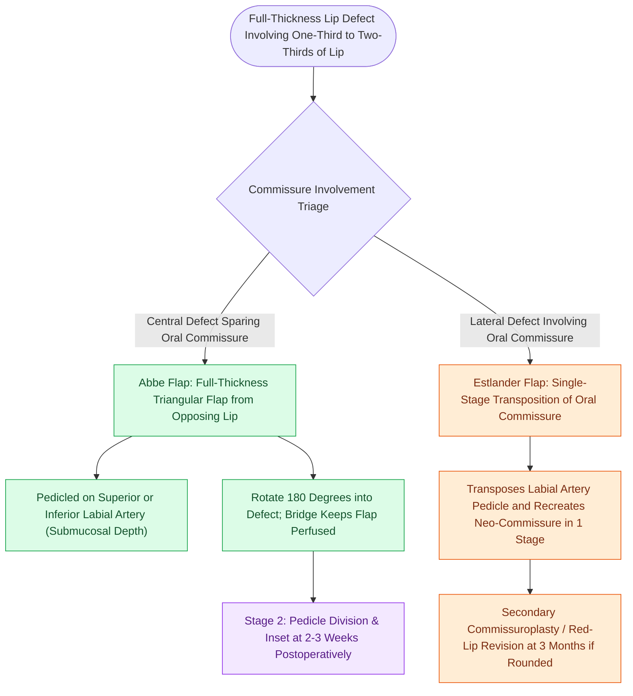

# Abbe and Estlander cross-lip flaps are pedicled on the labial artery to repair lip defects

## Active Recall

> [!question]- In what tissue plane does the labial artery run relative to the vermilion border and orbicularis oris muscle?
> *Answer / Clinical Rationale*: The labial artery runs **$1\text{–}2\text{ mm}$ posterior to the vermilion-cutaneous junction**, positioned **submucosally on the posterior/inner surface** of the orbicularis oris muscle.

> [!question]- What is the fundamental difference in clinical application between an Abbe flap and an Estlander flap?
> *Answer / Clinical Rationale*: The **Abbe flap** repairs **central lip defects** without commissure involvement (requiring 2 stages), whereas the **Estlander flap** repairs **lateral lip defects involving the oral commissure** in a single stage.

## Core Clinical & Mechanistic Principles
The **Abbe** and **Estlander** flaps are full-thickness composite cross-lip flaps utilized to reconstruct large lip defects ($>1/3\text{ to }2/3$ total lip width) by borrowing tissue from the opposing lip. Both flaps are axial-pattern flaps pedicled on the **superior or inferior labial artery**.

### Abbe vs Estlander Comparison
1. **Abbe Flap (Lip Switch)**:
   - Reconstructs **central defects** of the upper or lower lip that do not involve the oral commissure (especially philtral [[Gonzalez-Ulloa facial aesthetic subunits guide complete subunit reconstruction|subunit]] defects).
   - The flap is rotated $180^\circ$ into the defect; the pedicle bridges the oral aperture for **$2\text{–}3\text{ weeks}$** before division.
2. **Estlander Flap**:
   - Reconstructs **lateral defects involving the oral commissure**.
   - Rotates tissue around the commissure in a single stage. Results in a blunted, rounded oral commissure requiring secondary **commissuroplasty**.

## Connected Concepts & Graph Traversal
- **Advancement Flap**: [[Advancement flaps recruit adjacent tissue laxity along a linear vector without rotation|V-Y Lip Advancement]]
- **Cheek Advancement Alternative**: [[Gilles fan flaps and Webster-Bernard cheek advancements reconstruct large lower lip defects|Gilles Fan Flap]]
- **Innervated Circumferential Flap**: [[Karapandzic orbicularis oris myocutaneous rotation flaps preserve oral sphincter innervation|Karapandzic Flap]]
- **Complex Defect Ladder**: [[Near-total lip reconstruction combines functional local muscle flaps with microvascular free flaps|Near-Total Lip Reconstruction]]
- **Flap Technique Foundation**: [[Oral commissure reconstruction balances single-stage Estlander transpositions against staged commissuroplasty to prevent microstomia and incontinence|Oral Commissure Reconstruction]]
- **Anatomical Foundation**: [[Philtral subunit reconstruction requires Abbe cross-lip flaps or bilateral melolabial advancement to restore three-dimensional contour|Philtral Subunit Reconstruction]]
- **Flap Alternative**: [[Vermilion reconstruction requires mucosal advancement, tongue flaps, or vermilionectomy with mucosal lip crawl|Vermilion Reconstruction]]
