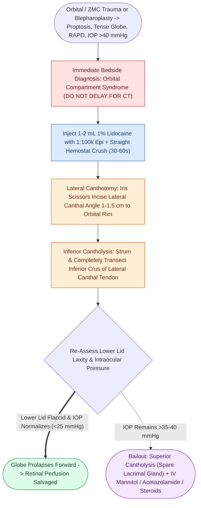

# Acute retrobulbar hematoma in facial trauma requires immediate bedside lateral canthotomy

## Active Recall

> [!question]- What are the cardinal clinical signs of orbital compartment syndrome, at what IOP threshold is decompression indicated, and why is delaying for CT imaging a critical error?
> *Answer / Clinical Rationale*: Cardinal signs include **progressive proptosis**, intense deep orbital pain, a **"rock-hard" globe** to palpation, **mydriasis (sluggish or non-reactive afferent pupillary defect / Marcus Gunn pupil)**, ophthalmoplegia, subconjunctival chemosis, and progressive vision loss. Decompression is indicated immediately when **IOP exceeds $40\text{ mmHg}$** (normal $= 10\text{–}21\text{ mmHg}$) or upon clinical recognition of vision loss with a tight globe. Central retinal artery occlusion and retinal ganglion cell ischemia cause **permanent irreversible blindness within 60–90 minutes**, so bedside decompression must proceed immediately without CT delay.

> [!question]- How is a bedside lateral canthotomy and inferior cantholysis executed, and how does the surgeon confirm complete release?
> *Answer / Clinical Rationale*: After infiltrating $1\text{–}2\text{ mL}$ lidocaine with epinephrine and crushing the lateral canthal angle horizontally with a straight hemostat for $30\text{–}60\text{ seconds}$, perform a **$1.0\text{–}1.5\text{ cm}$ horizontal lateral canthotomy** to the orbital rim with straight iris scissors. Retract the lower lid anteriorly and inferiorly, strum the taut **inferior crus of the lateral canthal tendon**, and transect it completely (**inferior cantholysis**). Release is confirmed when the lower eyelid becomes completely flaccid and untethered from the orbital rim ("string-plucking" resistance disappears), the globe prolapses forward, and IOP drops markedly.

> [!question]- What surgical bailout and medical adjuncts are deployed if intraocular pressure remains elevated after inferior cantholysis?
> *Answer / Clinical Rationale*: If IOP remains $>35\text{–}40\text{ mmHg}$ after inferior cantholysis, perform **superior cantholysis** by transecting the superior crus of the lateral canthal tendon while avoiding the **lacrimal gland**. Concurrent medical adjuncts include **IV mannitol ($1\text{–}2\text{ g/kg}$)**, **IV acetazolamide ($500\text{ mg}$)**, high-dose **IV corticosteroids** (dexamethasone $10\text{–}20\text{ mg}$ or methylprednisolone), and **topical beta-blocker/timolol drops** to reduce aqueous humor production.

## Core Clinical & Mechanistic Principles
**[[Post-blepharoplasty retrobulbar hematoma requires immediate bedside decompression to prevent blindness|Retrobulbar Hematoma]]** causing **Orbital Compartment Syndrome (OCS)** is a true ophthalmic emergency in craniomaxillofacial trauma (commonly associated with high-energy midface, ZMC, or [[Orbital floor blowout fractures with muscle entrapment or significant enophthalmos mandate reconstruction|orbital blowout fractures]]), blepharoplasty, and sinus surgery. The bony orbit is a rigid, non-compliant conical vault bounded anteriorly by the fibrous orbital septum and globe. Rapid arterial or venous bleeding into the retrobulbar fat space causes an exponential spike in intraorbital pressure ($IOP > 40\text{–}50\text{ mmHg}$), exceeding retinal artery perfusion pressure and producing **irreversible ischemic necrosis of retinal ganglion cells and optic neuropathy within 60 to 90 minutes**.

### Emergency Bedside Step-by-Step Cantholysis
1. **Never Send for CT Scanning**: If a patient with facial trauma develops progressive proptosis, decreased visual acuity, and an afferent pupillary defect (RAPD), performing a CT scan delays decompression beyond the window of retinal viability. Decompression must occur at the bedside within minutes.
2. **Local Anesthetic**: Inject $1\text{–}2\text{ mL}$ lidocaine with epinephrine into the lateral canthus.
3. **Crush for Hemostasis**: Place a straight hemostat horizontally across the lateral canthal angle for 30–60 seconds.
4. **Lateral Canthotomy**: Incise full-thickness horizontally from the lateral canthal angle to the bony orbital rim ($1.0\text{–}1.5\text{ cm}$) with straight iris scissors.
5. **Inferior Cantholysis**: Retract the lower eyelid anteriorly and inferiorly; strum the taut **inferior crus of the lateral canthal tendon** with scissors directed inferiorly against the orbital rim, and **transect the tendon completely** until the lower lid is completely flaccid.
6. **Superior Cantholysis Bailout & Medical Adjuncts**: If IOP remains $>35\text{–}40\text{ mmHg}$ after inferior cantholysis, transect the **superior crus of the lateral canthal tendon** while carefully avoiding the **lacrimal gland**. Administer IV mannitol ($1\text{–}2\text{ g/kg}$), IV acetazolamide ($500\text{ mg}$), IV dexamethasone ($10\text{–}20\text{ mg}$) or high-dose methylprednisolone, and topical beta-blocker/timolol drops.

### Key Consultation Supplies
- Coaxial surgical headlight
- 1% or 2% lidocaine with 1:100,000 epinephrine with 3 mL syringe and 27-gauge needle
- Straight or curved hemostat
- Iris scissors or straight Stevens tenotomy scissors
- 0.5 mm Castroviejo or Bishop-Harmon toothed forceps
- Tono-Pen® or Schiotz tonometer
- Erythromycin ophthalmic ointment and sterile eye pad

## References
1. Cornelius, C.P., Gellrich, N., Hillerup, S., et al. Orbit, Orbital Floor Fracture. *AO Foundation Surgery Reference*.
2. Kachniarz, B., Grant, M., Dorafshar, A.H. (2020). Orbital Fractures. In Dorafshar, A.H., Rodriguez, E.D., Manson, P.N. (Eds.), *Facial Trauma Surgery: From Primary Repair to Reconstruction* 1e (pp. 113-121). Edinburgh: Elsevier.
3. Krishnan, D., Ochs, M. (2011). Orbital and Ocular Trauma. In Miloro, M., Ghali, G.E., Larsen, P., et al. (Eds.), *Peterson’s Principles of Oral and Maxillofacial Surgery* 3e. People’s Medical Publishing House.
4. Rowh, A.D., Ufberg, J.W., Harrigan, R.A. (2015). Lateral canthotomy and cantholysis: emergency decompression for orbital compartment syndrome. *J Emerg Med*, 48(3):325-330.

## Connected Concepts & Graph Traversal
- **Blepharoplasty Etiology**: [[Lower blepharoplasty addresses fat herniation while preserving the inferior oblique muscle|Blepharoplasty Complications]]
- **Orbital Trauma Foundation**: [[Orbital floor blowout fractures with muscle entrapment or significant enophthalmos mandate reconstruction|Orbital Floor Reconstruction]]
- **Canthal Tendon Fixation**: [[Lateral canthopexy and lateral tarsal strip suspension prevent post-blepharoplasty ectropion|Lateral Tarsal Strip Suspension]]
- **Midface Fracture Association**: [[Zygomaticomaxillary complex fractures disrupt four buttress articulations requiring multi-point reduction|ZMC Fractures & Orbital Rim]]
- **Vascular Occlusion Alternative**: [[Hyaluronic acid filler vascular occlusion requires immediate high-dose pulsed hyaluronidase to prevent skin necrosis and blindness|Filler Vascular Occlusion & Blindness]]
- **Post-Surgical Rescue**: [[Post-blepharoplasty retrobulbar hematoma requires immediate bedside decompression to prevent blindness|Post-Blepharoplasty Retrobulbar Hematoma]]
