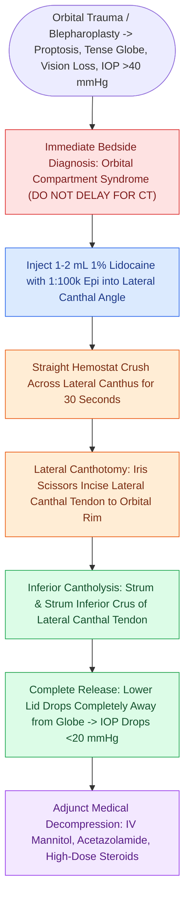

# Acute retrobulbar hematoma in facial trauma requires immediate bedside lateral canthotomy

## Active Recall

> [!question]- Why is it a critical error to send a patient with suspected acute retrobulbar hematoma for a CT scan?
> *Answer / Clinical Rationale*: Central retinal artery occlusion causes **permanent ischemic retinal necrosis within 60–90 minutes**. Decompression via bedside lateral canthotomy and inferior cantholysis must be performed immediately without radiological delay.

> [!question]- How does the surgeon confirm that an inferior cantholysis is complete?
> *Answer / Clinical Rationale*: The lower eyelid becomes completely loose and un-tethered from the lateral orbital rim ("string-plucking" resistance is gone), and IOP drops markedly.

## Core Clinical & Mechanistic Principles
**[[Post-blepharoplasty retrobulbar hematoma requires immediate bedside decompression to prevent blindness|Retrobulbar Hematoma]]** causing **Orbital Compartment Syndrome** is a catastrophic ophthalmic emergency in facial trauma, blepharoplasty, and sinus surgery. The bony orbit is a rigid, non-compliant cone; arterial hemorrhage rapidly elevates intraocular pressure ($IOP > 40\text{–}50\text{ mmHg}$), exceeding central retinal artery perfusion pressure and causing **permanent irreversible blindness within 60 to 90 minutes**.

### Emergency Bedside Step-by-Step Cantholysis
1. **Local Anesthetic**: Inject $1\text{–}2\text{ mL}$ lidocaine with epinephrine into lateral canthus.
2. **Crush for Hemostasis**: Place straight hemostat across lateral canthal angle for 30 seconds.
3. **Lateral Canthotomy**: Incise horizontally from lateral canthal angle to the bony orbital rim ($1.0\text{–}1.5\text{ cm}$).
4. **Inferior Cantholysis**: Retract lower eyelid anteriorly; identify the **inferior crus of the lateral canthal tendon** with scissors pointing strummed against bone, and **transect the tendon completely**.
### Key Consultation Supplies
- Coaxial surgical headlight
- 1% or 2% lidocaine with 1:100,000 epinephrine with 3 mL syringe and 27-gauge needle
- Straight or curved hemostat
- Iris scissors or straight Stevens tenotomy scissors
- 0.5 mm Castroviejo or Bishop-Harmon toothed forceps
- Tono-Pen® or Schiotz tonometer
- Erythromycin ophthalmic ointment and sterile eye pad
- Medical adjunctive therapy: IV mannitol (1–2 g/kg), IV acetazolamide (500 mg), and high-dose IV methylprednisolone

## References
1. Cornelius, C.P., Gellrich, N., Hillerup, S., et al. Orbit, Orbital Floor Fracture. *AO Foundation Surgery Reference*.
2. Kachniarz, B., Grant, M., Dorafshar, A.H. (2020). Orbital Fractures. In Dorafshar, A.H., Rodriguez, E.D., Manson, P.N. (Eds.), *Facial Trauma Surgery: From Primary Repair to Reconstruction* 1e (pp. 113-121). Edinburgh: Elsevier.
3. Krishnan, D., Ochs, M. (2011). Orbital and Ocular Trauma. In Miloro, M., Ghali, G.E., Larsen, P., et al. (Eds.), *Peterson’s Principles of Oral and Maxillofacial Surgery* 3e. People’s Medical Publishing House.
4. Rowh, A.D., Ufberg, J.W., Harrigan, R.A. (2015). Lateral canthotomy and cantholysis: emergency decompression for orbital compartment syndrome. *J Emerg Med*, 48(3):325-330.

## Connected Concepts & Graph Traversal
- **Blepharoplasty Etiology**: [[Lower blepharoplasty addresses fat herniation while preserving the inferior oblique muscle|Blepharoplasty Complications]]
- **Orbital Trauma Foundation**: [[Orbital floor blowout fractures with muscle entrapment or significant enophthalmos mandate reconstruction|Orbital Floor Reconstruction]]
- **Canthal Tendon Fixation**: [[Lateral canthopexy and lateral tarsal strip suspension prevent post-blepharoplasty ectropion|Lateral Tarsal Strip Suspension]]
- **Midface Fracture Association**: [[Zygomaticomaxillary complex fractures disrupt four buttress articulations requiring multi-point reduction|ZMC Fractures & Orbital Rim]]
- **Vascular Occlusion Alternative**: [[Hyaluronic acid filler vascular occlusion requires immediate high-dose pulsed hyaluronidase to prevent skin necrosis and blindness|Filler Vascular Occlusion & Blindness]]
- **Post-Surgical Rescue**: [[Post-blepharoplasty retrobulbar hematoma requires immediate bedside decompression to prevent blindness|Post-Blepharoplasty Retrobulbar Hematoma]]
