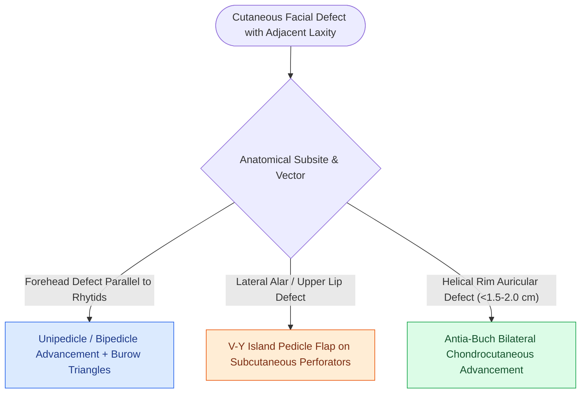

# Advancement flaps recruit adjacent tissue laxity along a linear vector without rotation

## Active Recall

> [!question]- Why are Burow's triangles placed at the base of a unipedicle advancement flap?
> *Answer / Clinical Rationale*: To equalize the length discrepancy between the advancing flap and the fixed lateral wound margins, flattening lateral dog-ears and relieving closing tension.

> [!question]- What anatomical defect on the auricle is ideally repaired with an Antia-Buch flap?
> *Answer / Clinical Rationale*: Helical rim defects measuring up to **$1.5\text{–}2.0\text{ cm}$**, advancing the superior and inferior chondrocutaneous flaps along the curve of the ear.

## Core Clinical & Mechanistic Principles
An **advancement flap** mobilizes adjacent soft tissue directly along a **linear vector into a primary defect without rotation, transposition, or lateral pivoting**. Movement relies entirely on stretching tissue along the [[Relaxed skin tension lines minimize scar hypertrophy along perpendicular muscular vectors|Lines of Maximal Extensibility]] (LME) and releasing lateral wound tethers. 

Standard cutaneous advancement flaps are **random-pattern flaps** whose vascular supply depends exclusively on the **subdermal vascular plexus** rather than a designated axial feeding artery. Because microvascular perfusion is pressure-dependent across the subdermal plexus, safe length-to-width ratios for facial random-pattern advancement flaps are classically maintained between **$3:1\text{ to }4:1$** (exploiting the exceptional collateral vascularity of the head and neck, compared to $1:1\text{ to }1.5:1$ on the trunk and lower extremities) to avoid ischemic necrosis at the advancing leading edge.

### Classic Advancement Variations
1. **Unipedicle & Bipedicle Advancement**:
   - Useful for forehead defects where incision lines hide parallel to horizontal forehead rhytids.
   - Requires excision of **bilateral Burow's triangles** at the base to prevent standing cone puckering.
2. **V-Y Advancement (Island Pedicle Flap)**:
   - A triangular skin island is incised down to subcutaneous fat and advanced forward into a defect; the donor site is closed as a straight line, converting a "V" into a "Y". Excellent for lateral alar and upper lip defects.
3. **Antia-Buch Helical Rim Advancement**:
   - Chondrocutaneous advancement along the helical rim to repair defects up to $1.5\text{–}2.0\text{ cm}$ without altering ear contour.

## Connected Concepts & Graph Traversal
- **Biomechanical Vector**: [[Relaxed skin tension lines minimize scar hypertrophy along perpendicular muscular vectors|Lines of Maximal Extensibility]]
- **Flap Comparison**: [[Rotation flaps redistribute closing tension along a curvilinear arc of rotation|Rotation Flaps]]
- **Ear Reconstruction**: [[Mustarde and Furnas sutures correct antihelical effacement and conchal hypertrophy|Otoplasty & Auricular Surgery]]
- **Diagnostic Evaluation**: [[Rhombic and Limberg flaps transpose tissue into sixty-degree and one-hundred-twenty-degree defects|Rhombic Flap]]
- **Anatomical Foundation**: [[Bilateral A-T plasty and H-plasty advancements reconstruct forehead and suprabrow defects by recruiting transverse tissue laxity along relaxed skin tension lines|Forehead A-T Plasty]]
