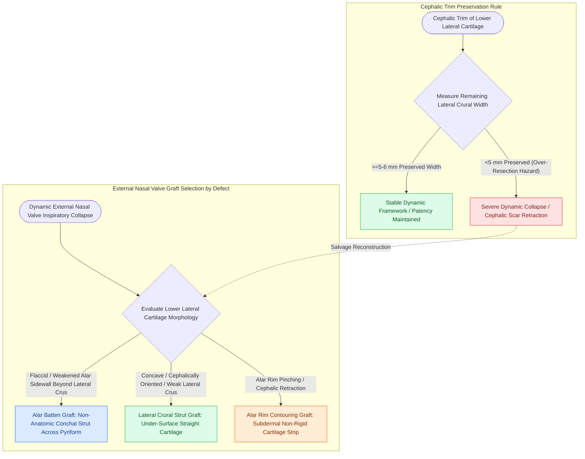

# Alar batten and lateral crural strut grafts prevent external nasal valve inspiratory collapse

## Active Recall

> [!question]- Where is an alar batten graft anatomically placed to correct dynamic external nasal valve collapse?
> *Answer / Clinical Rationale*: In a subcutaneous pocket over the area of maximum collapse, positioned **lateral to the lateral crus and bridging the bony pyriform aperture**.

> [!question]- What is the minimum width of lateral crus that must be preserved during a cephalic trim?
> *Answer / Clinical Rationale*: A minimum of **$5\text{ to }6\text{ mm}$** must be preserved to prevent structural weakening and dynamic valve collapse.

## Core Clinical & Mechanistic Principles
The **External Nasal Valve (ENV)** is the caudal aperture of the nose, bounded by the **lateral crus of the lower lateral cartilage (LLC)**, the **alar lobule / fibrofatty tissue**, the **columella**, and the **nasal sill**.

Dynamic collapse during inspiration occurs due to negative intraluminal pressure (Bernoulli's principle) acting on a weakened or over-resected cartilaginous framework.

### The Cephalic Trim Warning
- **The $5\text{–}6\text{ mm}$ Rule**: When performing a [[Cephalic trim of lower lateral cartilages must preserve at least six millimeters of lateral crus|cephalic trim]] of the lower lateral cartilages for tip refinement, a **minimum of $5\text{–}6\text{ mm}$ of lateral crural width must be preserved**.
- **Over-Resection**: Leaving $<5\text{ mm}$ of lateral crus leads to loss of structural elasticity, dynamic alar collapse during inspiration, and severe alar rim retraction.

## Connected Concepts & Graph Traversal
- **Internal Valve**: [[Spreader grafts restore internal nasal valve patency and prevent inverted-V deformity|Internal Nasal Valve]]
- **Tip Tripod**: [[The Anderson tripod theory governs nasal tip projection, rotation, and support dynamics|Anderson Tripod Theory]]
- **Crural Maneuvers**: [[Lateral crural steal and overlay maneuvers dynamically modify tip rotation and projection|Lateral Crural Steal & Overlay]]
- **High-Stakes Safety**: [[Pollybeak deformities arise from cartilaginous over-projection or supratip soft tissue fibrosis|Pollybeak Deformity]]
- **Classification / Grading**: [[Alar rim retraction requires non-anatomical contour grafts, batten grafts, or composite chondrocutaneous grafting based on the Gorney classification|Alar Rim Retraction (Gorney Classification)]]
