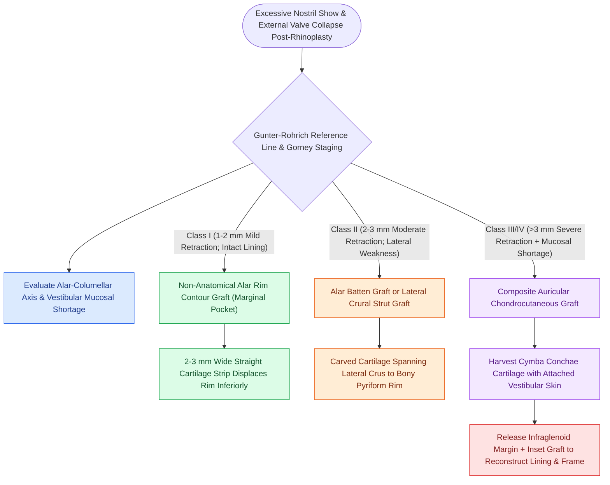

# Alar rim retraction requires non-anatomical contour grafts, batten grafts, or composite chondrocutaneous grafting based on the Gorney classification

## Active Recall

> [!question]- How does the Gunter-Rohrich reference line differentiate true alar rim retraction from columellar excess (hanging columella)?
> *Answer / Clinical Rationale*: A reference line is drawn connecting the most anterior and posterior boundaries of the nostril opening. Normally, the distance from this line to the alar rim and columellar crest is balanced ($1\text{ to }2\text{ mm}$ above and below, yielding $2\text{ to }4\text{ mm}$ total columellar show). Distance exceeding $2\text{ mm}$ above the line defines true **alar rim retraction**, whereas distance exceeding $2\text{ mm}$ below the line defines **columellar excess**.

> [!question]- Why does aggressive cephalic trim leaving less than 6 mm of lateral crus trigger severe delayed alar retraction and external valve collapse?
> *Answer / Clinical Rationale*: It destroys the structural cartilaginous framework needed to counteract postoperative healing. As scar contracture occurs, the thin, unsupported fibrofatty alar margin is pulled cephalically, causing alar notching, pinching, and dynamic inspiratory [[Alar batten and lateral crural strut grafts prevent external nasal valve inspiratory collapse|external nasal valve collapse]].

## Core Clinical & Mechanistic Principles
**Alar rim retraction** is an aesthetic and functional nasal deformity defined as the abnormal cephalic displacement of the alar margin, resulting in excess nostril show on profile and three-quarter views. While congenital variants occur (familial traits, facial cleft hypoplasia), the vast majority of cases are iatrogenic sequelae of primary [[Costal cartilage harvest and concentric carving prevent structural graft warping in revision rhinoplasty|rhinoplasty]] ($7\\%\text{ to }14\\%$ incidence) or oncologic skin cancer resections along the alar subunit.

### Biomechanical Etiology in Rhinoplasty
1. **Excessive Cephalic Resection of Lateral Crura**: During tip narrowing maneuvers, over-resection that leaves $<6\text{ mm}$ of lateral crus destroys the rigid cartilaginous scaffold supporting the alar margin. As the thin alar rim contracts during cicatricial healing, cephalic contraction vectors overcome structural resistance.
2. **Inadvertent Vestibular Skin Excision**: Resecting vestibular skin during marginal incisions or cephalic trims creates a direct mucosal lining deficit that contracts cephalically.
3. **Cephalic Malposition of the Lateral Crura**: In patients with an anatomical "parentheses deformity" where lateral crura course toward the medial canthus rather than the lateral pyriform aperture, the alar rim is naturally devoid of cartilaginous support, making even conservative cephalic trims catastrophic.

### The Gorney & Martello Classification & Gunter Analysis
- **Class I (Mild)**: $1\text{ to }2\text{ mm}$ of alar retraction; smooth contour, intact vestibular lining, preserved external valve.
- **Class II (Moderate)**: $2\text{ to }3\text{ mm}$ of alar retraction; visible notching, cartilage weakness, mild external valve collapse.
- **Class III (Severe)**: $3\text{ to }4\text{ mm}$ of alar retraction; marked asymmetry, severe cartilage deficiency, dynamic valve collapse.
- **Class IV (Complex / Cicatricial)**: $>4\text{ mm}$ retraction with gross tissue loss, dense inner vestibular cicatricial scarring, or external cutaneous tethering.

### Surgical Hierarchy & Craft of Repair
- **Class I: Non-Anatomical Alar Rim Contour Grafts (Marginal Grafts)**:
  - Through a tiny marginal incision ($2\text{ to }3\text{ mm}$), a precise, tight subcutaneous pocket is dissected with fine tenotomy scissors directly along the caudal-most margin of the ala, staying inferior to the lateral crus.
  - A rigid, straight strip of septal or conchal cartilage ($2\text{ to }3\text{ mm}$ wide, $15\text{ to }20\text{ mm}$ long) is carved with beveled edges and seated into the pocket. It acts as a non-anatomical structural strut, pushing the soft tissue margin downward and correcting $1\text{ to }2\text{ mm}$ of retraction.
- **Class II: Alar Batten & Lateral Crural Strut Grafts**:
  - For moderate retraction combined with lateral wall flaccidity, an alar batten graft is harvested from septal or auricular cartilage.
  - The graft is carved with a gentle convexity oriented laterally and placed into a precise pocket extending from the lateral crus across the bony pyriform aperture, simultaneously lowering the alar margin and stenting the external valve open.
- **Class III & IV: Auricular Composite Chondrocutaneous Grafts**:
  - In severe retraction ($>3\text{ mm}$), cartilage grafting alone fails because the underlying vestibular lining is severely contracted and shortened.
  - A marginal relaxing incision is placed inside the alar rim, releasing the cicatricial contracture and allowing the alar margin to drop into an anatomical position, which creates a elliptical inner lining defect ($4\text{ to }8\text{ mm}$ wide).
  - A composite graft consisting of skin and underlying cartilage is harvested from the anterosuperior helical margin or the cymba conchae of the ear. The skin paddle replaces the missing vestibular lining, while the attached cartilage strut provides rigid structural support to prevent recurrent contracture.

## Critical Failure Modes & Error Traps
- **Over-Sizing Composite Grafts**: Composite grafts $>1.5\text{ cm}$ in diameter carry a high risk of central ischemic necrosis because survival depends entirely on peripheral inosculation and capillary ingrowth.
- **Failing to Distinguish Hanging Columella**: Placing rim grafts in a patient with a normal alar position and excess caudal septum/columella creates an unnatural, low-riding alar margin with complete obliteration of normal nostril show.

## Connected Concepts & Graph Traversal
- **Ear Cartilage Graft Craft**: [[Auricular conchal cartilage grafts provide curved structural support for the alar and nasal valves|Conchal Cartilage Harvesting]]
- **Helical Composite Graft**: [[Composite chondrocutaneous auricular graft transfers reconstruct complex alar and helical defects|Composite Graft Biology]]
- **Tripod Projection Dynamics**: [[The Anderson tripod theory governs nasal tip projection, rotation, and support dynamics|Anderson Tripod Mechanics]]
- **Rigid Septal Overlap**: [[The caudal septal extension graft controls tip projection and rotation via rigid septal overlap|Caudal Septal Extension]]
- **Internal Valve Repair**: [[Spreader grafts restore internal nasal valve patency and prevent inverted-V deformity|Spreader Graft Alignment]]
- **Lateral Crural Adjustments**: [[Lateral crural steal and overlay maneuvers dynamically modify tip rotation and projection|Lateral Crural Mechanics]]
