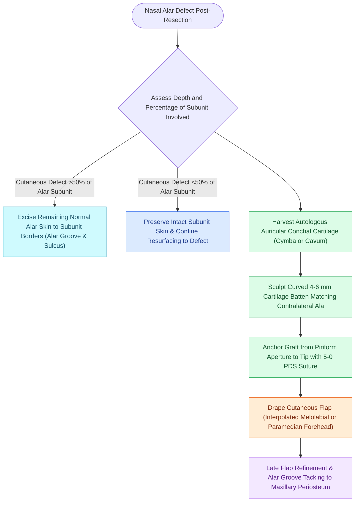

# Alar subunit reconstruction requires non-anatomical rigid cartilage grafting to counteract scar contracture and prevent alar rim notching

## Active Recall

> [!question]- Given that the native alar lobule contains no cartilage along its caudal 5 mm, why is a rigid cartilage graft mandatory when reconstructing an alar defect?
> *Answer / Clinical Rationale*: In normal anatomy, the alar lobule is composed exclusively of dense fibrofatty tissue. However, in surgical reconstruction, healing tissue flaps generate **relentless centripetal and vertical myofibroblastic scar contracture**. Without a rigid cartilage scaffold spanning from the piriform aperture to the tip, contracture inevitably produces **severe upward alar rim notching (retraction) and dynamic inspiratory external valve collapse**.

> [!question]- How should an auricular conchal cartilage graft be sculpted and oriented when reconstructing the alar framework?
> *Answer / Clinical Rationale*: The graft is harvested from the **cymba or cavum conchae** to utilize its natural three-dimensional curvature. It is carved into an arched strip **4 to 6 mm wide** and oriented so its **convex surface faces outward**, matching the natural gentle outward convexity of the alar lobule and reinforcing the nostril margin.

> [!question]- What surgical threshold dictates whole aesthetic subunit excision for alar cutaneous defects?
> *Answer / Clinical Rationale*: If a cutaneous defect involves **greater than 50% of the alar subunit**, the remaining normal skin of the ala is completely excised to allow the reconstructive flap to resurface the entire subunit, hiding perimeter scars within the **alar groove and alar-facial sulcus**.

## Core Clinical & Mechanistic Principles
The nasal alar lobule is a delicate, three-dimensionally curved aesthetic structure that maintains patent airway laminar flow while framing [[Goode's ratio and nasolabial angles define standard aesthetic nasal tip proportions|nasal tip aesthetics]]. Reconstructing the alar subunit presents a unique anatomical paradox: while the native alar margin is completely devoid of cartilage (consisting solely of skin, fibrofatty core, and vestibular lining), surgical reconstruction **always requires a rigid, non-anatomical cartilaginous scaffold**.

### Biomechanics of Alar Margin Scar Contracture
When cutaneous flaps (such as melolabial or paramedian forehead flaps) and mucosal lining flaps heal, wound contracture exerts powerful cephalic and medial vectors:
- **Vertical Retraction**: Without rigid internal support, the nostril margin elevates by 3 to 8 mm, exposing the dark nasal vestibule, causing noticeable asymmetric nostril display and cosmetic disfigurement.
- **External Nasal Valve Collapse**: The negative pressure generated during inspiration pulls an unsupported, flaccid reconstructive flap inward, causing complete functional obstruction of the nasal valve.
- **The Non-Anatomical Batten Mandate**: A structural cartilage graft must be interposed along the caudal margin of the defect, extending from the bony piriform aperture laterally across the alar lobule to overlap the remaining lower lateral cartilage or tip graft medially.

### Technical Craft Pearls for Alar Framework Grafting
1. **Donor Site Selection**: Conchal cartilage harvested via an anterior or posterior approach provides superior contour compared to septal cartilage, because the natural dome-like concavity of the cymba conchae duplicates the outward flare of the alar lobule.
2. **Graft Sizing & Cantilever Anchoring**: The graft must measure at least 4 to 6 mm in vertical height. The lateral end is notched and anchored with permanent or slowly absorbable suture to the fibrous tissue or periosteum of the piriform aperture, preventing cephalic displacement.
3. **Mattress Suture Fixation**: The cartilage is stabilized against the underlying lining flap (bipedicled vestibular flap or septal hinge flap) using through-and-through mattress sutures of 5-0 chromic or polydioxanone before external flap inset.
4. **Alar-Facial Sulcus Preservation**: When transposing or advancing tissue, the normal indentation between the alar base and cheek must be preserved or secondarily recreated with deep dermal-to-periosteal anchor sutures.

## Connected Concepts & Graph Traversal
- **Aesthetic Subunit Rule**: [[Gonzalez-Ulloa facial aesthetic subunits guide complete subunit reconstruction|Facial Aesthetic Subunits]]
- **External Valve Support**: [[Alar batten and lateral crural strut grafts prevent external nasal valve inspiratory collapse|Alar Batten Grafts]]
- **Auricular Donor Site**: [[Auricular conchal cartilage grafts provide curved structural support for the alar and nasal valves|Conchal Cartilage Harvesting]]
- **Full-Thickness Composite**: [[Composite chondrocutaneous auricular graft transfers reconstruct complex alar and helical defects|Composite Chondrocutaneous Grafts]]
- **Cutaneous Workhorse**: [[The paramedian forehead flap is an axial interpolated flap pedicled on the supratrochlear artery|Paramedian Forehead Flap]]
- **Trilaminar Reconstruction**: [[Total nasal reconstruction requires three-layer structural restoration of lining, cartilage, and cover|Total Nasal Reconstruction]]
- **Contour Deformity Rescue**: [[Alar rim retraction requires non-anatomical contour grafts, batten grafts, or composite chondrocutaneous grafting based on the Gorney classification|Alar Rim Retraction (Gorney Classification)]]
