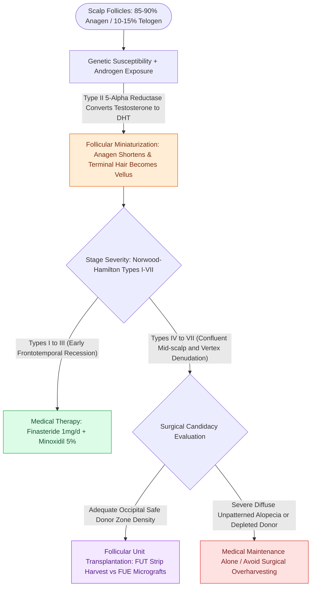

# Androgenic alopecia management spans Norwood-Hamilton staging, medical five-alpha reductase blockade, and follicular unit transplantation

## Active Recall

> [!question]- What are the three biological phases of the hair follicle growth cycle, their durations, and the physiological follicle distribution?
> *Answer / Clinical Rationale*:
> 1. **Anagen (Active growth phase)**: Lasts **2 to 6 years** (determines ultimate hair length); accounts for **85% to 90%** of scalp hair follicles under normal conditions.
> 2. **Catagen (Apoptosis / Transitional regression phase)**: Lasts **2 to 3 weeks**; accounts for **<1%** of follicles. Cell division ceases, and the dermal papilla condenses.
> 3. **Telogen (Resting phase)**: Lasts **approximately 3 months (100 days)**; accounts for **10% to 15%** of follicles. Telogen hairs are naturally shed at a baseline rate of **50 to 100 hairs per day**. In telogen effluvium, physiological stress triggers premature transition of anagen hairs into telogen.

> [!question]- How does the Norwood-Hamilton classification categorize male pattern baldness from early recession to severe denudation?
> *Answer / Clinical Rationale*:
> - **Type I**: Minimal or no frontotemporal recession.
> - **Type II**: Symmetrical triangular frontotemporal recession anterior to the coronal interaural line.
> - **Type III**: Deep symmetrical frontotemporal recession extending posterior to the coronal plane; this is the **minimal threshold for cosmetically significant baldness**. (Type III-Vertex: recession predominantly at vertex).
> - **Type IV**: Severe frontotemporal recession and prominent vertex balding separated by a distinct, dense band of hair across the mid-scalp.
> - **Type V**: The intervening mid-scalp hair band narrows and thins substantially.
> - **Type VI**: The intervening band completely dissolves; frontotemporal and vertex balding zones become confluent.
> - **Type VII**: The most severe form; only a narrow horseshoe-shaped rim of sparse hair remains in the inferior occipital and temporal margins.

> [!question]- What are the pharmacological mechanisms, target enzymes, and key side effects of finasteride versus minoxidil in androgenic alopecia?
> *Answer / Clinical Rationale*:
> - **Finasteride** ($1\text{ mg/day}$ PO): A competitive inhibitor of **Type II 5-alpha reductase**, which converts testosterone to dihydrotestosterone (DHT). It suppresses circulating and scalp DHT by **60% to 70%**, arresting hair miniaturization, halting hair loss in >80% of patients, and inducing crown regrowth. Side effects: reversible erectile dysfunction, decreased libido, and ejaculatory disorders in **1% to 2%** of men.
> - **Minoxidil** ($2\%$ or $5\%$ topical solution or foam): An **ATP-sensitive potassium channel opener and peripheral vasodilator**. It promotes microvascular perfusion around dermal papillae and directly **prolongs the anagen phase** while accelerating telogen-to-anagen transition. Side effects: hypertrichosis (especially in females), contact dermatitis, and transient shedding during the initial 4 to 8 weeks of therapy.

## Core Clinical & Mechanistic Principles

Androgenic alopecia (male pattern hair loss) is an androgen-dependent, genetically determined progressive process characterized by the **miniaturization of terminal hair follicles into vellus hairs** in response to local dihydrotestosterone (DHT) binding within the dermal papillae.

### The Norwood-Hamilton Staging Ledger

The Norwood-Hamilton staging system dictates clinical severity and surgical planning:

| Stage | Anatomical Hairline & Vertex Pattern | Management Strategy |
| :--- | :--- | :--- |
| **Type I** | Juvenile hairline; minimal to no recession | Observation; baseline photography |
| **Type II** | Mild frontotemporal recession not extending behind coronal plane | Medical prophylaxis (finasteride, topical minoxidil) |
| **Type III** | Deep frontotemporal recession posterior to coronal line; **first cosmetically significant stage** | Medical therapy; optional micrograft hairline reconstruction |
| **Type III-Vertex** | Frontotemporal recession accompanied by isolated crown/vertex thinning | Medical therapy first-line; high response rate in vertex |
| **Type IV** | Deep frontotemporal recession + isolated vertex balding separated by dense mid-scalp bridge | Combined medical + surgical hairline/vertex grafting |
| **Type V** | Vertex and frontal balding enlarge; intervening hair bridge thins significantly | Staged follicular unit transplantation (FUT/FUE) |
| **Type VI** | Mid-scalp bridge completely lost; frontal and vertex regions confluent | Extensive grafting prioritizing anterior hairline and mid-scalp |
| **Type VII** | Severe bare calvarium; only narrow lateral and occipital horseshoe rim remains | Limited coverage; conservative anterior hairline framing only |

### Surgical Hair Restoration Craft: Donor Zones & Grafting

1. **The Safe Donor Zone (SDZ)**:
   - Located in the mid-occipital scalp between the superior nuchal line and external occipital protuberance.
   - Follicles in this territory are developmentally **resistant to androgen-induced miniaturization** because they originate from distinct embryonic mesenchyme that lacks high 5-alpha reductase expression. When transplanted into balding frontal scalp, they retain their intrinsic longevity (**donor dominance** principle).

2. **Graft Architecture & Natural Hairline Creation**:
   - **Follicular Units**: Natural anatomical groupings containing **1 to 4 terminal hairs**, 1 vellus hair, sebaceous glands, and the surrounding perifolliculum.
   - **Micrografts ($1\text{–}2\text{ hairs}$)**: Placed strictly along the transition zone of the anterior hairline in an irregular, staggered distribution ("feathering") angled **$10^\circ\text{–}15^\circ$ anteriorly** to mimic natural growth.
   - **Minigrafts / Multi-hair units ($3\text{–}4\text{ hairs}$)**: Placed posterior to the transition zone into the mid-scalp and vertex to provide optical density.
   - **FUT vs FUE**:
     - *Follicular Unit Transplantation (FUT / Strip Harvesting)*: A horizontal strip of hair-bearing scalp is excised from the occipital donor zone, and individual follicular units are dissected under stereo-microscopes. Trichophytic closure minimizes linear scar visibility.
     - *Follicular Unit Extraction (FUE)*: Individual follicular units are harvested directly using $0.8\text{–}1.0\text{ mm}$ micro-punches. Eliminates a linear scar but leaves tiny hypopigmented dot scars.

3. **Adjunctive Procedures**:
   - **Scalp Reduction**: Serial excision of hair-bearing vertex skin to reduce the total area requiring grafting; rarely used today due to stretch-back and unnatural scar orientation.
   - **Tissue Expansion**: Subgaleal expanders placed under hair-bearing occipital/temporal scalp to reconstruct massive traumatic or burn alopecia.

Comprehensive physiological and surgical principles connect these findings directly to [[Facial horizontal fifths and vertical thirds define baseline aesthetic analysis and proportions|facial aesthetic proportions]].

## Connected Concepts & Graph Traversal
- **Scalp Anatomy**: [[Scalp laceration repair requires layered subgaleal and galeal closure with galeatomy to achieve tension-free closure|Layered Galeal Scalp Anatomy]]
- **Tissue Expansion**: [[Tissue expansion biomechanics generate vascularized skin for large pediatric and scalp defects|Tissue Expansion Biomechanics]]
- **Surgical Incision Planning**: [[Coronal and pretrichial open browlifts address severe brow ptosis with high versus low hairlines|Pretrichial Hairline Browlift Incisions]]
- **Vascular Foundations**: [[The facial artery and facial vein provide the primary vascular supply to the anterior face|Facial Vascular Anatomy]]
- **Aesthetic Subunits**: [[Gonzalez-Ulloa facial aesthetic subunits guide complete subunit reconstruction|Gonzalez-Ulloa Aesthetic Subunits]]
