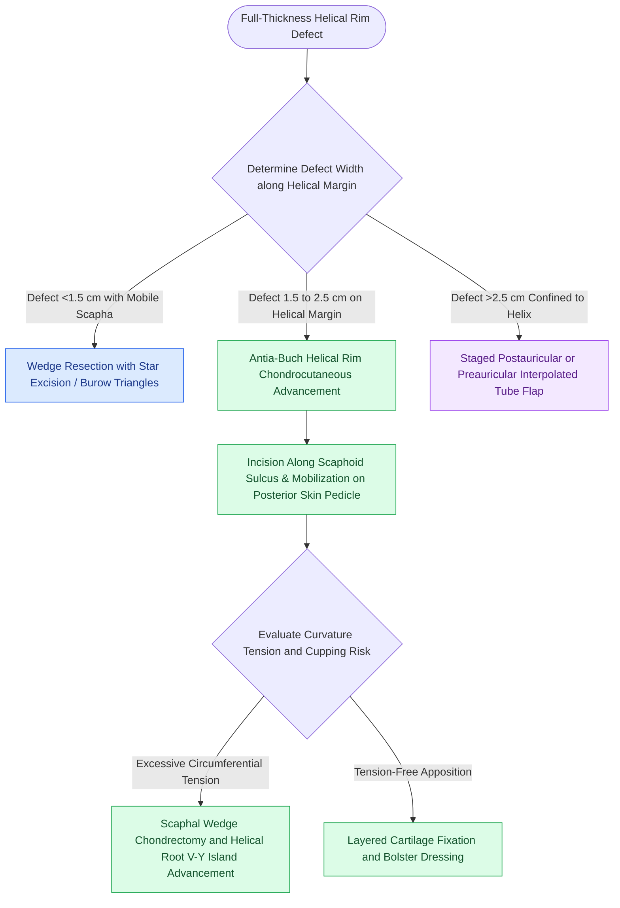

# Antia-Buch helical rim chondrocutaneous advancement flaps mobilize the helical margin and lobule to close defects up to two centimeters

## Active Recall

> [!question]- What is the primary anatomical vascular base that sustains the chondrocutaneous advancement flap in the Antia-Buch procedure?
> *Answer / Clinical Rationale*: The flap relies on the **posteromedial auricular skin and its subcutaneous/perichondrial vascular plexus**, supplied by branches of the **posterior auricular artery**; the anterior skin and helical cartilage are transected while leaving the posterior skin and perichondrium intact (or minimally released) to maintain perfusion.

> [!question]- How does the surgeon prevent auricular cupping or buckling when advancing helical margins for defects approaching 2.0 cm?
> *Answer / Clinical Rationale*: By performing a **scaphal wedge excision / crescentic chondrectomy** or resecting a small Burow triangle of scapha/antihelix, combined with **V-Y advancement of the helical crus/root** to recruit anterior tissue and reduce closing circumference tension.

## Core Clinical & Mechanistic Principles
Reconstruction of full-thickness defects of the helical rim presents a challenging surgical problem because simple wedge resections exceeding $1.5\text{ cm}$ in width cause significant auricular cupping, distortion of the antihelical complex, and an abrupt reduction in vertical ear height. The **Antia-Buch chondrocutaneous advancement flap** solves this geometric constraint by mobilizing the helical margin along its curvilinear axis as a composite tissue block sustained on a wide posterior vascular pedicle through [[Advancement flaps recruit adjacent tissue laxity along a linear vector without rotation|local tissue advancement]].

### Biomechanics and Surgical Execution
1. **Defect Triage**:
   - *Defects $<1.5\text{ cm}$*: May be addressed by star wedge excision with small Burow triangles or direct primary repair.
   - *Defects $1.5\text{ to }2.0\text{ cm}$* (and up to $2.5\text{ cm}$ with bilateral mobilization): Ideal for Antia-Buch chondrocutaneous advancement.
   - *Defects $>2.5\text{ cm}$*: Require multi-staged interpolated preauricular/postauricular tubed cutaneous flaps or autologous costal cartilage frameworks.
2. **Incision and Pedicle Dissection**:
   - An incision is placed precisely at the junction of the helical rim and the scapha on the lateral surface, extending along the scaphoid sulcus through the lateral skin and helical cartilage.
   - The incision completely transects the cartilage while leaving the underlying posteromedial skin and perichondrium intact.
   - Wide subcutaneous undermining is performed on the posteromedial surface of the ear, releasing the skin toward the retroauricular sulcus to create a supple, elastic vascular carrier pedicled on the posterior auricular artery system.
3. **Mobilization of the Lobule and Helical Root**:
   - *Inferior Limb*: Redundant, compliant fibrofatty tissue of the lobule is mobilized in continuity with the helical cartilage, advancing superiorly into the defect.
   - *Superior/Anterior Limb*: The root of the helix is mobilized as a V-Y advancement island flap based on medial soft tissue, advancing posteriorly and inferiorly to meet the advancing inferior helical segment.
4. **Prevention of Cupping and Asymmetry**:
   - Because advancement along an arc of smaller radius shortens the external circumference relative to the inner cartilaginous skeleton, uncorrected advancement causes forward cupping (pursing) of the auricle.
   - Baker emphasizes excising a small triangle of scapha and antihelix (or wedge chondrectomy) to accommodate the smaller perimeter, achieving a proportionate, anatomically planar ear with only minimal overall size reduction.
5. **Layered Fixation**:
   - Cartilage edges are carefully aligned and sutured with interrupted 5-0 clear absorbable sutures (PDS or Monocryl) placed through perichondrium to prevent notching.
   - Skin margins are approximated with 6-0 fast-absorbing gut or nylon. A contoured mastoid bolster dressing prevents hematoma formation and splints the delicate neo-helical contour.

### Complications and Caveats
- **Helical Notching**: Failure to meticulously approximate the cartilaginous framework leads to late scar contracture and a visible step-off notch on the helical margin.
- **Venous Congestion**: Overly aggressive skeletonization or acute kinking of the posterior skin pedicle can induce microvascular compromise of the distal advancing margin.
- **Cupping Deformity**: Inadequate reduction of the inner cartilaginous scapha forces the ear into an unnatural bowl shape with loss of projection.

## Connected Concepts & Graph Traversal
- **W-Plasty & Scar Redirection**: [[Z-plasty and W-plasty reorient scar vectors and break up linear contracture lines|W-plasty and Scar Redirection]]
- **Nerve Vulnerability**: [[The great auricular nerve emerges at Erb's point and is vulnerable during rhytidectomy|Great Auricular Nerve Anatomy]]
- **Perforator Angiosomes**: [[Facial angiosomes and perforator choke zones determine cutaneous flap survival boundaries|Perforator Choke Zones & Angiosomes]]
- **Cartilage Scoring Biomechanics**: [[Stenstrom and Chongchet cartilage scoring utilizes Gibson's principle to fold the antihelix|Gibson's Principle of Cartilage Warping]]
- **Relaxed Skin Tension Vectors**: [[Relaxed skin tension lines minimize scar hypertrophy along perpendicular muscular vectors|Relaxed Skin Tension Lines]]
