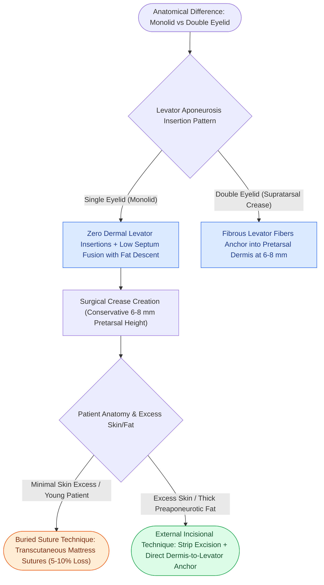

# Asian double eyelid blepharoplasty creates a supratarsal crease by anchoring skin to levator aponeurosis

## Active Recall

> [!question]- What is the anatomical reason for the absence of a supratarsal eyelid crease in a monolid Asian eye?
> *Answer / Clinical Rationale*: The **absence of fibrous insertions from the levator aponeurosis into the overlying pre-tarsal dermis**, combined with low fusion of the orbital septum allowing fat to descend over the tarsus.

> [!question]- What target crease height is typically measured from the ciliary margin in Asian blepharoplasty?
> *Answer / Clinical Rationale*: **$6.0\text{ to }8.0\text{ mm}$** (conservative height prevents an unnatural, high supratarsal fold).

## Core Clinical & Mechanistic Principles
In the **single (monolid) Asian eyelid**, the **levator aponeurosis does not send terminal fibrous interdigitations through the orbicularis oculi to insert into the dermis**, and the [[Blepharochalasis causes episodic painless eyelid edema leading to atrophic skin laxity, orbital fat pseudoherniation, and secondary ptosis|orbital]] septum fuses with the levator aponeurosis **below the superior tarsal border**, allowing preaponeurotic fat to descend low into the pre-tarsal space.

### Suture vs External Incisional Techniques
- **Non-Incisional (Buried Suture Technique)**: Uses transcutaneous mattress sutures; minimal downtime; higher long-term crease loss rate ($5\text{–}10\%$).
- **Incisional Technique**: Allows precise skin, muscle, and preaponeurotic fat excision with permanent dermis-to-levator anchoring.

## Connected Concepts & Graph Traversal
- **Upper Blepharoplasty**: [[Upper blepharoplasty requires precise skin crease marking to avoid lagophthalmos|Upper Blepharoplasty Craft]]
- **Lower Blepharoplasty**: [[Lower blepharoplasty addresses fat herniation while preserving the inferior oblique muscle|Lower Blepharoplasty]]
- **Canthal Suspension**: [[Lateral canthopexy and lateral tarsal strip suspension prevent post-blepharoplasty ectropion|Canthopexy]]
- **Anatomical Foundation**: [[Blepharochalasis causes episodic painless eyelid edema leading to atrophic skin laxity, orbital fat pseudoherniation, and secondary ptosis|Blepharochalasis Syndrome]]
- **Surgical Craft**: [[Bilateral A-T plasty and H-plasty advancements reconstruct forehead and suprabrow defects by recruiting transverse tissue laxity along relaxed skin tension lines|Forehead A-T Plasty]]
