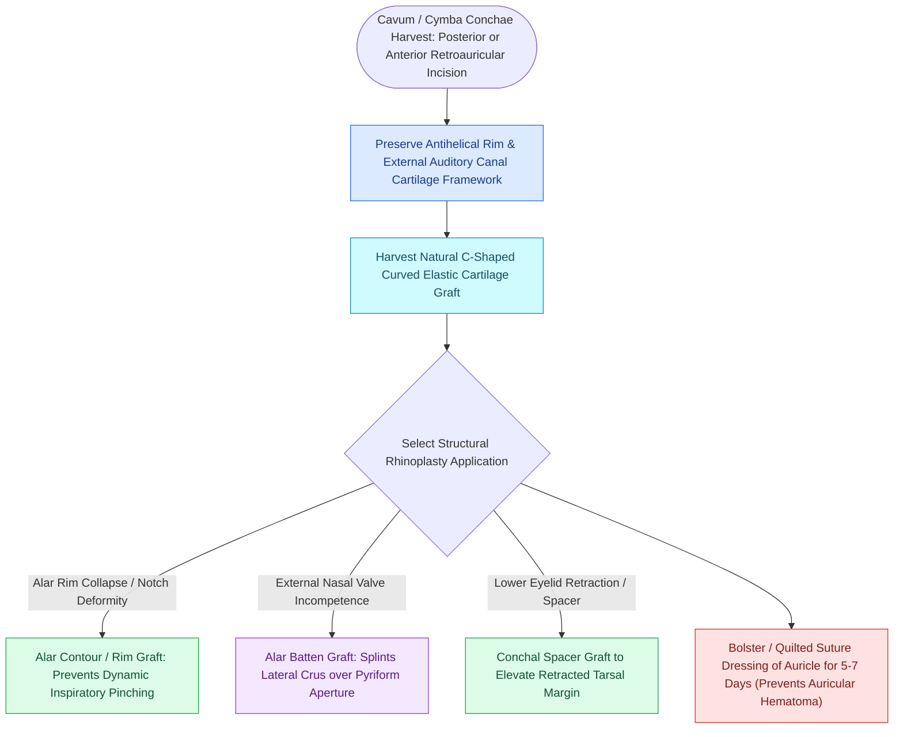

# Auricular conchal cartilage grafts provide curved structural support for the alar and nasal valves

## Active Recall

> [!question]- Why is conchal cartilage preferred over septal cartilage for alar batten grafts?
> *Answer / Clinical Rationale*: Conchal cartilage has an **intrinsic anatomical curvature** that matches the outward convexity of the alar sidewall, reinforcing the external nasal valve without intraoperative bending.

> [!question]- What structural boundary must be preserved during conchal cartilage harvest to prevent ear collapse?
> *Answer / Clinical Rationale*: The **antihelical crus and the upright posterior conchal wall**, maintaining structural framework support for the auricle.

## Core Clinical & Mechanistic Principles
**Auricular Conchal Cartilage** (harvested from the **concha cymba and concha cavum**) provides soft, flexible, naturally contoured fibrocartilage ideally suited for non-linear, curved structural nasal [[Composite chondrocutaneous auricular graft transfers reconstruct complex alar and helical defects|reconstruction]].

### Advantages Over Septal & Costal Cartilage
- Natural convex/concave curvatures match the lower lateral cartilages and alar sidewall without requiring scoring.
- Soft texture prevents sharp, visible graft edges beneath thin nasal skin.

## Connected Concepts & Graph Traversal
- **External Valve**: [[Alar batten and lateral crural strut grafts prevent external nasal valve inspiratory collapse|Alar Batten Grafts]]
- **Composite Transfer**: [[Composite chondrocutaneous auricular graft transfers reconstruct complex alar and helical defects|Composite Graft]]
- **Anatomical Foundation**: [[Cephalic trim of lower lateral cartilages must preserve at least six millimeters of lateral crus|Cephalic Trim 6-mm Rule]]
- **High-Stakes Safety**: [[Pollybeak deformities arise from cartilaginous over-projection or supratip soft tissue fibrosis|Pollybeak Deformity]]
- **Surgical Craft**: [[Spreader grafts restore internal nasal valve patency and prevent inverted-V deformity|Spreader Grafts]]
- **Alar Reconstruction Application**: [[Alar subunit reconstruction requires non-anatomical rigid cartilage grafting to counteract scar contracture and prevent alar rim notching|Non-Anatomical Alar Batten]]
- **Composite Graft Application**: [[Composite conchal cartilage grafts provide three-dimensional structural support and cutaneous coverage for auricular and facial defects|Composite Conchal Grafts]]
