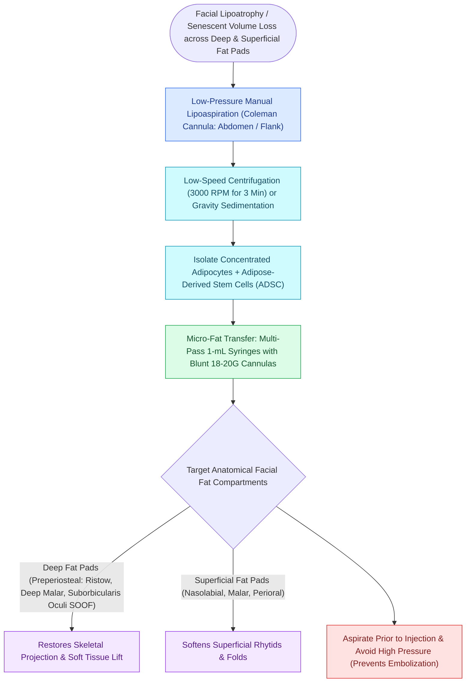

# Autologous fat grafting restores volume loss across facial aesthetic fat compartments

## Active Recall

> [!question]- Why is fat grafted in minute micro-droplets (0.05 to 0.1 mL) rather than large boluses?
> *Answer / Clinical Rationale*: To maximize surface contact area with vascularized recipient tissue; large boluses suffer central ischemia, leading to **fat necrosis, oil cysts, and calcifications**.

> [!question]- What three layers are produced following centrifugation of lipoaspirate in the Coleman protocol?
> *Answer / Clinical Rationale*: Top layer = **free oil / triglycerides** (discarded); Middle layer = **purified viable adipocytes and stem cells** (injected); Bottom layer = **blood and local anesthetic** (drained).

## Core Clinical & Mechanistic Principles
[[The superficial musculoaponeurotic system divides facial fat into distinct surgical planes|Facial]] aging is characterized not only by gravitational ptosis and skin laxity, but critically by **selective volumetric deflation and atrophy of superficial and deep facial fat compartments** (described by Rohrich and Pessa).

**Autologous Fat Grafting (Coleman technique)** restores three-dimensional facial volume using micro-droplet structural fat placement.

### Adipose-Derived Stem Cells (ADSCs)
- Purified lipoaspirate contains high concentrations of **adipose-derived stem cells (ADSCs)**, which secrete pro-angiogenic and trophic factors that actively improve overlying skin quality and elasticity.

## Connected Concepts & Graph Traversal
- **SMAS Surgery**: [[Deep-plane rhytidectomy mobilizes the skin and SMAS as a composite flap across retaining ligaments|Deep-Plane Rhytidectomy]]
- **Deep Fat Anatomy**: [[Suborbicularis oculi fat SOOF elevation restores malar projection and midface youthfulness|SOOF Elevation]]
- **Tissue Expansion**: [[Tissue expansion biomechanics generate vascularized skin for large pediatric and scalp defects|Tissue Expansion]]
- **Anatomical Foundation**: [[The superficial musculoaponeurotic system divides facial fat into distinct surgical planes|SMAS Architecture]]
- **Surgical Craft**: [[Alar rim retraction requires non-anatomical contour grafts, batten grafts, or composite chondrocutaneous grafting based on the Gorney classification|Alar Rim Retraction Repair]]
