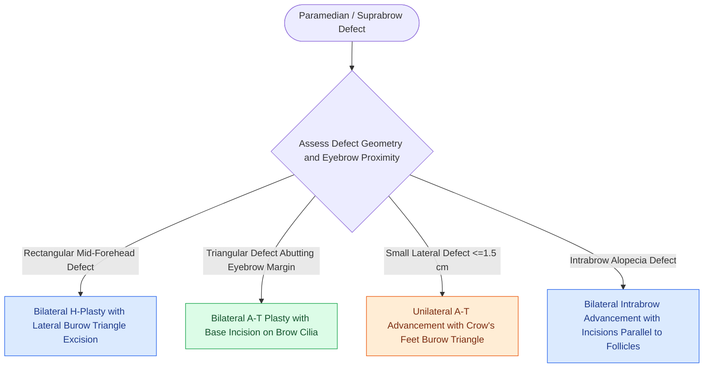

# Bilateral A-T plasty and H-plasty advancements reconstruct forehead and suprabrow defects by recruiting transverse tissue laxity along relaxed skin tension lines

## Active Recall

> [!question]- How does the incision geometry of an A-T plasty differ from a classic H-plasty in forehead reconstruction?
> *Answer / Clinical Rationale*: An **H-plasty** utilizes **two parallel horizontal incisions** extending laterally from both the superior and inferior borders of a rectangular defect (generating a dual-pedicle opposing advancement). In contrast, an **A-T plasty** utilizes a **single horizontal incision** along the baseline of a triangular or semicircular defect (positioned along the superior eyebrow border or a prominent rhytid), converting a round defect into a linear "T" scar.

> [!question]- Why is a laterally based forehead advancement flap designed longer than a medially based flap during bilateral H-plasty reconstruction?
> *Answer / Clinical Rationale*: The **lateral forehead and temple possess significantly greater tissue elasticity and compliance** than the rigid central paramedian skin. Designing the lateral flap with a longer length-to-width ratio (up to 4:1) exploits lateral laxity and recruits the majority of advancement distance, minimizing medial counter-traction on the glabella.

## Core Clinical & Mechanistic Principles
Cutaneous defects of the paramedian and lateral forehead located near the eyebrow or hairline represent prime indications for [[Advancement flaps recruit adjacent tissue laxity along a linear vector without rotation|advancement flap design]]. Because the forehead possesses rigid attachment to the underlying convex calvarium, linear advancement along horizontal relaxed skin tension lines minimizes vertical distortion of mobile free margins (the eyebrow and anterior hairline).

Advancement techniques in the forehead utilize two primary geometric configurations:
1. **H-Plasty (Bilateral Rectangular Advancement)**: Two horizontal parallel incisions are made extending medially and laterally from the superior and inferior edges of the defect. The borders of the defect are squared into a rectangle. Standing cutaneous deformities (Burow triangles) are excised on opposite sides of the flap bases. For defects located immediately superior to the eyebrow, the inferior horizontal incision is placed precisely along the superior border of the eyebrow cilia. Excising additional normal skin between the defect and the brow margin allows the entire inferior scar line to hide within the eyebrow border.
2. **A-T Plasty (Single-Incision Bilateral Advancement)**: Indicated for triangular or hemispherical defects where the base of the defect aligns with a natural aesthetic boundary (such as the eyebrow or a deep horizontal furrow). A single transverse incision is made along the base, creating two opposing advancement flaps that pivot and slide medially to appose in a vertical midline stem. The vertical closure line is limited in height, while the transverse limbs hide seamlessly along the brow or rhytid. For smaller defects ($\le 1.5\text{ cm}$), a unilateral A-T modification utilizing a single lateral incision and a lateral Burow triangle in the crow's-feet rhytids provides complete closure.

Management of redundant standing cones during advancement relies on [[Z-plasty and W-plasty reorient scar vectors and break up linear contracture lines|W-plasty]] excisions or the "rule of halves" suturing technique. By distributing unequal wound margin lengths with bisecting sutures, standing cutaneous deformities at the lateral flap base can often be sewn out entirely without lengthening incisions.

### Technical Safeguards for Follicular Preservation
- **Angulation Parallel to Hair Follicles**: When designing incisions along the superior eyebrow margin or within the frontal trichion, the scalpel blade must be angled precisely parallel to the hair shafts ($30^\circ\text{ to }45^\circ$) rather than perpendicular to the skin. Perpendicular cuts transect hair bulbs, causing permanent focal cicatricial alopecia along the scar margin.
- **Subdermal Dissection Plane**: Flaps under moderate tension should be elevated in the superficial subcutaneous plane directly over the frontalis muscle, protecting both the frontalis motor rami and hair bulb dermal papillae.

## Connected Concepts & Graph Traversal
- **RSTL Biomechanics**: [[Relaxed skin tension lines minimize scar hypertrophy along perpendicular muscular vectors|Relaxed Skin Tension Lines]]
- **Scar Camouflage**: [[Scar revision employs Z-plasty W-plasty and geometric broken line closure along relaxed skin tension lines|Scar Revision Techniques]]
- **Facial Subunit Architecture**: [[Gonzalez-Ulloa facial aesthetic subunits guide complete subunit reconstruction|Aesthetic Subunit Boundaries]]
- **Motor Nerve Protection**: [[Pitanguy's line defines the danger zone for the frontal branch of the facial nerve|Frontal Branch Danger Zones]]
- **Regional Scalp Laxity**: [[Scalp local flap design exploits loose temporoparietal tissue laxity and galeal scoring to reconstruct rigid vertex defects|Scalp Flap Biomechanics]]
