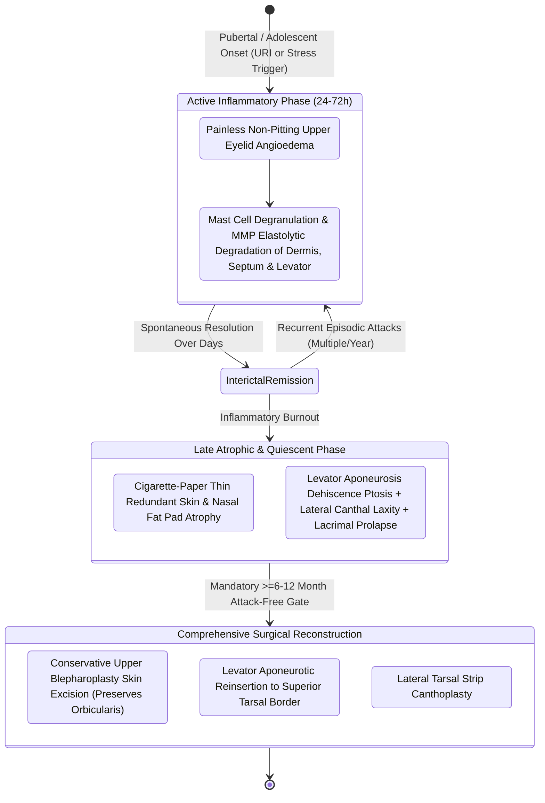

# Blepharochalasis causes episodic painless eyelid edema leading to atrophic skin laxity, orbital fat pseudoherniation, and secondary ptosis

## Active Recall

> [!question]- How does blepharochalasis fundamentally differ from routine senile dermatochalasis in age of onset and underlying pathophysiology?
> *Answer / Clinical Rationale*: **Blepharochalasis** occurs in young individuals (adolescents/young adults) and is driven by recurrent episodes of painless neurovascular angioneurotic edema causing enzymatic elastolysis and dermal atrophy. In contrast, **dermatochalasis** is a chronic senescent aging process affecting older adults caused by gradual solar elastosis and gravitational skin laxity.

> [!question]- Why must corrective blepharoplasty and ptosis repair in blepharochalasis be strictly delayed until the patient enters a quiescent phase?
> *Answer / Clinical Rationale*: Performing surgery during active, recurrent inflammatory episodes triggers acute graft/suture failure, unpredictable wound healing, and rapid recurrence of skin stretching and levator dehiscence. Surgery requires a quiescent, attack-free interval of at least **6 to 12 months**.

## Core Clinical & Mechanistic Principles
**Blepharochalasis** is a rare, poorly understood mucocutaneous disorder characterized by recurrent, episodic, painless, non-pitting angioneurotic edema of the upper (and rarely lower) eyelids. First described by Beer in 1817 and named by Fuchs in 1896, it predominantly affects young individuals with onset around puberty or early adolescence ($80\%$ of cases present before age 20), with equal sex distribution.

### Pathophysiologic Cascades & Dermal Elastolysis
1. **The Active Edema Phase**: Patients experience sudden-onset, painless, bilateral eyelid swelling lasting 24 to 72 hours, occurring multiple times per year. Biopsies during acute attacks demonstrate perivascular lymphocytic infiltrates, dermal edema, and degranulating mast cells releasing elastases and collagenases.
2. **Progressive Dermal Elastolysis**: Recurrent inflammatory episodes induce extensive destruction and loss of dermal elastic fibers within the delicate pre-tarsal and pre-septal skin.
3. **The Late Atrophic / Quiescent Phase**: Over several years, attacks diminish in frequency, leaving the eyelid tissues irreversibly damaged. The skin becomes paper-thin, atrophic, wrinkled, and hyperpigmented, classically described as resembling wrinkled **"cigarette paper."**
4. **Associated Triad (Ascher's Syndrome)**: Blepharochalasis may present in combination with double lip (hyperplasia of the labial mucosa and mucous glands of the upper lip) and non-toxic thyroid enlargement.

### Clinical Staging & Deformity Spectrum
| Clinical Feature | Anatomic Pathophysiology | Clinical Manifestation |
| :--- | :--- | :--- |
| **"Cigarette-Paper" Skin** | Profound loss of elastic fibers; epidermal and dermal thinning. | Severe atrophic skin redundancy draped over lash line. |
| **Secondary Blepharoptosis** | Attenuation and dehiscence of the levator aponeurosis. | True ptosis with high/absent lid crease ($>10\text{ mm}$ above margin). |
| **Orbital Fat Disruption** | Attenuation of orbital septum; early pseudoherniation, late fat atrophy. | Medial/central fat pouching transitioning to deep superior sulcus. |
| **Lateral Canthal Deformity** | Laxity or disinsertion of lateral canthal tendon. | Pseudo-epicanthal folds, rounded lateral canthus, phimosis. |

### Operative Technique & Timed Reconstruction
Surgery is strictly contraindicated during the active inflammatory stage. When an attack-free quiescent window of at least **6 to 12 months** is established, a multi-component surgical restoration is executed:
1. **Conservative Upper Blepharoplasty**: Skin markings are placed conservatively to account for diminished tissue recoil and avoid lagophthalmos. Redundant atrophic skin is excised, but underlying orbicularis oculi muscle is meticulously preserved to maintain vascularity and eyelid closure force, following principles of [[Upper blepharoplasty requires precise skin crease marking to avoid lagophthalmos|upper blepharoplasty]].
2. **Levator Aponeurosis Advancement / Repair**: In $>80\%$ of patients, severe ptosis is present due to true disinsertion of the levator aponeurosis from the anterior tarsal plate. The orbital septum is opened, the retracted edge of the levator aponeurosis is identified, mobilized, and advanced, securing it to the mid-anterior tarsus with buried 5-0 clear nylon or Mersilene sutures to re-establish a normal margin-reflex distance-1 ($MRD_1 \approx 4\text{ to }4.5\text{ mm}$).
3. **Lateral Canthal Stabilization**: Laxity or lateral canthal rounding is corrected with a [[Lateral canthopexy and lateral tarsal strip suspension prevent post-blepharoplasty ectropion|lateral tarsal strip canthoplasty]], suspending the tarsus to Whitnall's tubercle on the inner lateral orbital rim.
4. **Managing Lower Lid & Fat Compartments**: Lower eyelid laxity is addressed via [[Lower blepharoplasty addresses fat herniation while preserving the inferior oblique muscle|lower blepharoplasty]] with lateral canthal resuspension, while intraoperative fat grafting or transposition corrects late-stage sunken superior sulcus deformity.

## Critical Failure Modes & Error Traps
- **Confusing Blepharochalasis with Dermatochalasis**: Performing an isolated skin excision without levator aponeurosis repair leaves the patient with persistent severe ptosis and an elevated, scarred eyelid crease.
- **Operating During Active Flares**: Suture disruption, acute recurrence of dermal stretching, and wound dehiscence occur if surgery is undertaken before the inflammatory cycle burns out.

## Connected Concepts & Graph Traversal
- **Retrobulbar Bleeding Emergency**: [[Post-blepharoplasty retrobulbar hematoma requires immediate bedside decompression to prevent blindness|Retrobulbar Hematoma]]
- **Lid Crease Vector Mechanics**: [[Relaxed skin tension lines minimize scar hypertrophy along perpendicular muscular vectors|Relaxed Skin Tension Vectors]]
- **Aponeurosis Crease Creation**: [[Asian double eyelid blepharoplasty creates a supratarsal crease by anchoring skin to levator aponeurosis|Levator Aponeurosis Anchoring]]
- **Suborbital Facial Subunit**: [[Cheek reconstruction partitions defects into suborbital, preauricular, and buccomandibular aesthetic zones to direct tissue recruitment along relaxed skin tension lines|Suborbital Aesthetic Subunits]]
- **Midface Projection Dynamics**: [[Suborbicularis oculi fat SOOF elevation restores malar projection and midface youthfulness|SOOF Elevation Dynamics]]
- **Periorbital Suture Selection**: [[Monofilament versus braided absorbable and non-absorbable sutures have distinct tissue reactivity|Eyelid Suture Selection]]
