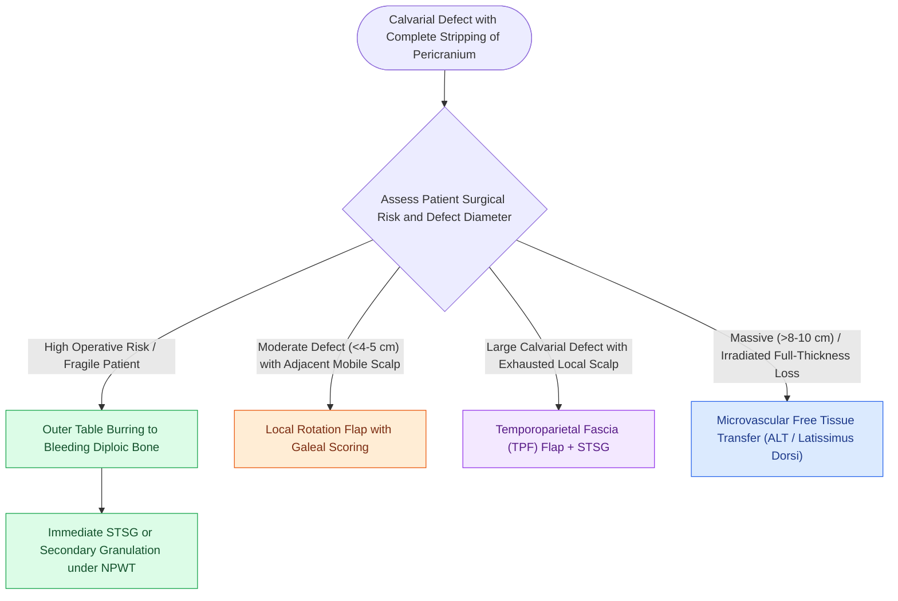

# Calvarial bone denuded of periosteum requires outer table burring to diploic bone or vascularized flap coverage to prevent osteonecrosis

## Active Recall

> [!question]- Why does split-thickness skin grafting fail when applied directly to dry, intact denuded calvarial cortex?
> *Answer / Clinical Rationale*: Intact outer cortical bone is **dense, compact, and virtually avascular** without overlying periosteum; skin grafts require capillary ingrowth and plasmatic imbibition from a vascularized wound bed.

> [!question]- How does outer table calvarial burring or trephination convert an avascular bony wound into a viable graft bed?
> *Answer / Clinical Rationale*: It removes the dense cortical outer table to expose the **underlying bleeding, highly vascular diploic space (cancellous bone)**, which either directly supports a split-thickness skin graft or forms a robust granulation tissue layer.

## Core Clinical & Mechanistic Principles
Surgical or traumatic scalp defects that strip the pericranium leave bare calvarial bone exposed to atmospheric desiccation. Because cortical bone derives its superficial perfusion from the pericranium, denuded outer cortical plate rapidly undergoes avascular necrosis if left uncovered without [[Advancement flaps recruit adjacent tissue laxity along a linear vector without rotation|local flap advancement]] or periosteal resurfacing.

Reconstructive strategies depend on patient medical status, defect diameter, and prior radiation therapy:
- **Outer Table Burring / Trephination**: In elderly, medically compromised patients or those unable to undergo extensive flap surgery, high-speed burring or outer-table osteotomy is performed down to bleeding cancellous bone (diploë). Small multiple trephinations or complete unroofing of the outer table exposes diploid vessels:
  - *Option A (Direct Skin Grafting)*: Immediate application of a split-thickness skin graft (STSG) onto actively oozing diploë.
  - *Option B (Granulation Induction)*: Packing the wound or utilizing negative pressure wound therapy (NPWT) for 3 to 4 weeks until a dense bed of vascularized granulation covers the bone, followed by STSG.
- **Local Vascularized Scalp Flaps**: When adjacent hair-bearing tissue is mobile, rotating an axial scalp flap provides durable, full-thickness vascularized coverage over bare bone while shifting the donor defect to a periosteum-intact periphery that can accept a skin graft.
- **Temporoparietal Fascial (TPF) Flap**: A regional fascial flap pedicled on the superficial temporal artery, elevated and transposed directly over exposed calvarium to supply a rich vascular sheet that immediately accepts a split-thickness skin graft.

### Complications and Caveats
1. **Osteomyelitis and Sequestration**: Failure to revascularize denuded bone leads to osteonecrosis, chronic purulent drainage, and ring sequestra that mandate re-excision.
2. **Post-Radiation Calvarium**: Irradiated calvarium has fibrotic, sclerotic diploic spaces with diminished angiogenic potential; burring alone frequently fails, mandating vascularized flap coverage (TPF, regional muscle, or free flap).

## Connected Concepts & Graph Traversal
- **Galeal Scoring & Flap Principles**: [[Scalp reconstruction requires galeal score incisions and large rotational pinwheel flaps|Scalp Reconstruction]]
- **Laceration & Tension Release**: [[Scalp laceration repair requires layered subgaleal and galeal closure with galeatomy to achieve tension-free closure|Scalp Laceration Repair]]
- **Free Flap Coverage**: [[The anterolateral thigh free flap provides versatile soft tissue volume based on the LCFA|ALT Scalp Reconstruction]]
- **Tissue Expansion**: [[Tissue expansion biomechanics generate vascularized skin for large pediatric and scalp defects|Tissue Expansion in Scalp]]
- **Skin Tension Vectors**: [[Relaxed skin tension lines minimize scar hypertrophy along perpendicular muscular vectors|Skin Tension Lines]]
