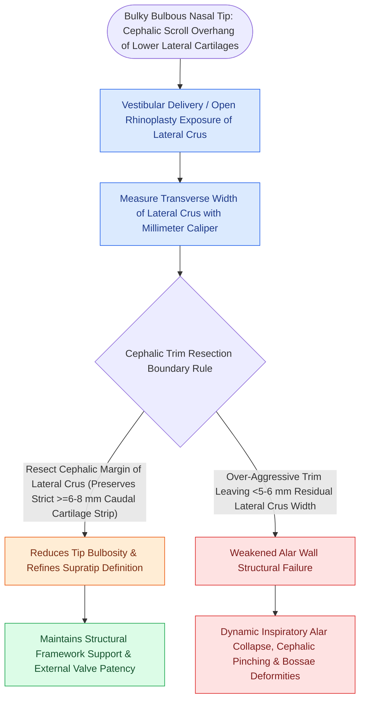

# Cephalic trim of lower lateral cartilages must preserve at least six millimeters of lateral crus

## Active Recall

> [!question]- What is the minimum width of lateral crus that must be preserved during a cephalic trim?
> *Answer / Clinical Rationale*: At least **$6.0\text{ mm}$** (and $7.0\text{–}8.0\text{ mm}$ in thick-skinned or weak-cartilage patients) to maintain external nasal valve structural support.

> [!question]- What functional and aesthetic complications occur when the lateral crus is over-resected?
> *Answer / Clinical Rationale*: **Dynamic external nasal valve collapse** on inspiration, **alar rim retraction/notching**, and a **pinched tip deformity** with visible cartilaginous bossae.

## Core Clinical & Mechanistic Principles
**Cephalic trim** involves excising the superior (cephalic) margin of the lower lateral cartilage (LLC) lateral crus to reduce bulbous tip volume and promote cephalic [[Goode's ratio and nasolabial angles define standard aesthetic nasal tip proportions|tip rotation]].

The non-negotiable surgical mandate is to **preserve a continuous, structurally sound lateral crural strip of at least $6.0\text{ mm}$ ($7.0\text{–}8.0\text{ mm}$ in thick skin)**.

### Modern Shift: Preservation & Restructuring
- Aggressive cephalic trimming has been largely replaced in modern rhinoplasty by **lateral crural repositioning, [[Lateral crural steal and overlay maneuvers dynamically modify tip rotation and projection|lateral crural steal]], and lateral crural strut grafting**, preserving cartilaginous integrity.

## Connected Concepts & Graph Traversal
- **External Valve**: [[Alar batten and lateral crural strut grafts prevent external nasal valve inspiratory collapse|Alar Batten & Strut Grafts]]
- **Tripod Theory**: [[The Anderson tripod theory governs nasal tip projection, rotation, and support dynamics|Anderson Tripod Dynamics]]
- **Tip Repositioning**: [[Lateral crural steal and overlay maneuvers dynamically modify tip rotation and projection|Lateral Crural Steal]]
- **High-Stakes Safety**: [[Pollybeak deformities arise from cartilaginous over-projection or supratip soft tissue fibrosis|Pollybeak Deformity]]
- **Surgical Craft**: [[Spreader grafts restore internal nasal valve patency and prevent inverted-V deformity|Spreader Grafts]]
