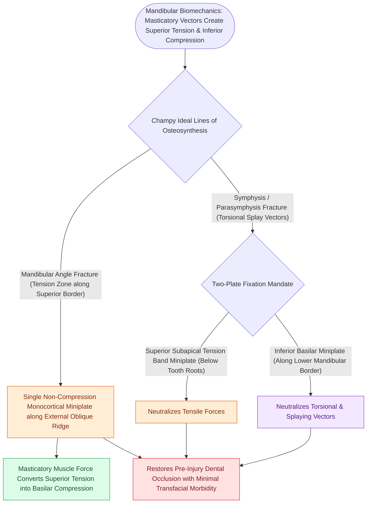

# Champy lines of ideal osteosynthesis dictate monocortical miniplate fixation along mandibular tension zones

## Active Recall

> [!question]- Where is a single miniplate placed according to Champy's principles to fix a non-comminuted fracture of the mandibular angle, and why does a single plate suffice?
> *Answer / Clinical Rationale*: Along the **superior border on the external oblique ridge** (the line of maximum tensile stress). Neutralizing tensile distracting forces along the superior border allows the patient's own physiologic masticatory bite forces to compress the inferior basilar border, stabilizing the fracture without an inferior plate.

> [!question]- Why are two miniplates required for fractures of the mandibular symphysis and parasymphysis?
> *Answer / Clinical Rationale*: To neutralize the powerful **rotational and torsional twisting forces** generated by the mylohyoid, digastric, and lateral pterygoid muscles acting on the anterior mandible (requiring a subapical tension band plate $>5\text{ mm}$ below tooth roots and an inferior basilar plate spaced $4\text{–}5\text{ mm}$ apart).

## Core Clinical & Mechanistic Principles
**Champy's Principles of Ideal Osteosynthesis (Maxime Champy, 1976)** define the biomechanical lines of tension and compression in the [[Mandible fractures require anatomical reduction and load-sharing miniplate fixation along Champy lines of ideal osteosynthesis|mandible]], allowing stable fracture fixation with small, non-compression **monocortical miniplates**:
- **Mandibular Biomechanics (Tension vs. Compression Zones)**:
  - During mastication, the mandible acts as a cantilever beam subjected to muscular loading forces:
    - **Superior Border (Alveolar Border)**: Subjected to **tensile (distractive) forces** pulling the fracture apart.
    - **Inferior Border (Basal Border)**: Subjected to **compressive forces** pushing the bony edges together.
- **Champy's Lines of Fixation**:
  1. **Body and Angle Fractures**:
     - Fixation must be placed along the **ideal line of osteosynthesis at the superior border** to neutralize tensile forces.
     - At the **mandibular angle**: A single $2.0\text{-mm}$ monocortical miniplate is placed along the **superior border on the broad superior/lateral surface of the external oblique ridge** (using transoral or transbuccal screws).
  2. **Symphyseal and Parasymphyseal Fractures (Torsional Force Zone)**:
     - Subjected to complex rotational and torsional twisting forces.
     - Requires **two miniplates**:
       - *Superior plate*: Subapical tension band plate placed below the incisor tooth roots ($5\text{ mm}$ below alveolar crest).
       - *Inferior plate*: Basal plate placed near the lower border of the mandible, spaced at least **$4\text{ to }5\text{ mm}$ apart** to prevent torsional rotation.

### Surgical Technique & Critical Safety Checks
- **Tooth Root & Nerve Preservation**: Monocortical screws ($6\text{ mm}$ length) prevent damage to the dental roots above and the **inferior alveolar neurovascular bundle** traversing the mandibular canal.

## Connected Concepts & Graph Traversal
- **AO Principles**: [[Mandible fractures require anatomical reduction and load-sharing miniplate fixation along Champy lines of ideal osteosynthesis|AO Fixation Principles]]
- **Condylar Trauma**: [[Mandibular condyle fractures managed via open versus closed reduction depend on displacement and occlusion|Condylar Fractures]]
- **Surgical Occlusion**: [[Maxillomandibular fixation MMF using arch bars, hybrid systems, and IMF screws re-establishes occlusion|Maxillomandibular Fixation (MMF)]]
- **Vascular Donor Reconstruction**: [[The fibula free flap provides vascularized cortical bone for composite mandibular reconstruction|Fibula Free Flap Reconstruction]]
- **Anatomical Foundation**: [[Cheek reconstruction partitions defects into suborbital, preauricular, and buccomandibular aesthetic zones to direct tissue recruitment along relaxed skin tension lines|Cheek Aesthetic Zones]]
