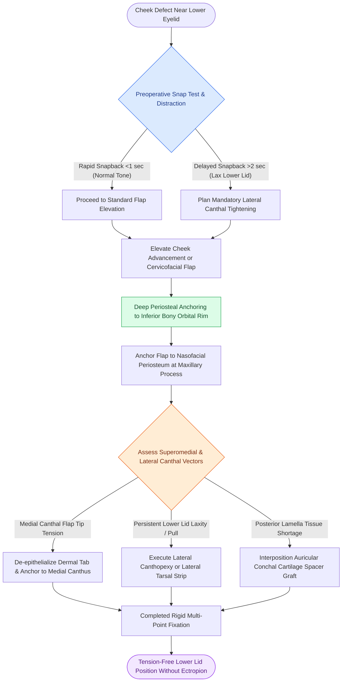

# Cheek flap reconstruction requires deep periosteal suspension to the orbital rim and lateral retinaculum to prevent lower eyelid retraction and ectropion

## Active Recall

> [!question]- What physical examination maneuver must be performed preoperatively on every patient scheduled for cheek flap elevation near the lower eyelid?
> *Answer / Clinical Rationale*: The **snap test (and distraction test)** to evaluate lower eyelid horizontal laxity and orbicularis oculi muscle tone. A slow snap-back ($>2\text{ seconds}$) or $>6\text{ mm}$ distraction indicates severe lid laxity requiring concurrent **lateral canthopexy or lateral tarsal strip suspension** to prevent cicatricial or mechanical ectropion.

> [!question]- What deep anchoring technique prevents downward gravitational pull and tissue drag at the superomedial edge of an advancement cheek flap?
> *Answer / Clinical Rationale*: **Flap tip de-epithelialization**: the superomedial dermal tongue/peninsula is de-epithelialized and anchored directly to the **periosteum of the medial canthal tendon and anterior lacrimal crest** with permanent or long-lasting absorbable sutures, creating a stable platform.

> [!question]- Why are sutures anchored to the periosteum of the inferior and lateral bony orbital rim rather than relying on subcutaneous dermal closure?
> *Answer / Clinical Rationale*: The heavy soft tissue weight and contractile vector of a cheek flap exert downward and lateral traction directly against the compliant tarsoligamentous lower lid sling. **Rigid periosteal fixation** transfers closing tension to immobile bone, completely isolating the lower eyelid from flap vector forces.

## Core Clinical & Mechanistic Principles

Cheek reconstruction in the suborbital, infraorbital, and medial cheek aesthetic zones directly borders the highly delicate, mobile tarsoligamentous sling of the lower eyelid. Unlike rigid structures of the face, the lower eyelid possesses negligible intrinsic structural resistance against caudal traction. Secondary tissue movement, gravitational descent of large cutaneous flaps, and wound bed myofibroblast contraction inevitably pull the lower lid margin downward, causing scleral show, lagophthalmos, epiphora, and potentially severe [[Upper eyelid platinum weights and lateral tarsal strips protect the cornea in flaccid facial paralysis|corneal exposure keratopathy]].

### Mandatory Deep Fixation Anchoring
To neutralize downward contractile and gravitational vectors, tension must be transferred away from the cutaneous margins and anchored to the underlying facial skeleton:
1. **Inferior Bony Orbital Rim Periosteal Tacking**:
   - The deep undersurface of the advancing cheek flap (deep dermis and investing fibroadipose fascia) is anchored to the periosteum of the inferior orbital rim using 4-0 long-lasting absorbable sutures (such as polydioxanone).
   - This creates an immobile shelf that bears the total weight of the flap and halts downward scar transmission.
2. **Nasofacial Sulcus Anchorage**:
   - For flaps advancing from lateral to medial, deep tacking sutures secure the flap to the periosteum overlying the frontal process of the maxilla.
   - This reconstructs the deep concavity of the nasofacial sulcus and prevents webbed blunting or lateral displacement of the nasal sidewall and alar base.
3. **Flap Tip De-epithelialization for Medial Canthal Support**:
   - The superomedial extremity of the flap can be deepithelialized to create a deep dermal tongue.
   - This dermal extension is anchored directly to the periosteum of the medial canthal tendon insertion or the anterior lacrimal crest, providing rigid medial suspensory support.

### Preoperative Assessment & Canthal Tightening Adjuncts
- **Snap Test & Eyelid Distraction**: Preoperative evaluation of orbicularis tone is mandatory. Patients with preexisting lid laxity cannot resist even minimal flap contracture, which exceeds the threshold seen in [[Full-thickness and split-thickness skin grafts differ in primary contraction and vascular take|primary and secondary contraction]].
- **Concurrent Lateral Canthopexy / Canthoplasty**: In older patients or patients with compromised snap testing, a formal lateral canthopexy or lateral tarsal strip suspension must be incorporated at the time of cheek flap transfer. Suspending the lateral retinaculum slightly overcorrected to the inner aspect of Whitnall's tubercle ensures long-term lid margin apposition against the globe.
- **Cartilage Grafting for Posterior Lamella Support**: When tumor resection or scar contracture removes vertical eyelid height, autologous auricular cartilage grafts harvested from the cymba or cavum conchae are grafted to bridge posterior lamellar deficiencies, preventing late cicatricial retraction.

## Connected Concepts & Graph Traversal
- **Ectropion Prevention Mechanics**: [[Lateral canthopexy and lateral tarsal strip suspension prevent post-blepharoplasty ectropion|Canthopexy & Tarsal Strip Suspension]]
- **Curvilinear Vector Redistribution**: [[Rotation flaps redistribute closing tension along a curvilinear arc of rotation|Rotation Flap Vectors]]
- **Eyelid Incision Landmarks**: [[Upper blepharoplasty requires precise skin crease marking to avoid lagophthalmos|Upper Blepharoplasty Crease Precision]]
- **Total Lower Eyelid Reconstruction**: [[Mustarde cheek rotation flaps advance malar skin for total lower eyelid anterior lamella reconstruction|Mustarde Cheek Rotation Flap]]
- **Linear Vector Advancements**: [[Advancement flaps recruit adjacent tissue laxity along a linear vector without rotation|Advancement Flap Kinematics]]
- **Surgical Plane Stratification**: [[The superficial musculoaponeurotic system divides facial fat into distinct surgical planes|SMAS Anatomy & Facial Fat]]
