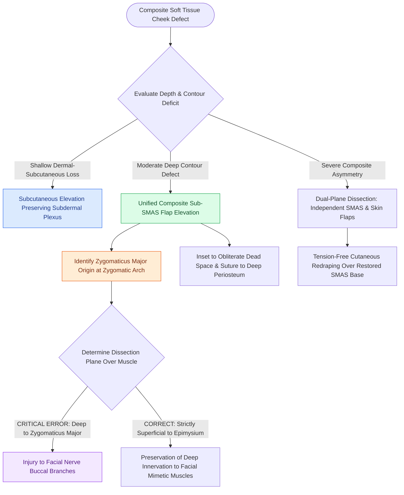

# Cheek reconstruction employs deep SMAS plane elevation superficial to the zygomaticus major to restore volume contour defects while preserving the facial nerve

## Active Recall

> [!question]- When elevating an independent SMAS flap or sub-SMAS composite flap in the cheek, why must the dissection remain strictly superficial to the zygomaticus major muscle?
> *Answer / Clinical Rationale*: Motor branches of the **facial nerve (buccal branches)** course in the deep sub-SMAS plane and **enter the deep, undersurface of the zygomaticus major**. Dissecting superficial to the zygomaticus major ensures the motor nerve branches remain protected beneath the muscular barrier.

> [!question]- What is the surgical landmark used to safely initiate the transition into the sub-SMAS plane over the midface?
> *Answer / Clinical Rationale*: Identify the **origin of the zygomaticus major muscle at the zygoma superiorly**, where it is superficial and readily identified. The surgeon then follows the muscle inferiorly, staying precisely on its superficial epimysial surface.

> [!question]- How does the surgeon manage extensive composite contour defects involving cutaneous and soft tissue loss without microvascular free transfer?
> *Answer / Clinical Rationale*: By either **dual-plane dissection** (an independent SMAS transposition flap used to fill the deep dead space beneath a cutaneous flap) or by harvesting a **pedicled supraclavicular artery island flap (SCAIF)** based on the transverse cervical vessels, de-epithelializing the proximal pedicle to tunnel bulk into the cheek.

## Core Clinical & Mechanistic Principles

Ablative oncologic resections of invasive cutaneous malignancies or parotid tumors often create composite cheek defects with simultaneous cutaneous and deep soft tissue volume deficits. Attempting to repair deep crater defects with superficial cutaneous flaps alone yields noticeable hollows, contour depressions, and adherence to underlying bone. Restoring natural facial convexity requires mobilizing vascularized fibroadipose volume through deep surgical planes.

### Sub-SMAS vs Dual-Plane Dissection
The surgeon can address volume deficits through two distinct anatomic approaches:
1. **Single-Plane Composite Sub-SMAS Flap**:
   - The cutaneous flap, subcutaneous adipose tissue, and superficial musculoaponeurotic system are elevated as a unified, full-thickness composite paddle.
   - This provides robust axial perfusion to the overlying skin and restores moderate subcutaneous thickness in a single layer.
2. **Dual-Plane Independent SMAS Dissection**:
   - In deep excavations, elevating the skin and SMAS as separate layers provides maximum flexibility.
   - The independent SMAS flap is mobilized, advanced, folded, or transposed to obliterate the deep cavitary dead space and re-establish the malar and submalar convexity, functioning in a reconstructive analog to [[MACS lift and SMAS plication provide vertical vector elevation via suspension purse-string sutures|SMAS plication and suspension]].
   - The overlying cutaneous flap is then redraped tension-free, uncoupled from the deep structural suspension.

### Anatomic Danger: The Zygomaticus Major Muscle & Facial Nerve
- **The Path-of-Least-Resistance Trap**: The SMAS envelops the zygomaticus major muscle. Lateral to the muscle, the sub-SMAS plane is loose and easily developed over the parotid-masseteric fascia. As dissection proceeds medially, there is a natural anatomic tendency to continue beneath the zygomaticus major muscle. This cleavage plane is hazardous because [[The masseteric nerve provides a dense motor donor for single-stage facial reanimation|buccal motor branches]] of the facial nerve course deep to the muscle to innervate its deep aspect.
- **Surgical Transition Technique**: The surgeon must locate the zygomaticus major at its superior bony origin on the zygoma and intentionally transition to a plane *superficial* to the muscle. Developing the plane directly along the anterior epimysium keeps the mimetic muscle as a structural shield protecting the underlying facial nerve plexus.
- **Supraclavicular Artery Island Flap (SCAIF) Alternative**: For massive composite defects involving the cheek, parotid, and upper neck that exceed local SMAS volume, the pedicled SCAIF based on the transverse cervical artery provides up to $24 \times 8\text{ cm}$ of pliable, thin fasciocutaneous tissue. The proximal pedicle is de-epithelialized and tunneled subcutaneously beneath intact cervical skin to deliver autologous tissue without microvascular anastomoses.

## Connected Concepts & Graph Traversal
- **SMAS Structural Stratification**: [[The superficial musculoaponeurotic system divides facial fat into distinct surgical planes|SMAS Anatomy & Facial Fat]]
- **Composite Plane Dissection**: [[Deep-plane rhytidectomy mobilizes the skin and SMAS as a composite flap across retaining ligaments|Deep-Plane Rhytidectomy]]
- **Frontal Branch Landmark Danger**: [[Pitanguy's line defines the danger zone for the frontal branch of the facial nerve|Pitanguy's Danger Line]]
- **Retaining Ligament Architecture**: [[Facial retaining ligaments require surgical release to mobilize ptotic midface tissues|Facial Retaining Ligaments]]
- **Midface Vascular Supply**: [[The facial artery and facial vein provide the primary vascular supply to the anterior face|Facial Artery Anatomy]]
- **Alternative Soft Tissue Bulk**: [[The anterolateral thigh free flap provides versatile soft tissue volume based on the LCFA|Anterolateral Thigh Free Flap]]
