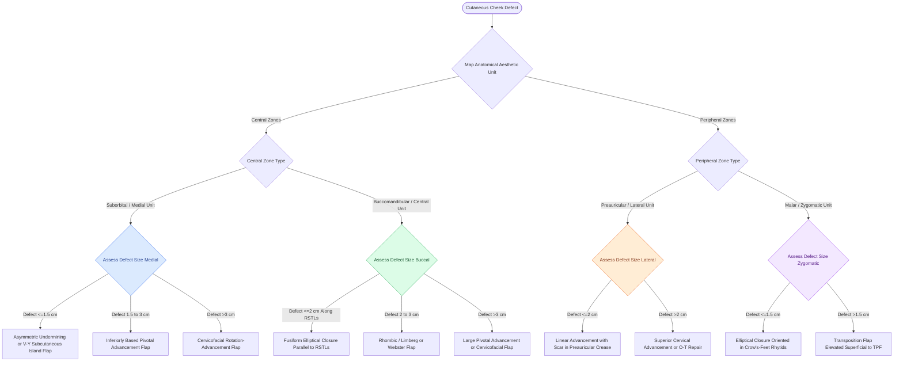

# Cheek reconstruction partitions defects into suborbital, preauricular, and buccomandibular aesthetic zones to direct tissue recruitment along relaxed skin tension lines

## Active Recall

> [!question]- Why is asymmetric or differential skin undermining utilized when closing medial cheek defects near the nasofacial sulcus or melolabial fold?
> *Answer / Clinical Rationale*: Differential undermining releases tissue predominantly on the **lateral and inferior wound margins** (the mobile cheek reservoir) while limiting undermining on the medial margin. This shifts the final closure line directly into the **nasofacial sulcus or melolabial crease**, achieving optimal scar camouflage while preventing secondary distortion of the nasal ala or upper lip.

> [!question]- What anatomic constraint limits the cephalic advancement of V-Y subcutaneous tissue pedicle island flaps in the medial cheek?
> *Answer / Clinical Rationale*: Medial cheek island flaps cannot be reliably advanced **superior to the level of the inferior bony orbital rim**. Attempting further cephalic mobilization creates upward traction that tethers the lower eyelid, risking ectropion and lower eyelid retraction.

> [!question]- Why is tissue recruitment from the zygomatic unit limited compared to the adjacent buccomandibular and cervical reservoirs?
> *Answer / Clinical Rationale*: The zygomatic unit has the **least skin laxity** of the cheek because the skin is densely anchored to the zygomatic arch by osteocutaneous retaining ligaments (**McGregor's patch**), and extensive undermining risks injuring the superficial **temporal branch of the facial nerve**.

## Core Clinical & Mechanistic Principles

The cheek is the largest aesthetic region of the face, presenting an extensive, slightly convex surface topography bordered by the inferior bony orbital rim, nasofacial sulcus, melolabial crease, labiomandibular crease, inferior border of the mandible, preauricular crease, and a line connecting the lateral canthus to the root of the helix. Cutaneous flap design depends on partitioning the cheek into four functional aesthetic units based on skin thickness, tissue mobility, and underlying retaining ligaments:

1. **Suborbital / Medial Aesthetic Unit**:
   - *Anatomic Profile*: Composed of thick, sebaceous skin with abundant subcutaneous adipose tissue, bordered medially by the nasofacial sulcus and inferiorly by the melolabial fold.
   - *Vascular Supply*: Highly robust perfusion derived from the angular branch of the [[The facial artery and facial vein provide the primary vascular supply to the anterior face|facial and transverse facial arteries]], supporting both random and subcutaneous island flaps.
   - *Reconstructive Strategies*: Small defects ($\le 1.5\text{ cm}$) are reconstructed with primary linear closure using differential undermining to position scars in natural sulci. When an elliptical excision threatens to cross the alar-facial junction, bilateral [[Z-plasty and W-plasty reorient scar vectors and break up linear contracture lines|M-plasty]] excisions shorten the overall length of the scar. Defects adjacent to the alae are uniquely suited for V-Y subcutaneous island advancement flaps, which harness the sliding mobility of medial cheek fat. Medium-to-large defects require inferiorly based pivotal advancement or cervicofacial rotation-advancement flaps.

2. **Buccomandibular / Central Buccal Aesthetic Unit**:
   - *Anatomic Profile*: Overlies the buccinator muscle and buccal fat pad, presenting pliable, moderately mobile skin.
   - *Reconstructive Challenge*: Centrally located scars cannot be placed along peripheral aesthetic boundaries. Excisions must be aligned strictly parallel to relaxed skin tension lines (RSTLs), running obliquely from the malar prominence toward the oral commissure and jawline.
   - *Flap Selection*: Elliptical excision parallel to RSTLs remains primary for defects $\le 2\text{ cm}$. Transposition flaps (Limberg, Dufourmentel, Webster M-plasty modification) or non-curvilinear pivotal advancement flaps recruit lax tissue from the lateral cheek or lower mandibular border.

3. **Preauricular / Lateral Aesthetic Unit**:
   - *Anatomic Profile*: Skin is moderately thin and adherent to the underlying parotid-masseteric fascia. The posterior boundary (the auricle) is fixed and provides no tissue redundancy.
   - *Tissue Recruitment*: The superior cervical skin provides an abundant tissue reservoir. Defects are repaired by advancing cervical skin superiorly into the preauricular crease, by bilateral O-T advancement flaps, or via wide cervicofacial rotation flaps extending into lateral cervical skin creases.

4. **Zygomatic / Malar Unit**:
   - *Anatomic Profile*: Displays the least tissue laxity of the cheek due to firm osseous tethering by McGregor's zygomatic retaining ligament.
   - *Nerve Danger*: The temporal (frontal) branches of the facial nerve course across the zygomatic arch within a landmark triangle (apex at the earlobe, base between the lateral brow and temporal hairline). Flap dissection must remain superficial to the temporoparietal fascia within the subcutaneous fat layer.

### Surgical Nuances & Undermining Limits
- **Undermining Threshold**: Subcutaneous undermining up to $4\text{ cm}$ radially from the wound perimeter yields significant reductions in wound closure tension. Undermining beyond $4\text{ cm}$ confers minimal additional biomechanical advantage while increasing seroma and hematoma risks.
- **Wound Edge Perpendicularity**: Mohs micrographic excisions typically leave beveled margins ($45^\circ$). To prevent inverted, depressed scars, beveled margins must be freshened with perpendicular scalpel trimming prior to layered closure.

## Connected Concepts & Graph Traversal
- **Aesthetic Subunit Architecture**: [[Gonzalez-Ulloa facial aesthetic subunits guide complete subunit reconstruction|Facial Aesthetic Subunits]]
- **Linear Vector Dynamics**: [[Advancement flaps recruit adjacent tissue laxity along a linear vector without rotation|Advancement Flaps]]
- **Scar Tension Optimization**: [[Relaxed skin tension lines minimize scar hypertrophy along perpendicular muscular vectors|Relaxed Skin Tension Lines]]
- **Rhomboid Transposition**: [[Rhombic and Limberg flaps transpose tissue into sixty-degree and one-hundred-twenty-degree defects|Rhombic & Limberg Flaps]]
- **Fusiform Geometry**: [[Fusiform ellipse geometry requires a three-to-one ratio to prevent standing cutaneous cones|Fusiform Ellipse Geometry]]
- **Facial Retaining Architecture**: [[Facial retaining ligaments require surgical release to mobilize ptotic midface tissues|Facial Retaining Ligaments]]
