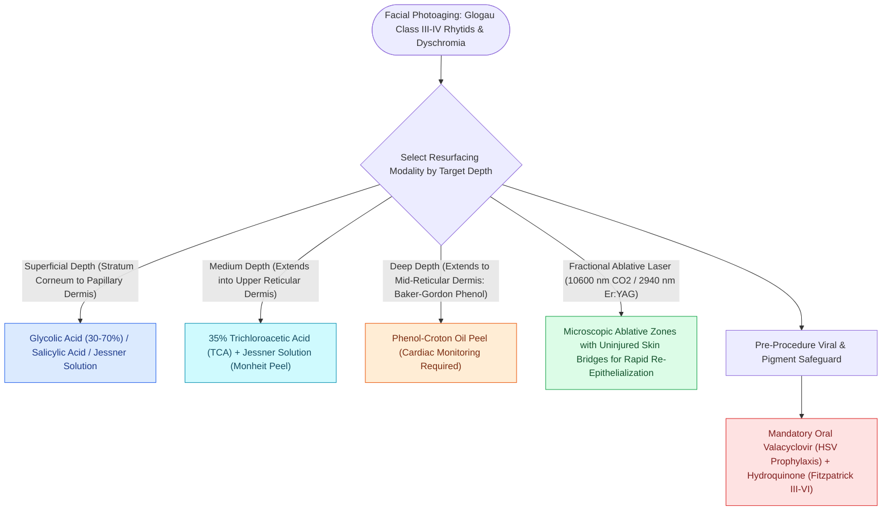

# Chemical peels and fractional CO2 laser resurfacing treat photoaging and perioral rhytids

## Active Recall

> [!question]- What active ingredient in the Baker-Gordon phenol peel formulation drives deep dermal penetration?
> *Answer / Clinical Rationale*: **Croton oil** (acts as a powerful epidermolytic surfactant that facilitates deep penetration of phenol into the reticular dermis).

> [!question]- What systemic complication requires continuous cardiac monitoring during a full-face phenol peel?
> *Answer / Clinical Rationale*: **Phenol-induced cardiac arrhythmias (ventricular ectopy and tachycardia)**; full-face peels must be applied slowly over $60\text{–}90\text{ minutes}$ with vigorous intravenous hydration.

## Core Clinical & Mechanistic Principles
Skin resurfacing modalities—principally **chemical peels (Glycolic, TCA, Baker-Gordon Phenol)** and **ablative lasers (Fractional & Fully Ablative $\text{CO}_2$ $10,600\text{ nm}$ and Er:YAG $2,940\text{ nm}$)**—induce controlled thermal or chemical coagulative necrosis of the epidermis and upper dermis, stimulating **[[Wound healing progresses through hemostasis, inflammation, proliferation, and maturation|collagen neogenesis and remodeling]]** as an adjunct to [[Deep-plane rhytidectomy mobilizes the skin and SMAS as a composite flap across retaining ligaments|deep-plane rhytidectomy]] and [[Cosmetic botulinum toxin treats dynamic rhytids through presynaptic acetylcholine blockade|cosmetic botulinum toxin]].

### Fractional Laser Resurfacing
- **Microscopic Treatment Zones (MTZs)**: Fractional $\text{CO}_2$ ($10,600\text{ nm}$) creates micro-columns of thermal injury surrounded by intact islands of reservoir skin, accelerating re-epithelialization ($4\text{–}7\text{ days}$) while reducing hypopigmentation risks.

## Connected Concepts & Graph Traversal
- **Wound Healing**: [[Wound healing progresses through hemostasis, inflammation, proliferation, and maturation|Wound Healing Phases]]
- **Rhytidectomy Adjunct**: [[Deep-plane rhytidectomy mobilizes the skin and SMAS as a composite flap across retaining ligaments|Deep-Plane Rhytidectomy]]
- **Volume Contrast**: [[Autologous fat grafting restores volume loss across facial aesthetic fat compartments|Fat Grafting]]
- **Neuromodulator Synergy**: [[Cosmetic botulinum toxin treats dynamic rhytids through presynaptic acetylcholine blockade|Cosmetic Botulinum Toxin]]
- **Anatomical Foundation**: [[Panfacial fracture reconstruction proceeds from known stable peripheral buttresses to central occlusion|Panfacial Fracture Sequencing]]
