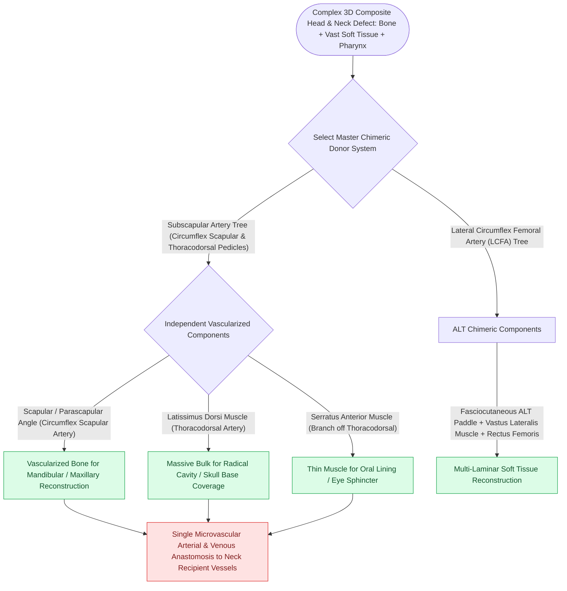

# Chimeric free flaps combine independent bone, muscle, and skin paddles on a common vascular branch

## Active Recall

> [!question]- What is the fundamental mechanical advantage of a chimeric flap over a standard composite flap?
> *Answer / Clinical Rationale*: Individual tissue paddles (bone, muscle, skin) can be **independently rotated and 3D-positioned** to fill separate intraoral and extraoral defects without tethering, while requiring only a single microvascular anastomosis.

> [!question]- What vascular system is the premier donor for chimeric free flap harvest in head and neck reconstruction?
> *Answer / Clinical Rationale*: The **subscapular arterial system**, which branches into the circumflex scapular artery (scapular bone/skin) and thoracodorsal artery (latissimus dorsi/serratus).

## Core Clinical & Mechanistic Principles
A **Chimeric Free Flap** consists of **multiple, physically independent tissue components (bone, muscle, skin, or fascia)**, each supplied by individual branch vessels arising from a **single common mother vascular pedicle**.

This enables 3D spatial freedom to reconstruct complex [[The subscapular system provides composite scapular bone and latissimus dorsi muscle flaps|composite]] head and neck defects (e.g., through-and-through cheek/mandible resections) with only **one set of microvascular anastomoses**.

### True Chimeric vs Composite Flaps
- **Composite Flap**: Tissues are physically attached to each other (e.g., standard fibula with skin paddle tethered to bone by perforators).
- **Chimeric Flap**: Tissues are completely detached from one another, connected only by their vascular stalks, allowing independent 3D inset.

## Connected Concepts & Graph Traversal
- **Donor System**: [[The subscapular system provides composite scapular bone and latissimus dorsi muscle flaps|Subscapular Free Flap]]
- **Alternative Bone**: [[The fibula free flap provides vascularized cortical bone for composite mandibular reconstruction|Fibula Free Flap]]
- **Soft Tissue Alternative**: [[The anterolateral thigh free flap provides versatile soft tissue volume based on the LCFA|ALT Flap]]
- **Reconstructive Ladder**: [[Osteoradionecrosis of the mandible requires radical bony debridement and vascularized fibula free flap repair|Mandibular Osteoradionecrosis (ORN)]]
- **Anatomical Foundation**: [[Near-total lip reconstruction combines functional local muscle flaps with microvascular free flaps|Near-Total Lip Reconstruction]]
- **Surgical Craft**: [[Postoperative free flap anticoagulation and antiplatelet protocols balance thrombosis against hematoma|Microvascular Anticoagulation Protocols]]
- **Bedrock Principle**: [[Composite chondrocutaneous auricular graft transfers reconstruct complex alar and helical defects|Composite Auricular Graft]]
