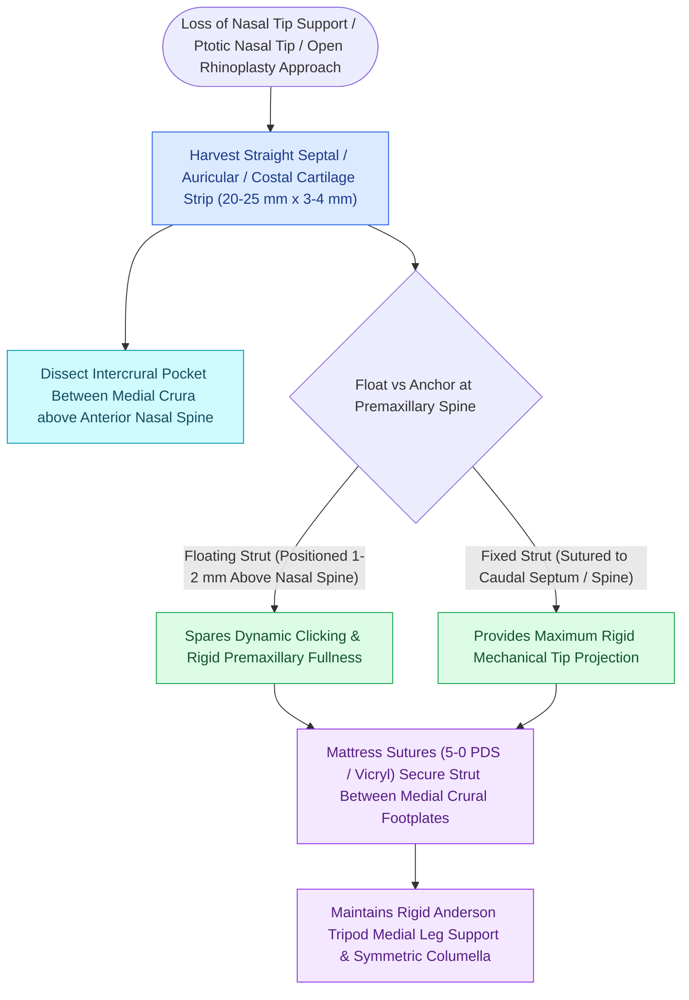

# Columellar strut grafts support the medial crural footplates to maintain tip projection

## Active Recall

> [!question]- Why should a floating columellar strut graft not rest directly on the anterior nasal spine?
> *Answer / Clinical Rationale*: To prevent **palpable clicking, discomfort, and lateral tip deviation** during dynamic upper lip and perioral movement.

> [!question]- How does a columellar strut graft increase [[Goode's ratio and nasolabial angles define standard aesthetic nasal tip proportions|tip projection]] within the Anderson tripod framework?
> *Answer / Clinical Rationale*: It unifies and straightens the medial crura, **strengthening the central medial leg of the tripod** to resist postoperative contractile forces.

## Core Clinical & Mechanistic Principles
A **Columellar Strut Graft** is a linear cartilage graft (harvested from nasal septum or rib) placed in a vertical pocket **between the intermediate and medial crura** to unify, strengthen, and [[The Anderson tripod theory governs nasal tip projection, rotation, and support dynamics|support]] the medial crural footplates.

### Strut vs Septal Extension Graft
- **Columellar Strut**: Preserves natural tip compressibility and dynamic elasticity; ideal for primary rhinoplasties.
- **Septal Extension Graft**: Rigidly fixed to septum; ideal when massive projection or rotation is required in revision cases.

## Connected Concepts & Graph Traversal
- **Tripod Model**: [[The Anderson tripod theory governs nasal tip projection, rotation, and support dynamics|Anderson Tripod Model]]
- **Septal Extension**: [[The caudal septal extension graft controls tip projection and rotation via rigid septal overlap|Septal Extension Graft]]
- **Tip Symmetry**: [[Tongue-in-groove and septal extension grafts provide rigid columellar and tip stabilization|Tongue-in-Groove]]
- **Anatomical Foundation**: [[Cephalic trim of lower lateral cartilages must preserve at least six millimeters of lateral crus|Cephalic Trim 6-mm Rule]]
- **High-Stakes Safety**: [[Pollybeak deformities arise from cartilaginous over-projection or supratip soft tissue fibrosis|Pollybeak Deformity]]
- **Surgical Craft**: [[Spreader grafts restore internal nasal valve patency and prevent inverted-V deformity|Spreader Grafts]]
- **Structural / Flap Alternative**: [[Champy lines of ideal osteosynthesis dictate monocortical miniplate fixation along mandibular tension zones|Champy's Principle of Osteosynthesis]]
