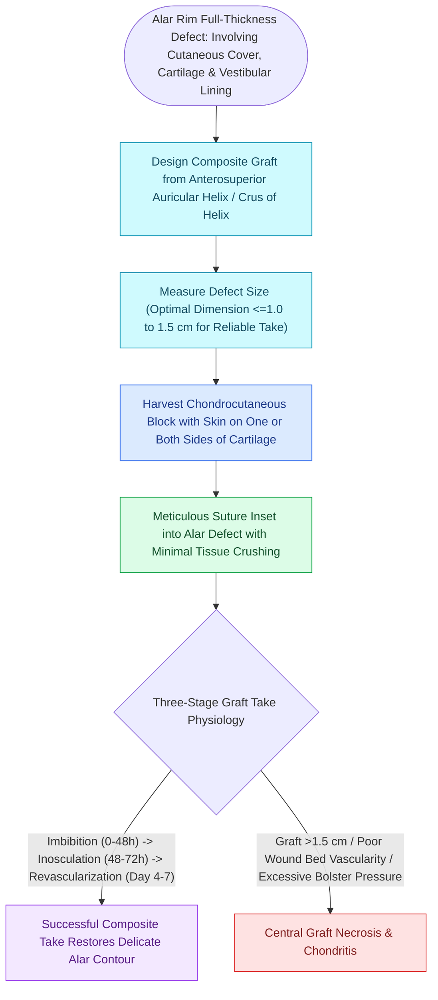

# Composite chondrocutaneous auricular graft transfers reconstruct complex alar and helical defects

## Active Recall

> [!question]- What is the critical size limit for a composite chondrocutaneous [[Auricular conchal cartilage grafts provide curved structural support for the alar and nasal valves|auricular graft]] to survive?
> *Answer / Clinical Rationale*: **$\le 1.0\text{ to }1.5\text{ cm}$** in total diameter, ensuring that no point on the graft is more than **$5.0\text{ mm}$ from a vascularized recipient wound margin**.

> [!question]- Why is the helical rim an ideal donor site for full-thickness nasal alar margin reconstruction?
> *Answer / Clinical Rationale*: It provides an exact anatomical three-dimensional match, delivering a **curved cartilage framework sandwiched between two delicate cutaneous surfaces** that mirrors the alar rim.

## Core Clinical & Mechanistic Principles
A **Composite Chondrocutaneous Graft** is a free tissue transfer consisting of **two or more tissue layers (skin and attached cartilage)** transplanted without a vascular pedicle.

The **auricular helix, antihelix, and conchal bowl** are the classic donor sites for reconstructing full-thickness defects of the **nasal alar rim, columella, and eyelid margin**.

### Cooling & Postoperative Care
- Postoperative cold compresses or cooling masks reduce cellular metabolic demand during the initial $48\text{–}72\text{ hours}$ of [[Skin graft bolsters and negative pressure wound therapy optimize graft bed inosculation|plasmatic imbibition]], significantly increasing graft survival rates.

## Connected Concepts & Graph Traversal
- **Graft Physiology**: [[Full-thickness and split-thickness skin grafts differ in primary contraction and vascular take|Skin Graft Take Mechanics]]
- **Alar Support**: [[Alar batten and lateral crural strut grafts prevent external nasal valve inspiratory collapse|Alar Batten Grafts]]
- **Forehead Coverage**: [[The paramedian forehead flap is an axial interpolated flap pedicled on the supratrochlear artery|Paramedian Forehead Flap]]
- **Anatomical Foundation**: [[Erb's point and the cervical plexus provide somatic sensory innervation to the head and neck|Superficial Cervical Plexus]]
- **Flap Alternative**: [[Antia-Buch helical rim chondrocutaneous advancement flaps mobilize the helical margin and lobule to close defects up to two centimeters|Antia-Buch Advancement]]
- **Surgical Craft**: [[Postauricular revolving door subcutaneous island flaps provide single-stage reconstruction of full-thickness conchal and nonmarginal auricular defects|Postauricular Revolving Door Flap]]
