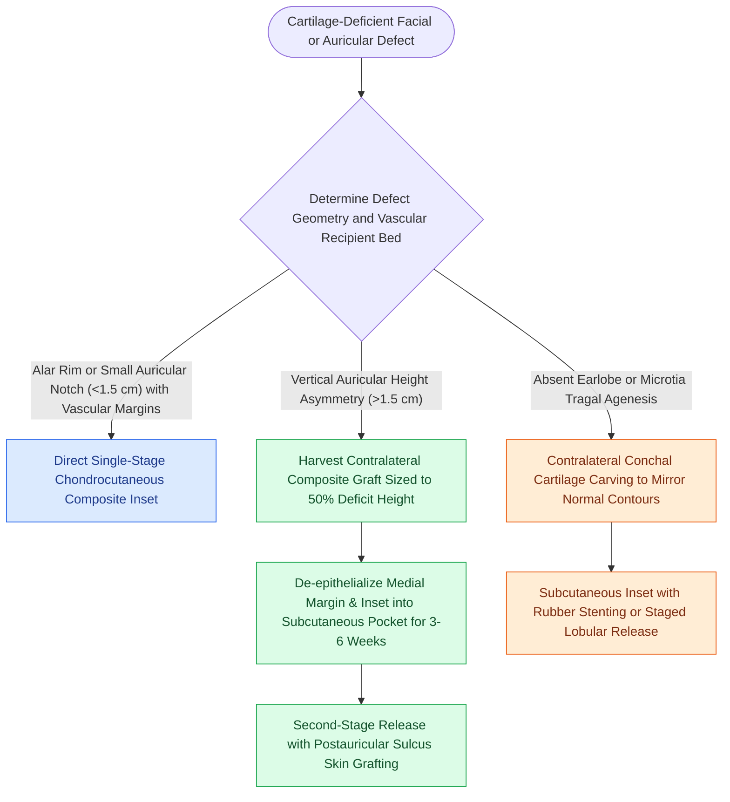

# Composite conchal cartilage grafts provide three-dimensional structural support and cutaneous coverage for auricular and facial defects

## Active Recall

> [!question]- What is the sizing principle described in Baker Chapter 22 for harvesting a contralateral composite auricular graft to correct vertical height deficiency in asymmetric ears?
> *Answer / Clinical Rationale*: The donor graft is sized to **half the vertical height deficit** of the recipient ear; harvesting reduces the donor ear height while augmenting the recipient ear, equalizing both ears to a balanced intermediate vertical dimension.

> [!question]- Why is the conchal bowl the premier donor site for composite cartilage grafts in nasal alar and external valve reconstruction?
> *Answer / Clinical Rationale*: The concha (cavum and cymba) naturally provides an **elliptical, preformed three-dimensional intrinsic curvature** and rigid fibrocartilage covered by firmly adherent, non-hair-bearing, thin skin that precisely replicates the structural rigidity and vestibular lining of the nasal ala.

## Core Clinical & Mechanistic Principles
A **composite graft** is a multi-tissue free autograft consisting of skin firmly attached to underlying cartilage, transferred without an intact vascular pedicle. Because the graft lacks intrinsic axial perfusion, survival depends entirely on plasmatic imbibition during the initial 24 to 48 hours, followed by capillary inosculation and neovascular ingrowth from the peripheral margins of the recipient wound bed. The **auricular concha (cavum and cymba)** serves as an indispensable donor bank, providing complex three-dimensional contours, structural rigidity, and thin, adherent cutaneous coverage via an [[Auricular conchal cartilage grafts provide curved structural support for the alar and nasal valves|auricular conchal cartilage framework]].

### Anatomical Subunits and Harvesting Principles
1. **Conchal Subunit Architecture**:
   - *Cymba Conchae*: The superior basin above the helical crus provides a gentle, single-radius curvature ideal for the alar margin, lower lateral crus, or upper eyelid tarsal replacement.
   - *Cavum Conchae*: The deeper, inferior basin below the helical crus provides a pronounced spherical, cup-shaped contour ideal for helical root, external auditory meatus, or complex dome defects.
   - *Donor Morbidity*: The conchal bowl can be harvested extraperichondrially from either an anterior or posterior approach without destabilizing the antihelix or helical rim, leaving the overall projection and contour of the donor auricle intact.
2. **Contralateral Sizing for Auricular Height Equalization**:
   - In patients with congenital hypoplasia or traumatic loss causing vertical height discrepancies between auricles exceeding $1.5\text{ to }2.0\text{ cm}$, Baker details harvesting a full-thickness composite chondrocutaneous graft from the contralateral normal ear.
   - **The 50% Rule**: The composite graft is designed at **half the vertical height deficit**. Removing the graft reduces the vertical height of the larger donor ear while augmenting the height of the smaller recipient ear, equalizing bilateral facial symmetry.
3. **Baker Staged Subcutaneous Pocketing for Large Grafts**:
   - Free composite grafts exceeding $1.5\text{ cm}$ in diameter face high failure rates due to metabolic exhaustion before capillary inosculation can cross from the margins.
   - To overcome this limitation, Baker describes **de-epithelializing the medial skin** of the composite graft and inserting it into a well-vascularized subcutaneous temporal or postauricular pocket at the recipient site.
   - After 3 to 6 weeks of neovascularization from the overlying skin and vascular bed, the graft is elevated in a second surgical stage with retroauricular sulcus skin grafting.
4. **Total Earlobe Reconstruction**:
   - Reconstructing an entirely avulsed or congenitally absent earlobe with soft tissue alone invariably results in retraction and curling.
   - A piece of contralateral conchal cartilage sculpted into an earlobe framework is embedded into an inferior cervical subcutaneous pocket for 6 weeks, followed by stage-two release and posterior full-thickness skin grafting to establish permanent three-dimensional projection.
5. **Microtia Tragal Construction**:
   - In staged microtia reconstruction (Brent Stage IV / Aguilar Stage IV), a triangular chondrocutaneous composite graft harvested from the normal contralateral ear is transplanted to create an upright, projected tragus and an illusion of external meatal depth.

### Complications and Caveats
- **Graft Necrosis and Epidermolysis**: Risk increases exponentially when the distance from any point on the graft to a vascularized margin exceeds $5\text{ to }7\text{ mm}$. Cooling ice packs in the first 48 hours reduce cellular metabolic rate during plasmatic imbibition.
- **Conchal Donor Hematoma**: Conchal harvesting creates a dead space susceptible to hematoma; through-and-through bolster dressings or mattress sutures are essential to maintain coaptation.
- **Late Cartilage Absorption**: Inadequately revascularized cartilage undergoes progressive chondrolysis and fibrous replacement, with loss of the engineered 3D contour.

## Connected Concepts & Graph Traversal
- **Nasal Alar Composite Transfer**: [[Composite chondrocutaneous auricular graft transfers reconstruct complex alar and helical defects|Composite Grafting to the Nose]]
- **External Valve Stabilization**: [[Alar batten and lateral crural strut grafts prevent external nasal valve inspiratory collapse|Alar Batten & Lateral Crural Grafts]]
- **Graft Vascularization Dynamics**: [[Full-thickness and split-thickness skin grafts differ in primary contraction and vascular take|Graft Vascularization & Take]]
- **🔗 Auricular Hematoma Prevention (Otology)**: [[Auricular hematoma evacuation and bolster compression prevents permanent cauliflower ear deformity|Auricular Bolster Dynamics]]
- **Three-Layer Structural Nasal Repair**: [[Total nasal reconstruction requires three-layer structural restoration of lining, cartilage, and cover|Three-Layer Structural Reconstruction]]
- **Delayed Reconstruction After Demarcation**: [[Frostbite tissue salvage prioritizes rapid warm water bath thawing and delayed tissue demarcation over early debridement|Frostbite Auricular Salvage]]
