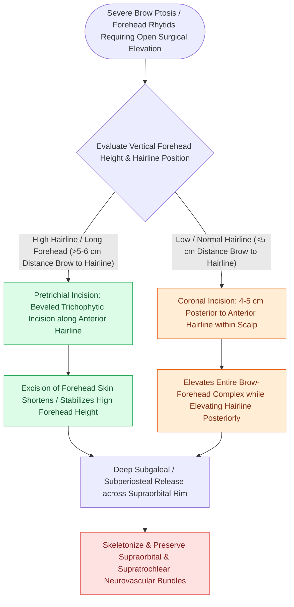

# Coronal and pretrichial open browlifts address severe brow ptosis with high versus low hairlines

## Active Recall

> [!question]- Why is a coronal browlift contraindicated in a patient with a high forehead and receding hairline?
> *Answer / Clinical Rationale*: A coronal browlift excises hair-bearing scalp posterior to the hairline, which **elevates the hairline further superiorly**, exaggerating forehead elongation.

> [!question]- How does a trichophytic beveled incision camouflage the scar in a pretrichial browlift?
> *Answer / Clinical Rationale*: By beveling the incision at **$45^\circ$ to transect underlying hair follicles**, allowing hair shafts to grow directly through the scar line.

## Core Clinical & Mechanistic Principles
Open [[Endoscopic browlift releases the conjoint tendon and arcus marginalis along the supraorbital rim|browlift]] techniques provide powerful, long-lasting repositioning of the brow-glabellar complex and release of the depressor muscles (corrugator supercilii, procerus, and depressor supercilii).

The choice between **Coronal and Pretrichial Browlifts** is determined strictly by the patient’s **preoperative hairline height**.

### Pathomechanics of Lateral Brow Descent (Temporal Hooding)
- **Fascial & Ligamentous Suspensory Deficit**:
  - The medial eyebrow is supported by dense osteocutaneous attachments (corrugator origin, procerus, and supraorbital ligamentous attachments). In contrast, the **lateral eyebrow lacks direct bony attachments**, suspended only by the loose temporoparietal fascia and temporal ligamentous adhesions.
  - *Temporal Hooding*: With age-related loss of skin elasticity and gravity, the unsupported lateral brow descends earlier and more severely than the medial brow.
  - *Lateral Canthal Bunching*: Lateral brow descent bunches excess skin over the lateral canthus and upper lid (**pseudoptosis / lateral hooding**), exacerbating dynamic lateral orbital rhytids ("crow's feet") and obstructing superior-lateral visual fields.

### The Trichophytic Bevel Principle
- Making a **$45^\circ$ beveled incision across hair follicles** allows transected hair shafts to grow directly *through* the resulting scar, camouflaging the hairline incision line.

## Connected Concepts & Graph Traversal
- **Endoscopic Option**: [[Endoscopic browlift releases the conjoint tendon and arcus marginalis along the supraorbital rim|Endoscopic Browlift]]
- **Nerve Hazard**: [[The sentinel vein marks the trajectory of the frontal branch of the facial nerve|Sentinel Vein & Frontal Branch]]
- **Blepharoplasty Relation**: [[Upper blepharoplasty requires precise skin crease marking to avoid lagophthalmos|Upper Blepharoplasty]]
- **Hairline Recession Staging**: [[Androgenic alopecia management spans Norwood-Hamilton staging, medical five-alpha reductase blockade, and follicular unit transplantation|Norwood-Hamilton Staging]]
- **Anatomical Foundation**: [[Coronoidectomy relieves severe trismus caused by temporalis impingement under displaced zygomatic arch|Mandibular Coronoidectomy]]
