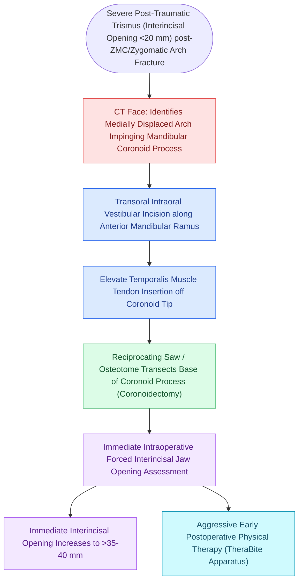

# Coronoidectomy relieves severe trismus caused by temporalis impingement under displaced zygomatic arch

## Active Recall

> [!question]- What anatomical structure is mechanically compressed by a depressed zygomatic arch fracture to cause severe trismus?
> *Answer / Clinical Rationale*: The **coronoid process of the mandible and the inserting tendon of the temporalis muscle**.

> [!question]- Through what plane is a Gillies elevator passed to safely reduce a depressed zygomatic arch fracture?
> *Answer / Clinical Rationale*: **Deep to the deep temporal fascia (DTF) and superficial to the temporalis muscle**, passing directly under the zygomatic arch.

## Core Clinical & Mechanistic Principles
Severe mechanical **trismus (inability to open the mouth, maximal incisal opening $<20\text{ mm}$)** following midfacial trauma is commonly caused by **medial displacement of the fractured zygomatic arch impinged against the mandibular coronoid process and temporalis muscle tendon**.

When [[Zygomaticomaxillary complex fractures disrupt four buttress articulations requiring multi-point reduction|reduction]] of the arch fails or long-standing fibrotic contracture occurs, **Ipsilateral Coronoidectomy** relieves mechanical obstruction.

### Gillies vs Keen Elevation
- In acute isolated zygomatic arch fractures, trismus is relieved by elevating the arch via the **Gillies temporal approach** (deep to deep temporal fascia) or **Keen intraoral approach** (sulcus incision) without needing a coronoidectomy.

## Connected Concepts & Graph Traversal
- **ZMC Reduction**: [[Zygomaticomaxillary complex fractures disrupt four buttress articulations requiring multi-point reduction|ZMC Tetrapod Fixation]]
- **Panfacial Trauma**: [[Panfacial fracture reconstruction proceeds from known stable peripheral buttresses to central occlusion|Panfacial Sequencing]]
- **Temporalis Anatomy**: [[Temporalis muscle tendon transfer provides regional dynamic smile reanimation|Temporalis Muscle Anatomy]]
- **Pathological Mechanism**: [[Orbital apex syndrome and superior orbital fissure syndrome manifest with ophthalmoplegia and vision loss|Orbital Apex Syndrome (OAS)]]
- **Anatomical Foundation**: [[Maxillomandibular fixation MMF using arch bars, hybrid systems, and IMF screws re-establishes occlusion|Maxillomandibular Fixation (MMF / IMF)]]
- **Critical Safety / Complication**: [[Osteoradionecrosis of the mandible requires radical bony debridement and vascularized fibula free flap repair|Mandibular Osteoradionecrosis (ORN)]]
