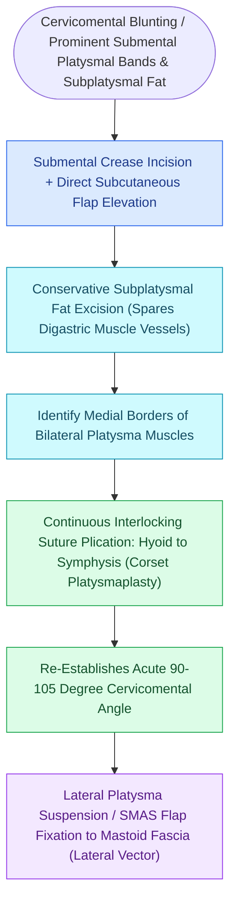

# Corset platysmaplasty and lateral suspension restore the youthfulness of the cervicomental angle

## Active Recall

> [!question]- What is the definition and ideal numerical range of a youthful cervicomental angle?
> *Answer / Clinical Rationale*: The angle formed between the submental horizontal plane and the anterior neck vertical plane; ideal range is **$105^\circ\text{–}120^\circ$**.

> [!question]- What surgical error causes a postoperative 'cobra neck deformity'?
> *Answer / Clinical Rationale*: Excessive, over-aggressive **resection of submental and subplatysmal fat** in the midline without adequate lateral fat blending or platysmal repair, leaving a hollow central trough with lateral bulging.

## Core Clinical & Mechanistic Principles
Rejuvenation of the aging neck requires restoring an acute, youthful **cervicomental angle ($105^\circ\text{–}120^\circ$)** by addressing the three layers of neck pathology: (1) Subcutaneous fat, (2) [[The marginal mandibular nerve courses deep to platysma over the facial vessels|Platysma]] muscle banding / diastasis, and (3) Subplatysmal fat / anterior digastric hypertrophy.

### The Subplatysmal Pitfalls
- **Subplatysmal Fat vs Subcutaneous Fat**: Subplatysmal fat lies deep to the platysma between the anterior bellies of the digastric muscles. If prominent, conservative excision is performed, but aggressive over-resection causes a hollow **"cobra neck deformity"**.
- **Anterior Digastric Muscle Resection**: Indicated only in severe muscular fullness; carries risk of submandibular hematoma and airway compromise.

## Connected Concepts & Graph Traversal
- **Facelift Partner**: [[Deep-plane rhytidectomy mobilizes the skin and SMAS as a composite flap across retaining ligaments|Deep-Plane Rhytidectomy]]
- **Nerve Safety**: [[The marginal mandibular nerve courses deep to platysma over the facial vessels|Marginal Mandibular Nerve]]
- **Sensory Nerve**: [[The great auricular nerve emerges at Erb's point and is vulnerable during rhytidectomy|Great Auricular Nerve]]
- **Anatomical Foundation**: [[The superficial musculoaponeurotic system divides facial fat into distinct surgical planes|SMAS Architecture]]
- **Surgical Craft**: [[The Dedo classification categorizes cervical aging deformities based on skin laxity, submental fat, platysma banding, and skeletal morphology|Dedo Classification]]
