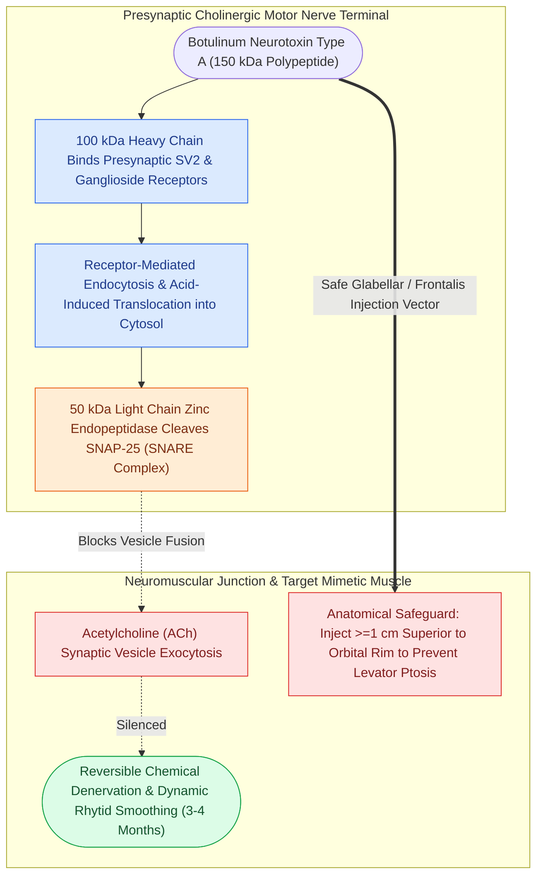

# Cosmetic botulinum toxin treats dynamic rhytids through presynaptic acetylcholine blockade

## Active Recall

> [!question]- Trace the molecular mechanism from injection to smooth glabella.
> *Answer / Clinical Rationale*: Toxin endocytosed at the terminal; light chain cleaves SNAP-25; acetylcholine vesicles cannot dock; corrugator/procerus contraction weakens; the overlying dynamic rhytid softens.

> [!question]- Explain post-injection eyelid ptosis and its temporizing treatment.
> *Answer / Clinical Rationale*: Toxin diffuses through the orbital septum to levator palpebrae; alpha-agonist drops (apraclonidine) recruit Muller's muscle for 1-2 mm of lift while the effect fades.

## Core Clinical & Mechanistic Principles
- Mechanism: the toxin's light chain cleaves **SNAP-25**, blocking presynaptic acetylcholine vesicle fusion — chemodenervation with onset in 3-7 days, peak ~2 weeks, duration ~3-4 months as sprouting and terminal regeneration recover. In contrast to **Type A** toxins, **Botulinum neurotoxin Type B (rimabotulinumtoxinB / Myobloc)** cleaves **synaptobrevin (vesicle-associated membrane protein / VAMP)**; Type B exhibits a more rapid onset (1–3 days) but a distinctly shorter clinical duration of **2–3 months** (versus 3–4 months for Type A) and carries a higher incidence of systemic anticholinergic effects (xerostomia, accommodation paresis) due to greater autonomic affinity.
- Target logic is **dynamic** rhytids (muscle-generated) within the [[The superficial musculoaponeurotic system divides facial fat into distinct surgical planes|SMAS and mimetic musculature]]: glabellar complex (corrugator/procerus), frontalis (with brow-position respect), lateral orbicularis (crow's feet) — static etched lines respond to resurfacing and [[Hyaluronic acid filler vascular occlusion requires immediate high-dose pulsed hyaluronidase to prevent skin necrosis and blindness|dermal fillers]], not paralysis alone.
- Unit literacy: onabotulinum/incobotulinum units differ from abobotulinum (~1:2.5-3 conversion) — 'units' are brand-specific currencies, a genuine safety point when covering colleagues' patients.
- Complication anatomy: **brow ptosis** (over-treated or low frontalis injection), **eyelid ptosis** (diffusion to levator via the orbital septum — apraclonidine drops as a temporizer), asymmetry — all technique- and anatomy-predictable.
- Contraindications: neuromuscular junction disease (myasthenia, LEMS), aminoglycoside potentiation, pregnancy/lactation by convention.

- **Bunny Lines (Nasal Sidewall Rhytids)**: Dynamic diagonal wrinkling over the nasal dorsum and upper sidewall is mediated by hyperfunctional contraction of the **transverse nasalis** muscle. Treatment entails injecting 2–4 units of botulinum toxin high on each lateral nasal sidewall above the nasofacial groove; injection must avoid low or lateral placement into the **levator labii superioris alaeque nasi (LLSAN)** or levator labii superioris to prevent inadvertent upper lip ptosis, oral asymmetry, and smile depression.

### Management & Critical Safety Checks
- Injection discipline: small volumes, anatomic landmarks (stay above the orbital rim laterally, respect the mid-pupillary line pattern in the glabella), photographic documentation, and two-week touch-up review.
- Frame outcomes as softening dynamic lines and slowing etching — the honest sell outlasts the dramatic one.

## Connected Concepts & Graph Traversal
- **Facial Rhytid Anatomy**: [[The superficial musculoaponeurotic system divides facial fat into distinct surgical planes|SMAS & Facial Musculature]]
- **Injectable Complication Salvage**: [[Hyaluronic acid filler vascular occlusion requires immediate high-dose pulsed hyaluronidase to prevent skin necrosis and blindness|Filler Vascular Occlusion]]
- **Facial Nerve Danger Zone**: [[The marginal mandibular nerve courses deep to platysma over the facial vessels|Marginal Mandibular Nerve]]
- **Frontal Branch Danger**: [[The sentinel vein marks the trajectory of the frontal branch of the facial nerve|Frontal Branch Anatomy]]
- **Facial Paralysis Staging**: [[The House-Brackmann facial nerve grading system standardizes facial paralysis severity|House-Brackmann Staging]]
