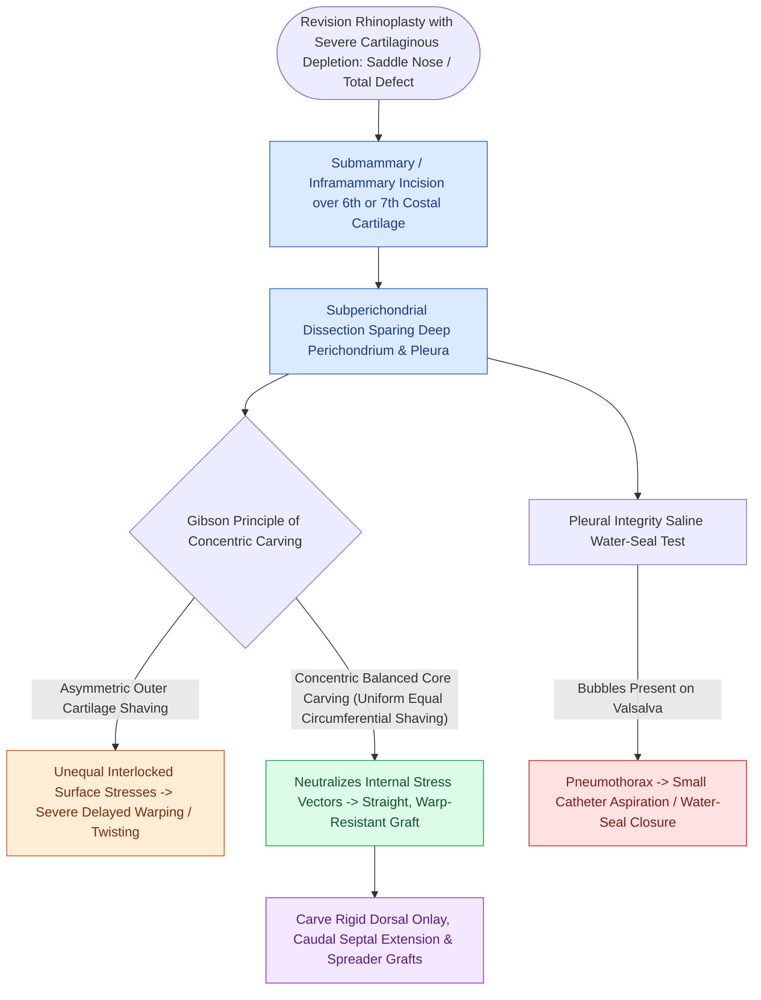

# Costal cartilage harvest and concentric carving prevent structural graft warping in revision rhinoplasty

## Active Recall

> [!question]- What is the concentric carving technique and why is it essential for costal cartilage grafts?
> *Answer / Clinical Rationale*: Carving structural grafts **from the central core of the rib with equal peripheral trimming**, balancing internal matrix tension forces to prevent long-term graft warping.

> [!question]- How is the integrity of the parietal pleura verified intraoperatively following rib harvest?
> *Answer / Clinical Rationale*: The **saline immersion / bubble test**: the wound is filled with sterile saline while the anesthesiologist delivers a sustained positive-pressure breath ($30\text{ cm H}_2\text{O}$); absence of air bubbling confirms an intact pleura.

## Core Clinical & Mechanistic Principles
When septal and auricular [[Stenstrom and Chongchet cartilage scoring utilizes Gibson's principle to fold the antihelix|cartilage]] donor sites are depleted, **Autologous Costal (Rib) Cartilage** (typically **Right 6th, 7th, or 8th rib**) provides an abundant, rigid structural source.

However, solid rib cartilage is prone to **delayed warping (curling)** governed by **Gibson’s Principle of Interlocked Stresses**.

### Harvest Craft & Pleural Safety
- **Subperichondrial Dissection**: Meticulous circumferential subperichondrial elevation protects the underlying parietal pleura and internal thoracic vessels.
- **Pneumothorax Test (Bubble Test)**: Fill the wound with saline and apply positive pressure ventilation ($30\text{ cm H}_2\text{O}$) to check for escaping air bubbles.

## Connected Concepts & Graph Traversal
- **Ear Scoring**: [[Stenstrom and Chongchet cartilage scoring utilizes Gibson's principle to fold the antihelix|Gibson's Principle in Otoplasty]]
- **Microtia Rib**: [[Microtia autologous costal cartilage framework stages balance four-stage Brent and two-stage Nagata reconstruction protocols|Brent & Nagata Microtia]]
- **Diced Option**: [[Diced cartilage glued with fibrin or wrapped in fascia reconstructs dorsal nasal contour|Diced Cartilage Alternative]]
- **Anatomical Foundation**: [[Cephalic trim of lower lateral cartilages must preserve at least six millimeters of lateral crus|Cephalic Trim 6-mm Rule]]
- **High-Stakes Safety**: [[Pollybeak deformities arise from cartilaginous over-projection or supratip soft tissue fibrosis|Pollybeak Deformity]]
