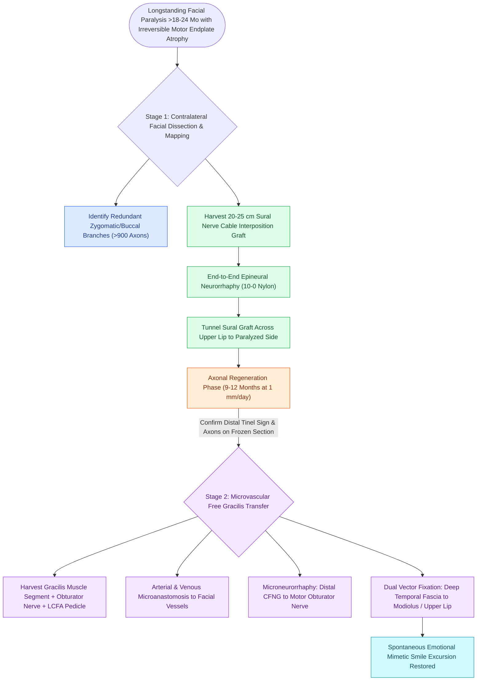

# Cross-facial nerve grafting combined with free gracilis muscle transfer restores spontaneous emotional smile excursion in established facial paralysis

## Active Recall

> [!question]- Why is cross-facial nerve grafting (CFNG) uniquely capable of restoring a spontaneous, emotional smile compared to masseteric or hypoglossal nerve transfers?
> *Answer / Clinical Rationale*: CFNG recruits motor axons directly from the **contralateral healthy facial nerve (CN VII)**, utilizing native central mimetic cortical pathways that fire automatically during involuntary emotional smiling, whereas CN V3 and CN XII require conscious cortical retraining and voluntary biting or tongue pushing.

> [!question]- What minimum donor axon count is required from the donor facial nerve branches to ensure successful reinnervation across a cross-facial nerve graft?
> *Answer / Clinical Rationale*: A minimum of **$>900$ axons** (harvested from robust, redundant zygomatic or buccal branches) is necessary to ensure adequate axonal regeneration across the long sural interposition graft to power a transplanted muscle.

## Core Clinical & Mechanistic Principles
In patients with irreversible, longstanding facial paralysis ($>18\text{ to }24\text{ months}$ denervation duration) or congenital facial palsy (e.g., Mobius syndrome), native facial mimetic muscles undergo permanent motor endplate degeneration and fibrofatty atrophy. In this chronic setting, nerve transfers alone (such as [[Hypoglossal-facial nerve transfer restores resting facial symmetry and basal muscle tone|hypoglossal-facial nerve transfer]] or [[The masseteric nerve provides a dense motor donor for single-stage facial reanimation|masseteric nerve transfer]]) fail, and restoration of dynamic smile excursion mandates **free functional muscle transfer (FFMT)**.

### The Two-Stage Reanimation Paradigm
The gold standard for achieving a truly spontaneous, symmetrical, and emotionally driven smile is the two-stage procedure combining [[Cross-facial nerve grafting provides coordinated spontaneous smile excursion in children|cross-facial nerve grafting (CFNG)]] with a microvascular free gracilis muscle transfer:

#### Stage 1: Cross-Facial Sural Nerve Grafting
1. **Donor Branch Selection**: Through a preauricular facelift incision on the healthy contralateral face, peripheral branches of the facial nerve are mapped with a nerve stimulator. Redundant zygomatic and buccal branches powering midface elevation are selected. To prevent donor deficit, at least $50\%$ of branches to each muscle group are preserved.
2. **Axonal Requirement**: Electrophysiologic studies demonstrate that $>900$ viable donor axons are required. Considering the facial nerve trunk contains $\approx 7,000$ axons, robust primary branches must be coapted.
3. **Graft Harvest & Inset**: A $20\text{ to }25\text{ cm}$ sural nerve graft is harvested from the lower leg. An epineural end-to-end neurorrhaphy is performed using 9-0 or 10-0 nylon under high magnification.
4. **Cross-Face Tunneling**: The sural nerve is tunneled across the upper lip in a subcutaneous plane (above the orbicularis oris) to the paralyzed preauricular area, banked in a subcutaneous pocket, and marked with a metal clip. Axons regenerate across the graft at $\approx 1\text{ mm/day}$ over 9 to 12 months.

#### Stage 2: Microvascular Free Gracilis Muscle Transfer
1. **Confirmation of Axonal Transit**: Axonal regeneration through the graft is confirmed clinically by a positive Tinel's sign at the distal tip and frozen section biopsy showing viable myelinated axons.
2. **Gracilis Muscle Harvest**: A segment of the gracilis muscle ($8\text{ to }10\text{ cm}$ long, $2\text{ to }3\text{ cm}$ wide) is harvested with its neurovascular pedicle (anterior branch of the lateral circumflex femoral vessels and the obturator nerve motor branch).
3. **Revascularization**: The gracilis vessels are anastomosed to the ipsilateral [[The facial artery and facial vein provide the primary vascular supply to the anterior face|facial artery and vein]] (or transverse facial vessels) using microvascular suture or [[Vascular coupler devices and hand-sewn microvascular anastomoses achieve high patency in free tissue transfer|vascular coupler devices]].
4. **Neurorrhaphy & Inset**: The obturator nerve is coapted to the distal end of the CFNG. The muscle is anchored superiorly to the deep temporal fascia and zygomatic arch, and inferiorly split into slips interdigitating with the modiolus, upper lip, and philtrum under intentional tension.

### The "Baby-Sitter" Alternative Procedure
- In patients evaluated between 6 and 18 months post-injury whose motor endplates are still viable, waiting 12 months for CFNG axons alone risks irreversible endplate loss.
- The **Terzis "Baby-sitter" procedure** solves this dilemma: an ipsilateral split hypoglossal (or masseteric) nerve transfer is immediately coapted to the facial trunk to rapidly deliver trophic axons and preserve motor endplates within 3 to 6 months, while a CFNG is placed simultaneously. When CFNG axons arrive 12 months later, they are spliced in to "supercharge" the system, conferring spontaneous emotional excursion onto an already toned muscular bed.

## Critical Failure Modes & Error Traps
- **Inadequate Donor Axon Count (<900 Axons)**: Sacrificing only a diminutive terminal branch on the normal side results in insufficient reinnervation density, causing weak muscle twitching rather than functional commissure excursion.
- **Incorrect Vector of Muscle Inset**: Insetting the gracilis muscle too horizontally pulls the corner of the mouth laterally (risorius vector) rather than superolaterally toward the temple (zygomaticus major vector), producing an unnatural grimace rather than an aesthetic smile.

## Connected Concepts & Graph Traversal
- **Regional Muscle Alternative**: [[Temporalis muscle tendon transfer provides regional dynamic smile reanimation|Temporalis Tendon Transfer Alternative]]
- **Paralysis Grading Scale**: [[The House-Brackmann facial nerve grading system standardizes facial paralysis severity|House-Brackmann Functional Stratification]]
- **Static Slings Alternative**: [[Static fascia lata slings suspend the modiolus and nasal valve in non-innervation candidates|Static Slings in Irreversible Palsy]]
- **Microvascular Recipient Vessels**: [[The facial artery and facial vein provide the primary vascular supply to the anterior face|Facial Recipient Vessels]]
- **Microvascular Technique**: [[Microvascular free flap salvage requires urgent re-exploration within two hours of vascular compromise|Free Flap Vascular Monitoring]]
