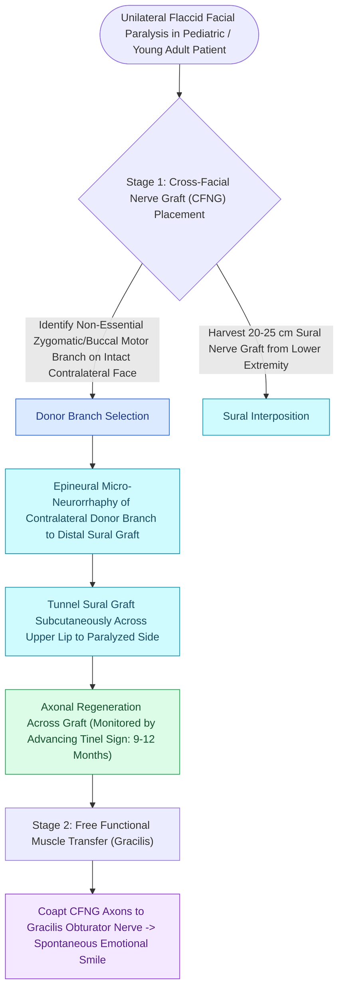

# Cross-facial nerve grafting provides coordinated spontaneous smile excursion in children

## Active Recall

> [!question]- Why is the cross-facial nerve graft (CFNG) the only reanimation technique that reliably produces a spontaneous, emotional smile?
> *Answer / Clinical Rationale*: Because it derives its motor axons directly from the **contralateral facial nucleus (CN VII)**, which automatically fires in response to involuntary emotional limbic stimuli.

> [!question]- What donor nerve is universally harvested for cross-facial nerve grafting?
> *Answer / Clinical Rationale*: The **sural nerve**, providing up to $30\text{–}40\text{ cm}$ of expendable, non-critical sensory cable.

## Core Clinical & Mechanistic Principles
The **Cross-Facial Nerve Graft (CFNG)** uses the **contralateral healthy facial nerve (CN VII)** to drive motor reinnervation across the face via a long **sural nerve [[Epineural neurorrhaphy and cable nerve grafting restore facial continuity within twelve months|interposition cable graft]]** coapted in a second stage to a [[Free gracilis muscle transfer provides dynamic smile restoration in chronic facial paralysis|free gracilis muscle transfer]], providing the unique ability to produce a **truly spontaneous, coordinated, emotionally triggered smile**.

### Pediatric vs Adult Outcomes
- **Children**: Outstanding axon regeneration and cortical plasticity; achieves robust spontaneous excursion.
- **Adults ($>50\text{ years}$)**: Slower axonal regeneration across the long $25\text{ cm}$ graft and higher axon attrition; the **masseteric nerve** is frequently preferred or used in a **dual-innervation (Masseter + CFNG)** approach.

## Connected Concepts & Graph Traversal
- **Free Muscle**: [[Free gracilis muscle transfer provides dynamic smile restoration in chronic facial paralysis|Free Gracilis Transfer]]
- **Masseteric Donor**: [[The masseteric nerve provides a dense motor donor for single-stage facial reanimation|Masseteric Nerve Transfer]]
- **Grading**: [[The House-Brackmann facial nerve grading system standardizes facial paralysis severity|House-Brackmann Scale]]
- **Anatomical Foundation**: [[Epineural neurorrhaphy and cable nerve grafting restore facial continuity within twelve months|Direct Epineural Neurorrhaphy]]
- **Surgical Craft**: [[Static fascia lata slings suspend the modiolus and nasal valve in non-innervation candidates|Static Facial Slings]]
