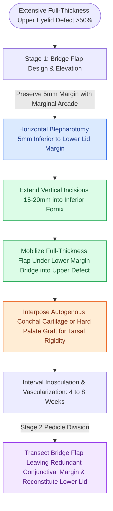

# Cutler-Beard bridge flaps reconstruct full-thickness upper eyelid defects via lower eyelid tissue advancement beneath a spared margin

## Active Recall

> [!question]- Why is the horizontal blepharotomy for a Cutler-Beard flap placed strictly 5 mm inferior to the lower eyelid margin?
> *Answer / Clinical Rationale*: Placing the horizontal cut **5 mm below the margin** preserves the **marginal vascular arcade and structural integrity of the lower eyelid tarsus and cilia**, ensuring lower lid margin survival as an intact bridge while permitting underlying composite tissue advancement.

> [!question]- Why must an autogenous structural graft be interposed between the tissue layers in a Cutler-Beard upper eyelid reconstruction?
> *Answer / Clinical Rationale*: The Cutler-Beard flap contains skin, orbicularis, and conjunctiva but lacks tarsal cartilage; without an interposition graft of **auricular conchal cartilage or hard palate mucosa**, the reconstructed upper eyelid suffers from **postoperative margin instability, entropion, severe notching, and loss of levator excursion**.

## Core Clinical & Mechanistic Principles
Extensive full-thickness upper eyelid defects encompassing greater than 50% to 100% of the lid width present complex reconstructive challenges. The upper eyelid is a dynamic structure requiring 5 to 10 mm of vertical excursion to provide active corneal coverage and normal visual fields. Unlike the lower eyelid, which can borrow upper tarsus via a Hughes flap, the upper eyelid cannot recruit lower tarsus directly because lower tarsal height is only 4 mm and cannot be split without sacrificing lower eyelid competence.

The Cutler-Beard bridge flap solves this problem by mobilizing a composite, full-thickness musculocutaneous-conjunctival flap from the lower eyelid, advanced beneath a preserved lower eyelid margin bridge into the upper eyelid defect:
1. **Bridge Design**: A horizontal incision is marked 5 mm inferior to the lower eyelid margin, extending 2 mm wider than the upper eyelid defect. Preserving this 5 mm bridge maintains the inferior marginal vascular arcade and prevents lower lid margin necrosis. Vertical relaxing incisions extend 15 to 20 mm inferiorly into the conjunctival fornix.
2. **Sub-Bridge Advancement**: The full-thickness composite flap (skin, orbicularis muscle, and palpebral conjunctiva) is passed underneath the lower lid bridge and brought into the upper eyelid defect.
3. **Rigid Posterior Lamellar Reconstruction**: Because the flap lacks structural tarsus, an autogenous graft of [[Auricular conchal cartilage grafts provide curved structural support for the alar and nasal valves|auricular conchal cartilage]] or hard palate mucosa is harvested and sutured to the remaining upper tarsal edges, levator aponeurosis superiorly, and the advanced conjunctiva posteriorly.
4. **Second-Stage Division & Inset**: After 4 to 8 weeks, the pedicle is divided under local anesthesia with scissors angled to preserve a 2 mm redundant conjunctival margin. The conjunctiva is advanced anteriorly over the cut edge and secured to the skin with 7-0 chromic catgut to ensure a non-keratinized lid margin. The lower eyelid bridge is freshened and the lower flap base is sutured back to its anatomical position in layers.

### Operative Considerations & Pitfalls
- **Marginal Arcade Preservation**: Incisions closer than 4 to 5 mm from the lower lid margin risk ischemic necrosis of the bridge, producing catastrophic bilateral eyelid breakdown.
- **Absence of Eyelashes**: The Cutler-Beard reconstruction does not restore cilia; patient counseling regarding lash loss and cosmetic contouring is essential.
- **Corneal Protection**: Interposition cartilage grafts must be completely lined by conjunctiva; exposed cartilage or protruding sutures will induce severe corneal epithelial abrasions or ulcers.

## Connected Concepts & Graph Traversal
- **Tri-Lamellar Framework Restoration**: [[Total nasal reconstruction requires three-layer structural restoration of lining, cartilage, and cover|Tri-Lamellar Framework Principles]]
- **Upper Crease & Levator Dynamics**: [[Upper blepharoplasty requires precise skin crease marking to avoid lagophthalmos|Upper Eyelid Levator Dynamics]]
- **Lower Eyelid Anatomy**: [[Lower blepharoplasty addresses fat herniation while preserving the inferior oblique muscle|Lower Eyelid Submarginal Anatomy]]
- **Canthal Suspension**: [[Lateral canthopexy and lateral tarsal strip suspension prevent post-blepharoplasty ectropion|Lateral Canthal Suspension]]
- **Wound Healing & Inosculation**: [[Wound healing progresses through hemostasis, inflammation, proliferation, and maturation|Wound Healing & Inosculation Phases]]
