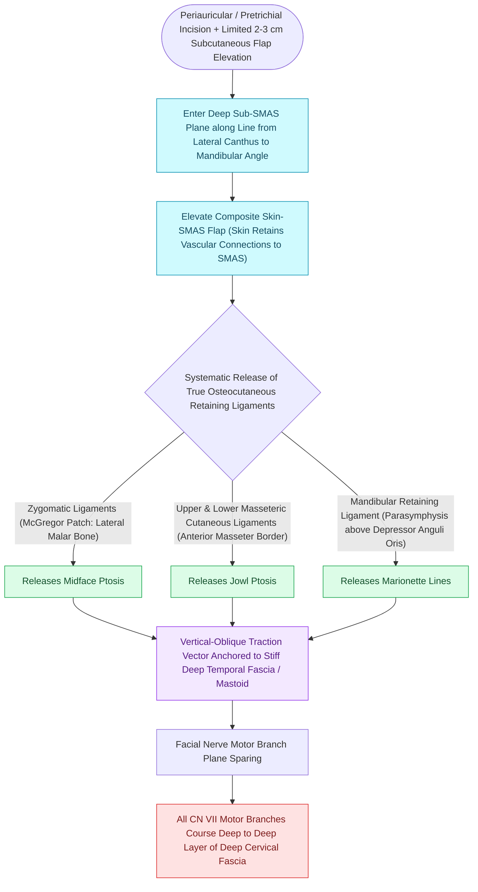

# Deep-plane rhytidectomy mobilizes the skin and SMAS as a composite flap across retaining ligaments

## Active Recall

> [!question]- Why does deep-plane rhytidectomy carry a lower risk of skin flap necrosis in smokers compared to a traditional subcutaneous facelift?
> *Answer / Clinical Rationale*: In deep-plane surgery, the **subdermal vascular plexus and subcutaneous fat remain in continuity with the SMAS**, maintaining robust axial perfusion through the composite flap rather than creating a thin, ischemic subdermal skin flap.

> [!question]- What anatomical structure marks the safe transition from subcutaneous to sub-SMAS dissection in the cheek?
> *Answer / Clinical Rationale*: The **anterior border of the parotid gland**. Dissection is subcutaneous over the parotid, then enters the sub-SMAS plane anterior to the parotid gland.

## Core Clinical & Mechanistic Principles
First introduced by Sam Hamra (1990) and refined by Bryan Mendelson and Andrew Jacono, **Deep-Plane Rhytidectomy** enters the **sub-[[High-SMAS rhytidectomy extends dissection above the zygomatic arch to rejuvenate the midface|SMAS]] plane anterior to the parotid gland**, maintaining the subcutaneous fat, dermis, and [[MACS lift and SMAS plication provide vertical vector elevation via suspension purse-string sutures|SMAS]] as a single, fully vascularized **composite flap**.

### Patient Selection & The Perkins Rhytidectomy Classification
- **Perkins Anatomic Aging Classification**:
  - *Type I*: Minimal cervical skin laxity, mild submental fat, minimal jowling, sharp cervicomental angle (candidates for isolated submental liposuction, micro-focused ultrasound, or limited mini-SMAS plication).
  - *Type II (Most Frequent Presentation)*: Moderate skin laxity, distinct jowling, early platysma banding, and moderate submental liposis (ideal candidates for SMAS imbrication/plication or deep-plane rhytidectomy with submental platysmaplasty).
  - *Type III (Severe Aging / Common in Men)*: Heavy, inelastic skin, prominent prejowl sulci, blunted cervicomental angle, deep nasolabial folds, and significant anterior platysma diastasis / "turkey gobbler" deformity (mandates deep-plane composite release with anterior corset platysmaplasty).
  - *Type IV*: Severe microgenia/retrognathia with low hyoid bone position (requires concurrent chin augmentation/alloplastic implant or hyoid suspension).

### Complications, Dead-Space Management & Craft Pearls
- **Hematoma (Most Common Complication)**:
  - Occurs in –4\%$ of female patients and up to **–9\%$ of male patients** (higher risk due to thicker, hypervascular skin and bearded hair follicles).
  - *Presentation & Emergency Rescue*: Typically manifests within the first 6 to 24 hours as sudden unilateral neck/facial swelling, ecchymosis, severe pain, and skin flap pallor; large or expanding hematomas mandate immediate suture release at the bedside to relieve skin tension and emergent OR exploration to evacuate clot and cauterize bleeding perforators (preventing ischemic flap necrosis).
  - *Pharmacological Prophylaxis*: Administration of **intravenous Tranexamic Acid (TXA 1g IV at induction followed by 1g infusion)** significantly reduces intraoperative blood loss and postoperative hematoma rates without increasing thromboembolic risk.
  - *Dressings & Drains Reality*: Clinical trials demonstrate that neither bulky compressive pressure dressings nor closed suction surgical drains reduce the true incidence of expanding hematoma; strict blood pressure control (systolic $<120–130	ext{ mmHg}$) is the primary preventative measure.
  - *Mechanical Hemostatic Nets*: Transcutaneous continuous quilting/mattress sutures (the **Auersvald hemostatic net**) effectively eliminate subcutaneous dead space and prevent hematoma formation in high-risk patients.
- **Flap & Lobular Craft Nuances**:
  - *Subcutaneous Fat Preservation*: When elevating the initial subcutaneous preauricular flap over the parotid, a uniform **–3	ext{ mm}$ subcutaneous fat cuff** must be left adherent to the dermis to safeguard the subdermal capillary plexus from devascularization and avoid skin slough.
  - *Pixie Ear Deformity (Satyricon Ear)*: Results from closing the cutaneous flap under tension at the earlobe inset; skin contracture pulls the lobule caudally toward the cheek, creating an elongated, tethered appearance. Prevention mandates anchoring all lifting tension to the deep mastoid fascia and SMAS, allowing the lobule to sit tension-free with an inverted 	ext{ mm}$ gutter.
  - *Tragal Camouflage*: When draping skin over the tragus (retrotragal incision), the flap must be meticulously thinned/defatted to reproduce the natural pretragal depression and sharp tragal edge.
  - *Sialocele / Parotid Leak*: Inadvertent breach of the parotid capsule during sub-SMAS dissection can cause a postoperative sialocele (painless, fluctuant cheek swelling); managed with **serial sterile fine-needle aspirations, pressure dressing, and oral anticholinergics (glycopyrrolate)**.

### Surgical Execution Across Danger Planes
1. **Subcutaneous Initiation**: Preauricular subcutaneous elevation for $2	ext{–}3	ext{ cm}$ over the parotid gland.
2. **Sub-SMAS Entry**: Incise the SMAS along a line from the lateral canthus to the gonial angle, entering the sub-SMAS plane anterior to the anterior border of the parotid.
3. **Ligamentous Release**:
   - Sharply divide the **masseteric cutaneous ligaments** entering the pre-masseteric space.
   - Divide the **zygocutaneous ligament (McGregor's patch)**, entering the pre-zygomatic space and elevating the malar fat pad off the zygomaticus major muscle.
4. **Vertical Vector Suspension**: The composite flap is suspended superolaterally to the deep mastoid fascia and preauricular parotid-masseteric fascia.

## Connected Concepts & Graph Traversal
- **Ligaments**: [[Facial retaining ligaments require surgical release to mobilize ptotic midface tissues|Facial Retaining Ligaments]]
- **SMAS Architecture**: [[The superficial musculoaponeurotic system divides facial fat into distinct surgical planes|SMAS Architecture]]
- **Neck Contouring**: [[Corset platysmaplasty and lateral suspension restore the youthfulness of the cervicomental angle|Platysmaplasty]]
- **Nerve Safety**: [[The great auricular nerve emerges at Erb's point and is vulnerable during rhytidectomy|Great Auricular Nerve]]
- **Surgical Plane Anatomy**: [[Parotid duct laceration requires primary microsurgical repair over a silastic stent to prevent sialocele and salivary fistula|Parotid-Masseteric Fascial Plane]]
