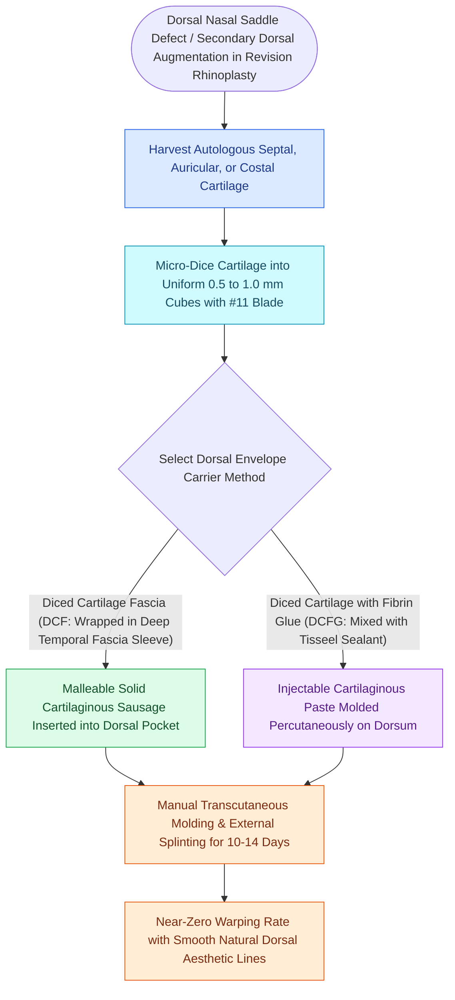

# Diced cartilage glued with fibrin or wrapped in fascia reconstructs dorsal nasal contour

## Active Recall

> [!question]- Why does dicing costal cartilage into 0.5 to 1.0 mm cubes eliminate the risk of graft warping?
> *Answer / Clinical Rationale*: Dicing completely **disrupts the intrinsic internal protein-polysaccharide matrix tension forces** that cause solid cartilaginous blocks to curve and warp over time.

> [!question]- What donor fascial tissue is most commonly harvested to wrap diced cartilage for dorsal augmentation?
> *Answer / Clinical Rationale*: **Deep temporal fascia (DTF)**, harvested via a small temporal scalp incision.

## Core Clinical & Mechanistic Principles
**Diced Cartilage** techniques—either wrapped in **deep temporal fascia (DCF)** or coalesced with **autologous fibrin glue (DCFG)**—provide an autologous, malleable, warp-resistant method for **dorsal nasal augmentation and contouring** in primary and revision [[Costal cartilage harvest and concentric carving prevent structural graft warping in revision rhinoplasty|rhinoplasty]].

### Overcoming Solid Block Costal Cartilage Warping
- Solid block rib cartilage grafts are notorious for unpredictable **curvilinear warping over time** due to internal molecular stress forces.
- Dicing cartilage into sub-millimeter pieces **completely neutralizes internal tensile forces**, eliminating warping while maintaining chondrocyte viability.

## Connected Concepts & Graph Traversal
- **Rib Harvest**: [[Costal cartilage harvest and concentric carving prevent structural graft warping in revision rhinoplasty|Costal Cartilage Carving]]
- **Pollybeak Management**: [[Pollybeak deformities arise from cartilaginous over-projection or supratip soft tissue fibrosis|Pollybeak Deformities]]
- **Saddle Nose**: [[Saddle nose deformity requires multi-tier dorsal and caudal structural reconstruction|Saddle Nose Reconstruction]]
- **Anatomical Foundation**: [[Cephalic trim of lower lateral cartilages must preserve at least six millimeters of lateral crus|Cephalic Trim 6-mm Rule]]
- **Surgical Craft**: [[Spreader grafts restore internal nasal valve patency and prevent inverted-V deformity|Spreader Grafts]]
