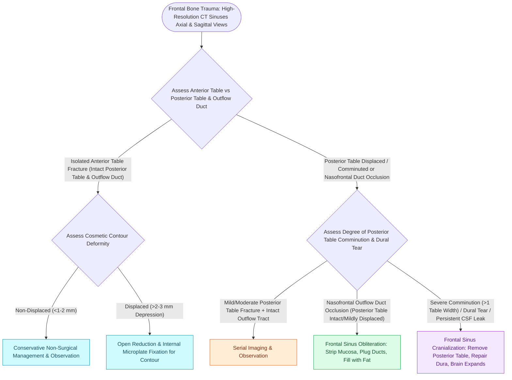

# Displaced posterior table frontal sinus fractures and nasofrontal outflow injury require obliteration or cranialization

## Active Recall

> [!question]- Why must the entire inner bony cortex of the frontal sinus be meticulously abraded with a diamond bur during sinus obliteration?
> *Answer / Clinical Rationale*: Frontal sinus respiratory mucosa sends microscopic invaginations (**canals of Breschet**) deep into the underlying diploic bone. If these microscopic epithelial crypts are not completely drilled down with a diamond bur, trapped residual secretory cells will proliferate under the fat graft, forming an expansile, destructive **delayed frontal sinus mucocele** or pyocele $5\text{–}20\text{ years}$ post-injury.

> [!question]- What anatomical and clinical findings differentiate the indication for frontal sinus obliteration versus cranialization?
> *Answer / Clinical Rationale*: **Sinus Obliteration** is indicated when the posterior table is intact or minimally displaced but the **nasofrontal outflow tract (NFOT) is irreversibly obstructed** (all mucosa is removed, NFOT plugged, sinus packed with fat). **Sinus Cranialization** is indicated for **severely comminuted, displaced posterior table fractures ($>1\text{ table width}$)** or through-and-through dural tears with persistent CSF leak; the entire posterior table is removed, allowing the frontal lobes and dura to occupy the dead space.

> [!question]- What autologous tissues are preferred for permanent sealing of the nasofrontal outflow tract during sinus obliteration?
> *Answer / Clinical Rationale*: **Temporalis fascia, periosteum, and cortical bone plugs** wedged firmly into the bilateral frontal infundibula, backed by an **autologous abdominal fat graft** harvested from the left lower quadrant.

## Core Clinical & Mechanistic Principles
**Posterior table and nasofrontal outflow tract (NFOT) injuries** represent high-stakes craniomaxillofacial emergencies due to their direct interface with the anterior cranial fossa dura and intracranial contents:

- **Pathophysiology & Risks**:
  - *Nasofrontal Outflow Tract (NFOT) Obstruction*: Comminution of the sinus floor or medial orbital roof blocks mucociliary clearance. An obstructed, mucosalized sinus inevitably develops an expansile **frontal sinus mucocele**, pyocele, or frontal osteomyelitis (**[[Pott's puffy tumor represents subperiosteal abscess and frontal bone osteomyelitis from sinusitis|Pott's puffy tumor]]**).
  - *Posterior Table Disruption*: Creates a direct conduit for **CSF rhinorrhea**, pneumocephalus, ascending meningitis, and frontal lobe abscess.
- **The Surgical Decision Tree**:
  1. *Anterior Table Only / Intact NFOT*: Reduction and fixation without obliteration.
  2. *Irreversible NFOT Obstruction with Intact/Minimally Displaced Posterior Table*: **Frontal Sinus Obliteration**.
  3. *Comminuted/Displaced Posterior Table ($>1\text{ Table Width}$) or Dural Laceration*: **Frontal Sinus Cranialization**.

### Operative Execution & Craft Nuance
1. **Osteoplastic Flap Exposure**:
   - Via a coronal incision, a radiographic 6-foot Caldwell template or image guidance outlines the frontal sinus perimeter.
   - Oscillating saw osteotomy creates a hinged anterior table flap pedicled on inferior periosteum.
2. **Exhaustive Mucosal Demucosation**:
   - Strip all gross respiratory mucosa with elevators.
   - Drill the entire interior cortical bone surface, interfrontal septum, and all recesses with a high-speed **diamond bur** under continuous irrigation to eradicate the microscopic **canals of Breschet**.
3. **NFOT Plugging & Dead-Space Obliteration**:
   - Invert the proximal mucosal sleeves down into the nasal cavity.
   - Plug both ostia with cortical bone chips, fascia lata, and tissue sealant.
   - Fill the cavity with **autologous vascularized fat** harvested atraumatically from the left lower quadrant (left side avoids confusion with appendectomy incisions).

## Connected Concepts & Graph Traversal
- **🔗 Anterior Table Correlate (Trauma)**: [[Isolated anterior table frontal sinus fractures require open reduction and microplate fixation for contour restoration|Anterior Table Frontal Fractures]]
- **🔗 Endoscopic Frontal Corridor (Sinus)**: [[Draf III modified Lothrop unites both frontal sinuses into a common cavity|Endoscopic Draf III Lothrop]]
- **🔗 Frontal Osteomyelitis (Sinus)**: [[Pott's puffy tumor represents subperiosteal abscess and frontal bone osteomyelitis from sinusitis|Pott's Puffy Tumor]]
- **🔗 CSF Leak Multi-Layering (Sinus)**: [[Multi-layer skull base reconstruction combines underlay, inlay, and overlay barriers|Skull Base Reconstruction]]
- **Facial Nerve Safety**: [[Pitanguy's line defines the danger zone for the frontal branch of the facial nerve|Pitanguy Line & Frontal Branch]]
