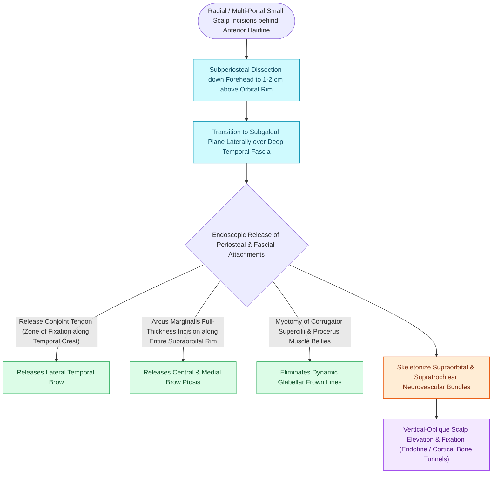

# Endoscopic browlift releases the conjoint tendon and arcus marginalis along the supraorbital rim

## Active Recall

> [!question]- What anatomical structure represents the 'zone of fixation' that must be divided to release the lateral brow during an endoscopic browlift?
> *Answer / Clinical Rationale*: The **conjoint tendon (temporal ligamentous adhesion)** along the superior temporal line, where the galea, periosteum, and deep temporal fascia fuse.

> [!question]- What muscles are avulsed or resected to eliminate vertical glabellar frown lines?
> *Answer / Clinical Rationale*: The **corrugator supercilii** (oblique and transverse heads) and the **depressor supercilii** muscles.

## Core Clinical & Mechanistic Principles
The **Endoscopic Forehead and Brow Lift** elevates ptotic brows, softens horizontal forehead rhytids, and [[Coronal and pretrichial open browlifts address severe brow ptosis with high versus low hairlines|addresses]] glabellar frown lines through minimally invasive radial scalp incisions.

Successful, durable brow elevation requires **complete $360^\circ$ release of the periosteal and ligamentous tethers** along the superior and lateral orbital rims.

### Neurovascular Bundle Preservation
- **Supraorbital & Supratrochlear Nerves**: Emerge from supraorbital notch/foramen. Dissection must transition from subperiosteal to cautious blunt spreading within $1\text{ cm}$ of the rim to prevent permanent forehead and scalp numbness.
- **Fixation Modalities**: Bioabsorbable Endotine anchors, cortical bone tunnels, or temporary titanium micro-screws.

## Connected Concepts & Graph Traversal
- **Nerve Landmark**: [[The sentinel vein marks the trajectory of the frontal branch of the facial nerve|Sentinel Vein Landmark]]
- **Nerve Vulnerability**: [[Pitanguy's line defines the danger zone for the frontal branch of the facial nerve|Pitanguy's Line]]
- **Blepharoplasty Partner**: [[Upper blepharoplasty requires precise skin crease marking to avoid lagophthalmos|Upper Blepharoplasty]]
- **Anatomical Foundation**: [[Coronal and pretrichial open browlifts address severe brow ptosis with high versus low hairlines|Coronal vs Pretrichial Browlift]]
- **Surgical Craft**: [[Bilateral A-T plasty and H-plasty advancements reconstruct forehead and suprabrow defects by recruiting transverse tissue laxity along relaxed skin tension lines|Forehead A-T Plasty]]
