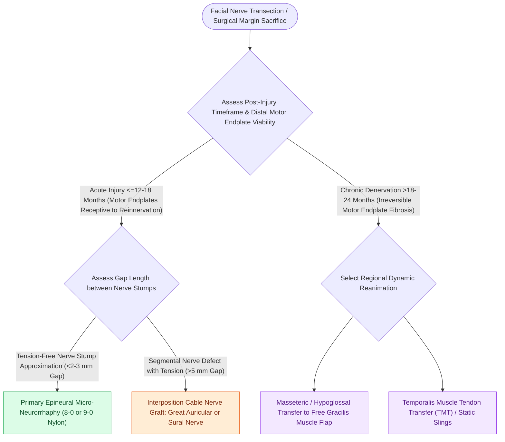

# Epineural neurorrhaphy and cable nerve grafting restore facial continuity within twelve months

## Active Recall

> [!question]- Why is an interposition cable nerve graft preferred over a primary end-to-end repair under tension?
> *Answer / Clinical Rationale*: Tension across a nerve repair compromises intra-neural microvascular perfusion, causing endoneurial ischemia, dense fibroblast proliferation, and complete blockage of axonal regeneration.

> [!question]- What is the typical rate of peripheral nerve axonal regeneration following successful coaptation?
> *Answer / Clinical Rationale*: Approximately **$1.0\text{ mm/day}$** ($1\text{ inch/month}$).

## Core Clinical & Mechanistic Principles
When acute facial nerve (CN VII) transection occurs, **direct primary epineural neurorrhaphy** or **interposition cable nerve grafting** provides the highest rate of functional axonal regeneration.

Timing is critical: reinnervation must occur **within 12 to 18 months** before irreversible motor endplate atrophy and fibrotic myocyte replacement take place.

### Microscopic Craft Standards
- **Fascicular Alignment**: Trim epineural sleeve; place 3 to 5 interrupted **9-0 or 10-0 [[Monofilament versus braided absorbable and non-absorbable sutures have distinct tissue reactivity|monofilament nylon]] sutures** through the epineurium without penetrating the endoneurium.
- **Fibrin Glue Seal**: Fibrin sealant stabilizes the coaptation site and prevents axonal egress.

## Connected Concepts & Graph Traversal
- **Nerve Transfer**: [[The masseteric nerve provides a dense motor donor for single-stage facial reanimation|Masseteric Nerve Transfer]]
- **Free Muscle**: [[Free gracilis muscle transfer provides dynamic smile restoration in chronic facial paralysis|Free Gracilis Muscle Transfer]]
- **Donor Nerve**: [[The great auricular nerve emerges at Erb's point and is vulnerable during rhytidectomy|Great Auricular Nerve]]
- **Anatomical Foundation**: [[Cross-facial nerve grafting provides coordinated spontaneous smile excursion in children|Cross-Facial Nerve Graft (CFNG)]]
- **Surgical Craft**: [[Static fascia lata slings suspend the modiolus and nasal valve in non-innervation candidates|Static Facial Slings]]
- **Structural / Flap Alternative**: [[Champy lines of ideal osteosynthesis dictate monocortical miniplate fixation along mandibular tension zones|Champy's Principle of Osteosynthesis]]
