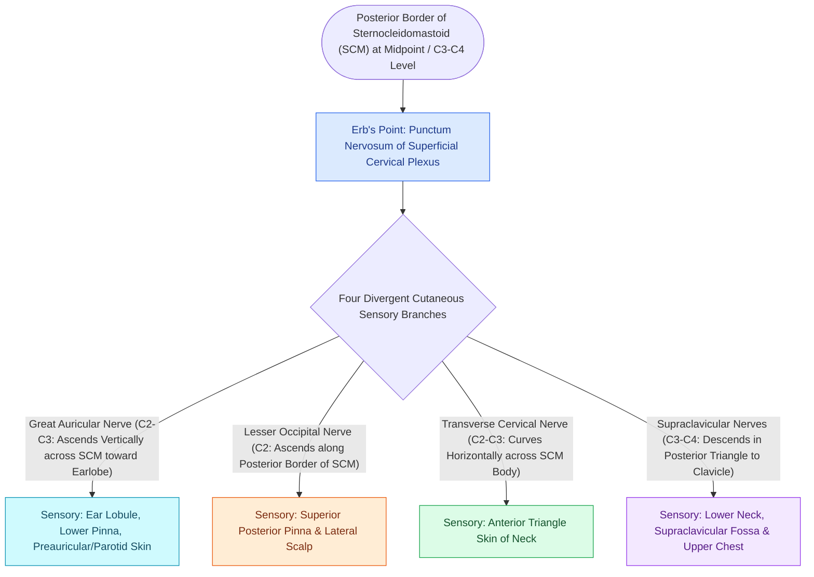

# Erb's point and the cervical plexus provide somatic sensory innervation to the head and neck

## Active Recall

> [!question]- What four sensory nerves emerge at Erb's point on the posterior border of the SCM?
> *Answer / Clinical Rationale*: (1) **Lesser Occipital Nerve**, (2) **Great Auricular Nerve**, (3) **Transverse Cervical Nerve**, and (4) **Supraclavicular Nerves**.

> [!question]- Which branch of the cervical plexus is the most frequently injured sensory nerve during rhytidectomy?
> *Answer / Clinical Rationale*: The **Great Auricular Nerve (GAN)** as it crosses the mid-belly of the SCM muscle deep to the [[High-SMAS rhytidectomy extends dissection above the zygomatic arch to rejuvenate the midface|SMAS]]/platysma.

## Core Clinical & Mechanistic Principles
The **superficial cervical plexus (C2–C4)** provides somatic cutaneous sensation to the posterior scalp, auricle, anterior neck, and supraclavicular chest. All four cutaneous branches emerge at **Erb’s Point** along the posterior border of the sternocleidomastoid (SCM) muscle.

### Superficial Cervical Plexus Block Technique
- Infiltrating $5\text{–}10\text{ mL}$ of local anesthetic along the posterior border of the SCM at Erb's point provides complete sensory anesthesia for [[Mustarde and Furnas sutures correct antihelical effacement and conchal hypertrophy|otoplasty]], rhytidectomy, and neck dissection.

## Connected Concepts & Graph Traversal
- **Nerve Vulnerability**: [[The great auricular nerve emerges at Erb's point and is vulnerable during rhytidectomy|Great Auricular Nerve Danger]]
- **Facelift Sparing**: [[Deep-plane rhytidectomy mobilizes the skin and SMAS as a composite flap across retaining ligaments|Deep-Plane Rhytidectomy]]
- **Otoplasty Anesthesia**: [[Mustarde and Furnas sutures correct antihelical effacement and conchal hypertrophy|Otoplasty Craft]]
- **Anatomical Foundation**: [[High-SMAS rhytidectomy extends dissection above the zygomatic arch to rejuvenate the midface|High-SMAS Technique (Fritz Barton)]]
- **Surgical Craft**: [[The Mustarde cervicofacial rotation-advancement flap recruits cervical and preauricular tissue laxity to reconstruct large cheek and lower eyelid defects|Mustarde Cervicofacial Flap]]
