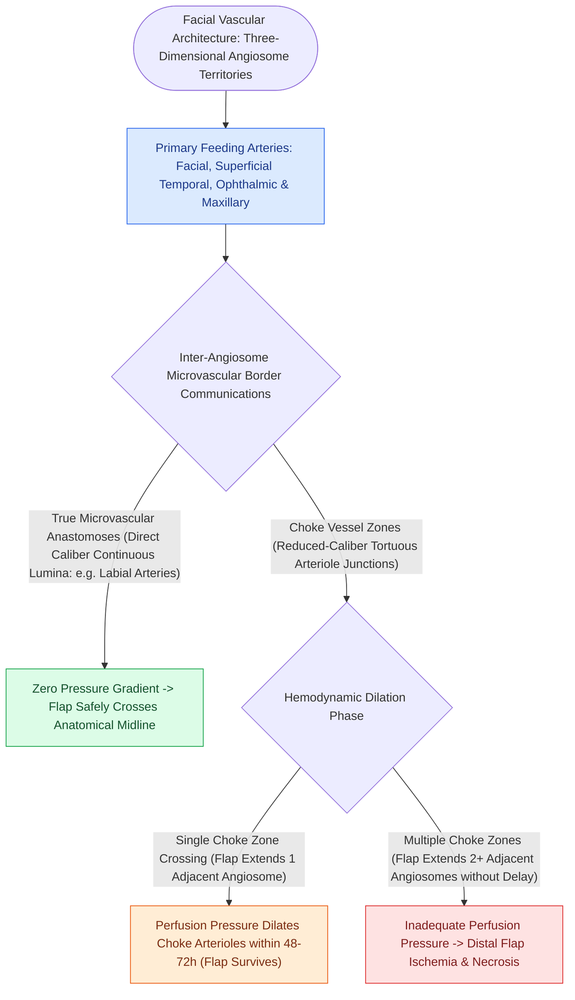

# Facial angiosomes and perforator choke zones determine cutaneous flap survival boundaries

## Active Recall

> [!question]- How many adjacent angiosomes can typically be safely captured on a single arterial perforator without surgical delay?
> *Answer / Clinical Rationale*: **One adjacent angiosome** across a single choke zone; capturing a third angiosome across a second choke boundary leads to distal ischemia without preconditioning.

> [!question]- What vascular change occurs in choke vessels during the surgical delay phenomenon?
> *Answer / Clinical Rationale*: Choke vessels undergo **progressive caliber dilation, smooth muscle relaxation, and endothelial hypertrophy**, converting high-resistance choke zones into low-resistance conduit vessels.

## Core Clinical & Mechanistic Principles
First defined by Ian Taylor in 1987, an **angiosome** is a three-dimensional block of tissue (skin, subcutaneous fat, deep fascia, muscle, and bone) supplied by a specific source [[The facial artery and facial vein provide the primary vascular supply to the anterior face|artery]] and drained by specific companion veins.

The face has the **richest angiosome network in the human body**, featuring dense direct and indirect cutaneous perforators connected by **choke vessels**.

### Choke Vessel Dilation & Delay Phenomenon
- When a flap is elevated, the reduced-caliber **choke vessels** between angiosomes experience sudden pressure differentials, undergoing **sympathetic denervation dilation and endothelial remodeling over 48 to 72 hours**.
- **Surgical Delay**: Making perimeter incisions without transposing the flap "conditions" the choke vessels, dramatically expanding the safe angiosome survival territory.

## Connected Concepts & Graph Traversal
- **Facial Vasculature**: [[The facial artery and facial vein provide the primary vascular supply to the anterior face|Facial Artery Anatomy]]
- **Local Flaps**: [[Advancement flaps recruit adjacent tissue laxity along a linear vector without rotation|Advancement Flap Perfusion]]
- **Forehead Axial Flap**: [[The paramedian forehead flap is an axial interpolated flap pedicled on the supratrochlear artery|Paramedian Forehead Flap]]
- **Vascular Supply**: [[Interpolated melolabial flaps reconstruct nasal alar defects by bridging the alar crease to prevent blunting and trapdoor deformity|Interpolated Melolabial Flap]]
- **Anatomical Foundation**: [[Three-stage paramedian forehead flap permits radical intermediate thinning and cartilage framework sculpting before pedicle division|Three-Stage PMFF Execution]]
