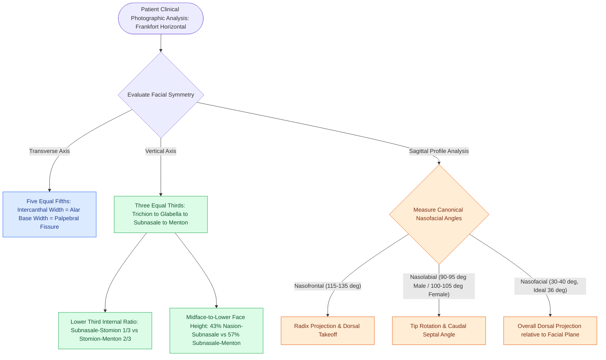

# Facial horizontal fifths and vertical thirds define baseline aesthetic analysis and proportions

## Active Recall

> [!question]- What anatomical landmarks define the classical vertical facial thirds, and what internal ratio governs the lower third?
> *Answer / Clinical Rationale*: The face is divided vertically into **three equal thirds**: (1) **Upper third**: Trichion (hairline) to Glabella; (2) **Middle third**: Glabella to Subnasale; and (3) **Lower third**: Subnasale to Menton. The lower third is internally subdivided into an **upper one-third** (Subnasale to Stomion / oral commissure) and a **lower two-thirds** (Stomion to Menton). When evaluated by skeletal heights (Nasion to Menton), the midface (Nasion to Subnasale) accounts for **43%**, while the lower face (Subnasale to Menton) accounts for **57%**.

> [!question]- What defines the transverse facial fifths, and what key facial landmarks align with the central fifth?
> *Answer / Clinical Rationale*: The face is divided transversely into **five equal fifths**, each corresponding to the width of **one eye** (measured from medial canthus to lateral canthus):
> 1. Two **lateral fifths**: Lateral helix / preauricular crease to lateral canthus.
> 2. Two **intermediate fifths**: Lateral canthus to medial canthus (palpebral fissure width, $\sim 30	ext{–}35	ext{ mm}$).
> 3. One **central fifth**: Medial canthus to medial canthus (intercanthal distance, $\sim 30	ext{–}35	ext{ mm}$).
> In ideal balance, the **alar base width equals the intercanthal distance**, meaning vertical lines dropped from the medial canthi should align precisely with the alar-facial grooves.

> [!question]- What are the four core nasofacial profile angles, and what are their standard aesthetic normative ranges?
> *Answer / Clinical Rationale*: The standard profile angles are:
> 1. **Nasofrontal angle**: Formed by the tangent to the forehead and nasal dorsum ($115^\circ	ext{–}135^\circ$).
> 2. **Nasofacial angle**: Formed by the dorsal plane and facial plane / vertical line from glabella to pogonion ($30^\circ	ext{–}40^\circ$, ideally $36^\circ$).
> 3. **Nasolabial angle**: Formed by the columella and upper lip philtrum ($90^\circ	ext{–}95^\circ$ in men, $100^\circ	ext{–}105^\circ$ in women).
> 4. **Nasomental angle**: Formed by the nasal dorsum tangent and a line from tip to pogonion ($120^\circ	ext{–}132^\circ$).

## Core Clinical & Mechanistic Principles

Systematic preoperative facial analysis requires evaluating the face across standardized photographic views oriented along the **Frankfort horizontal plane** (line connecting the superior border of the external auditory canal to the inferior orbital rim). The facial architecture is systematically dissected into vertical thirds, transverse fifths, and profile angular relationships.

### Transverse Facial Fifths

The transverse dimension is divided into five equal segments, each approximately equal to the intercanthal distance or one eye width ($\sim 30	ext{–}35	ext{ mm}$):

| Segment | Medial Boundary | Lateral Boundary | Clinical Assessment / Deformities |
| :--- | :--- | :--- | :--- |
| **Lateral Fifth (R/L)** | Lateral canthus | Lateral helix / preauricular border | Assesses malar-zygomatic projection and temporal hollowing |
| **Intermediate Fifth (R/L)** | Medial canthus | Lateral canthus | Palpebral fissure width ($\sim 30	ext{–}35	ext{ mm}$); ptosis, scleral show |
| **Central Fifth** | Right medial canthus | Left medial canthus | Intercanthal distance ($\sim 30	ext{–}35	ext{ mm}$); telecanthus, wide alar base |

**Key Surgical Alignment**:
- A vertical line dropped from the **medial canthus** intersects the **alar-facial groove**. If the alar base exceeds this line, an alar base reduction (Weir excision) is indicated.
- A vertical line dropped from the **pupil** at rest intersects the **oral commissure** (chelion).
- A vertical line dropped from the **lateral limbus** approximates the lateral extent of the oral aperture.

### Vertical Facial Thirds & Sub-Proportions

The vertical face is appraised across three canonical tiers:

1. **Upper Third (Forehead)**: **Trichion to Glabella**
   - Varies with hairline recession; in patients with androgenic alopecia or high hairlines, the superior orbital rim or midforehead crease is utilized.
2. **Middle Third (Midface)**: **Glabella to Subnasale**
   - Contains the nasal dorsum, lower orbital complex, and zygoma.
3. **Lower Third (Lower Face)**: **Subnasale to Menton**
   - Internally divided into unequal segments:
     - **Upper 1/3**: Subnasale to Stomion (upper lip length: ideally $18	ext{–}20	ext{ mm}$ in females, $20	ext{–}22	ext{ mm}$ in males).
     - **Lower 2/3**: Stomion to Menton (lower lip and chin complex: ideally $36	ext{–}40	ext{ mm}$ in females, $40	ext{–}44	ext{ mm}$ in males).

### Aesthetic Eyebrow Architecture & Sexual Dimorphism
Standard aesthetic eyebrow landmarks dictate surgical brow rejuvenation and forehead lift planning:
- **Eyebrow Landmarks & Horizontal Alignment**:
  - The medial head of the eyebrow begins along a vertical line drawn perpendicular from the **lateral ala / medial canthus**.
  - The lateral tail terminates at an oblique line drawn from the **alar margin intersecting the lateral canthus**.
  - *Horizontal Trajectory*: On horizontal reference lines, the **medial head and lateral tail should sit at approximately the same horizontal level**, or the lateral tail may sit slightly superior (never inferior to the medial head, which conveys sadness or anger).
- **Sexual Dimorphism (Male vs. Female Brow Aesthetics)**:
  - *Male Eyebrow*: Flatter, horizontal trajectory resting **directly at the level of the supraorbital rim**, with minimal arching and its subtle peak situated at the lateral limbus.
  - *Female Eyebrow*: Graceful, arched trajectory sitting **several millimeters (–10	ext{ mm}$) above the supraorbital rim**, with its highest apex/peak situated along a vertical line tangent to the **lateral corneal limbus or lateral canthus**.

### Lower Facial Profile & Chin Projection Metrics (Riedel & Gonzalez-Ulloa)
- **Lower Facial Profile Reference Lines**:
  - *Riedel's Line / True Vertical Plane*: Evaluated from standardized lateral profile photography using a vertical line dropped perpendicular to the Frankfort horizontal plane tangent to the **vermilion border of the lower lip (labrale inferius)**.
  - *Male Chin Projection*: In **men**, the **pogonion (most anterior point of the bony/soft-tissue chin) should rest directly tangent to this vertical line** (flush with the lower lip).
  - *Female Chin Projection*: In **women**, the pogonion should rest slightly recessed, ** to 3	ext{ mm}$ posterior to the vertical line** from the lower lip, imparting a softer, more delicate mandibular profile.

### Standard Aesthetic Profile Angles

Profile harmony is quantified by four core angles measured from standardized lateral photography:

| Angle | Anatomical Reference Vectors | Normative Aesthetic Range | Deformity Implications |
| :--- | :--- | :--- | :--- |
| **Nasofrontal Angle** | Tangent to glabella/forehead intersecting tangent to nasal dorsum | $115^\circ	ext{–}135^\circ$ | $<115^\circ$: Deep radix / pseudo-hump; $>135^\circ$: High radix / Greek nose profile |
| **Nasofacial Angle** | Tangent to nasal dorsum intersecting the facial plane (glabella to pogonion) | $30^\circ	ext{–}40^\circ$ (ideal: $36^\circ$) | $<30^\circ$: Under-projected nose; $>40^\circ$: Over-projected ("Pinocchio") nose |
| **Nasolabial Angle** | Line through anterior/posterior columellar margins intersecting subnasale-to-labrale superius tangent | **Men**: $90^\circ	ext{–}95^\circ$ **Women**: $100^\circ	ext{–}105^\circ$ | $<90^\circ$: Ptotic / plunged tip (aging nose); $>105^\circ$: Over-rotated / upturned ("piggy") tip |
| **Nasomental Angle** | Line along nasal dorsum intersecting line connecting nasal tip to pogonion | $120^\circ	ext{–}132^\circ$ | Evaluates chin projection relative to nasal dorsum; retrogenia increases angle |

Comprehensive physiological and surgical principles connect these findings directly to [[Androgenic alopecia management spans Norwood-Hamilton staging, medical five-alpha reductase blockade, and follicular unit transplantation|hairline analysis]].

## Connected Concepts & Graph Traversal
- **Aesthetic Units**: [[Gonzalez-Ulloa facial aesthetic subunits guide complete subunit reconstruction|Gonzalez-Ulloa Subunit Reconstruction]]
- **Nasal Tip Metrics**: [[Goode's ratio and nasolabial angles define standard aesthetic nasal tip proportions|Goode's Ratio and Nasolabial Analysis]]
- **Tip Dynamics**: [[The Anderson tripod theory governs nasal tip projection, rotation, and support dynamics|Anderson Tripod Dynamics]]
- **Cervical Aesthetics**: [[The Dedo classification categorizes cervical aging deformities based on skin laxity, submental fat, platysma banding, and skeletal morphology|Dedo Aging Neck Classification]]
- **Structural Rhinoplasty**: [[Spreader grafts restore internal nasal valve patency and prevent inverted-V deformity|Internal Valve Spreader Grafts]]
