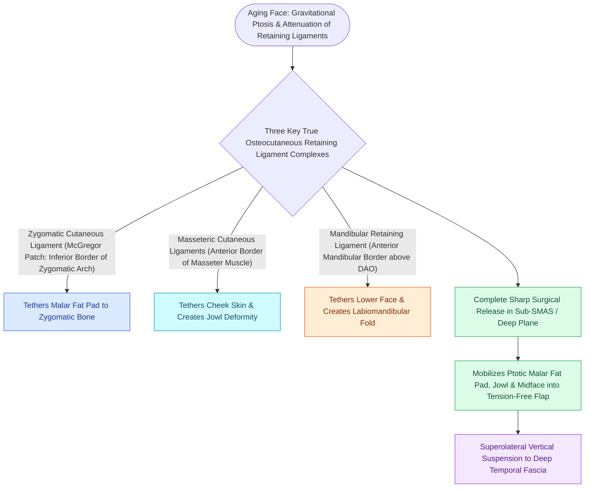

# Facial retaining ligaments require surgical release to mobilize ptotic midface tissues

## Active Recall

> [!question]- What retaining ligament must be completely divided to elevate and reposition the descended malar fat pad in a deep-plane facelift?
> *Answer / Clinical Rationale*: The **zygocutaneous retaining ligament (McGregor's patch)**, which tethers the anterior malar fat pad to the zygomatic arch.

> [!question]- What critical motor nerve runs in close anatomical proximity to the mandibular retaining ligament?
> *Answer / Clinical Rationale*: The **marginal mandibular branch of the facial nerve (CN VII)** as it crosses the inferior border of the mandible.

## Core Clinical & Mechanistic Principles
**Facial retaining ligaments** are dense, fibrous osteocutaneous and fasciocutaneous structures that originate from the facial skeleton or deep investing fascia, traverse the sub-[[High-SMAS rhytidectomy extends dissection above the zygomatic arch to rejuvenate the midface|SMAS]] space, and insert into the dermis. They anchor the superficial soft tissues and restrict the mobility of facial fat compartments.

With aging, attenuation of these ligaments leads to gravitational descent of the **malar fat pad**, deepening of the **nasolabial fold**, and formation of **jowls**.

### Surgical Release in Deep-Plane Rhytidectomy
- **The Anchor Barrier**: Standard subcutaneous pulling on the skin or lateral [[MACS lift and SMAS plication provide vertical vector elevation via suspension purse-string sutures|SMAS plication]] without ligament release creates excessive skin tension without repositioning the descended midface.
- **Complete Surgical Transection**: In **[[Deep-plane rhytidectomy mobilizes the skin and SMAS as a composite flap across retaining ligaments|deep-plane rhytidectomy]]**, entering the sub-SMAS plane and sharply dividing the **zygocutaneous** and **masseteric ligaments** allows tension-free, vertical-vector repositioning of the malar fat pad and midface.

## Connected Concepts & Graph Traversal
- **SMAS Architecture**: [[The superficial musculoaponeurotic system divides facial fat into distinct surgical planes|SMAS Architecture]]
- **Deep-Plane Technique**: [[Deep-plane rhytidectomy mobilizes the skin and SMAS as a composite flap across retaining ligaments|Deep-Plane Rhytidectomy]]
- **Nerve Vulnerability**: [[The marginal mandibular nerve courses deep to platysma over the facial vessels|Marginal Mandibular Nerve]]
- **Anatomical Foundation**: [[Cheek flap reconstruction requires deep periosteal suspension to the orbital rim and lateral retinaculum to prevent lower eyelid retraction and ectropion|Periosteal Suspension for Ectropion Prevention]]
- **Surgical Craft**: [[Mustarde cheek rotation flaps advance malar skin for total lower eyelid anterior lamella reconstruction|Mustarde Cheek Rotation Flap]]
