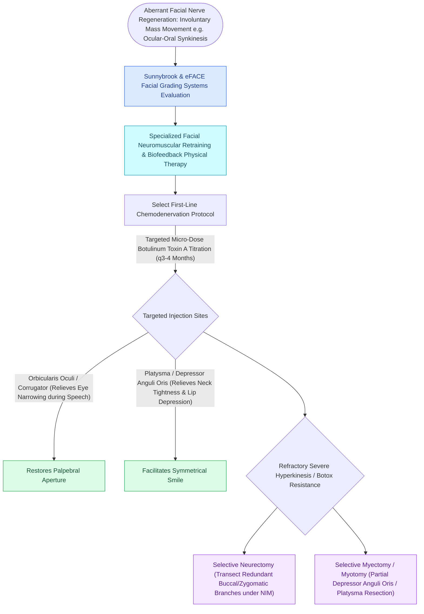

# Facial synkinesis is managed with selective neurolysis, myectomy, and botulinum toxin titration

## Active Recall

> [!question]- What pathophysiological event causes post-paralysis facial synkinesis?
> *Answer / Clinical Rationale*: **Aberrant axonal misdirection during peripheral nerve regeneration**, where regenerating motor axons cross into incorrect distal endoneurial tubes.

> [!question]- Why does botulinum toxin injection into the Depressor Anguli Oris (DAO) improve smile excursion in synkinetic patients?
> *Answer / Clinical Rationale*: The DAO acts as an antagonist that pulls the corner of the mouth downward; paralyzing the hyperactive DAO **eliminates downward resistance**, allowing the zygomaticus major to elevate the oral commissure freely.

## Core Clinical & Mechanistic Principles
**Facial Synkinesis** is the involuntary, abnormal co-contraction of facial muscle groups occurring during voluntary movement of another facial region (e.g., eye closure during smiling [ocular-oral], or mouth twitching during blinking).

It results from **aberrant axonal regeneration (miswiring)** and loss of central motor inhibition following severe [[The House-Brackmann facial nerve grading system standardizes facial paralysis severity|facial]] nerve injury (Sunderland Class III–V or HB Grade III–IV recovery).

### DAO Chemodenervation
- The **Depressor Anguli Oris (DAO)** pulls the oral commissure downward. In ocular-oral synkinesis, voluntary eye blinking triggers involuntary DAO spasm, locking the smile. Infiltrating $2\text{–}4\text{ units}$ of Botox into the DAO releases the smile vector.

## Connected Concepts & Graph Traversal
- **Grading Scale**: [[The House-Brackmann facial nerve grading system standardizes facial paralysis severity|House-Brackmann Grade III]]
- **Dynamic Reanimation**: [[The masseteric nerve provides a dense motor donor for single-stage facial reanimation|Masseteric Reinnervation]]
- **Corneal Sparing**: [[Upper eyelid platinum weights and lateral tarsal strips protect the cornea in flaccid facial paralysis|Corneal Protection]]
- **Anatomical Foundation**: [[Pitanguy's line defines the danger zone for the frontal branch of the facial nerve|Pitanguy's Line]]
- **Surgical Craft**: [[Cosmetic botulinum toxin treats dynamic rhytids through presynaptic acetylcholine blockade|Cosmetic Botulinum Toxin]]
