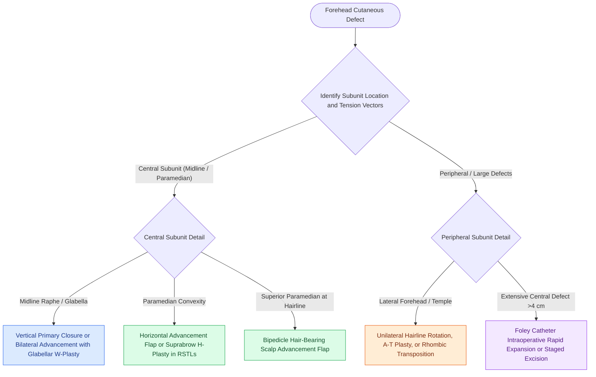

# Forehead aesthetic subunit reconstruction divides the forehead into midline, paramedian, and lateral zones to optimize scar camouflage and brow symmetry

## Active Recall

> [!question]- Why does vertical primary wound closure produce aesthetically acceptable scars in the midline forehead subunit despite running perpendicular to horizontal forehead rhytids?
> *Answer / Clinical Rationale*: The midline forehead corresponds to the anterior extension of the **galeal median raphe**, a structural fascial zone devoid of transverse frontalis muscle fibers. The absence of perpendicular muscular contracture prevents scar widening, while vertical advancement recruits bilateral laxity without creating asymmetrical vertical displacement of the eyebrows (though slight symmetrical medial brow approximation may occur).

> [!question]- How does intraoperative rapid tissue expansion with a Foley catheter facilitate primary closure of large midline or paramedian forehead defects?
> *Answer / Clinical Rationale*: A **30-mL Foley catheter** is tunneled beneath the frontalis muscle lateral to the supraorbital neurovascular bundle into the temple. The balloon is inflated until skin blanching occurs, held for **3 minutes**, and deflated for **3 minutes**, repeated across **3 cycles**. This exploits mechanical creep to gain **1 to 2 cm** of additional tissue advancement without vascular compromise.

## Core Clinical & Mechanistic Principles
Reconstruction of cutaneous forehead defects requires balancing three foundational priorities: complete oncologic eradication, motor and sensory nerve preservation, and strict maintenance of facial aesthetic boundaries. In accordance with [[Gonzalez-Ulloa facial aesthetic subunits guide complete subunit reconstruction|aesthetic subunit principles]], the forehead region is bounded superiorly by the frontal trichion, laterally by the temporal crests and temple hairline, and inferiorly by the superior orbital rims, eyebrows, and glabella. 

Topographically, the forehead behaves as three distinct functional zones with unique mechanical properties:
1. **Midline Subunit (Central Forehead & Glabella)**: Extends between the medial canthi up to the frontal hairline. Because the galeal median raphe lacks interdigitating frontalis muscle fibers, vertically oriented closures do not suffer from dynamic muscular distraction. Sizable vertical defects up to 3 to 4 cm can be closed primarily or via bilateral advancement flaps with M-plasty or W-plasty dog-ear excisions placed into glabellar frown lines. Small glabellar defects ($\le 2\text{ cm}$) are ideally reconstructed with V-Y subcutaneous tissue pedicled advancement flaps to prevent medial distortion of the eyebrow heads.
2. **Paramedian Subunit (Frontal Bossing)**: Extends from the lateral border of the midline raphe to the midpupillary line over the prominent convexity of the frontal bone. Unlike the midline, the paramedian zone contains thick, transversely active frontalis muscle. Closures must be oriented strictly horizontally along relaxed skin tension lines; vertical or oblique scars in this zone induce severe, disfiguring ipsilateral brow elevation. Defects exceeding 2.5 to 3 cm that cannot be closed primarily require horizontally oriented unipedicle or bilateral [[Advancement flaps recruit adjacent tissue laxity along a linear vector without rotation|advancement flaps]]. For defects abutting the hairline, a full-thickness bipedicle advancement scalp flap advanced inferiorly preserves eyebrow position while hiding the donor scar behind the frontal hairline.
3. **Lateral Subunit (Temple & Lateral Forehead)**: Extends from the midpupillary line laterally to the temporal hairline. This subunit transitions from the convexity of the forehead into the flat lateral brow and slightly concave temple fossa. The lateral skin displays significantly greater elasticity than central forehead skin, facilitating larger unilateral rotation flaps, O-to-Z repairs, and transposition flaps. Incisions can be camouflaged within downward-curving transverse forehead creases and lateral periorbital crow's-feet rhytids.

### Operative Pearls for Eyebrow Preservation
- **Suture Anchoring to Orbital Rim**: When advancing large forehead flaps downward or transversely near the supraorbital margin, anchor the deep dermis of the eyebrow to the superior orbital rim periosteum using 4-0 clear polydioxanone sutures to prevent upward eyebrow migration.
- **Eyebrow Asymmetry Assessment**: In elderly patients with profound dermatochalasis and forehead rhytids, post-repair eyebrow elevation up to 1 cm frequently settles within 4 to 8 weeks secondary to gravity and tissue relaxation. In younger patients with high skin elasticity, an elevation of even 3 mm remains permanent and requires strict avoidance of vertical tension.

## Connected Concepts & Graph Traversal
- **Tension Vector Alignment**: [[Relaxed skin tension lines minimize scar hypertrophy along perpendicular muscular vectors|Relaxed Skin Tension Lines]]
- **Scar Camouflage & Geometrics**: [[Scar revision employs Z-plasty W-plasty and geometric broken line closure along relaxed skin tension lines|W-Plasty & Scar Revision]]
- **Axial Forehead Flap Donor**: [[The paramedian forehead flap is an axial interpolated flap pedicled on the supratrochlear artery|Paramedian Forehead Flap]]
- **Brow Elevation Dynamics**: [[Coronal and pretrichial open browlifts address severe brow ptosis with high versus low hairlines|Open Browlift Mechanics]]
- **Microvascular Coverage**: [[Facial angiosomes and perforator choke zones determine cutaneous flap survival boundaries|Facial Angiosomes & Perforators]]
