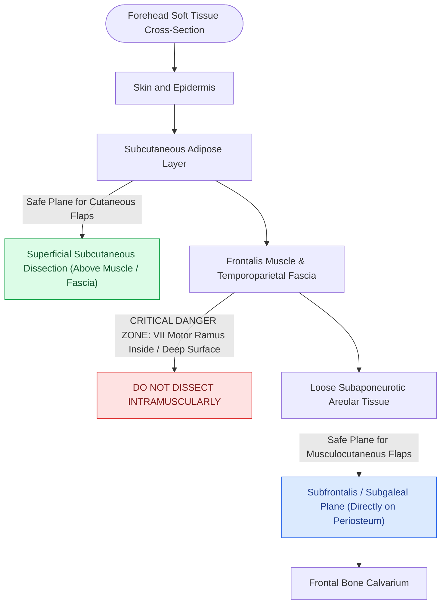

# Forehead reconstruction requires subcutaneous or subfrontalis dissection planes to prevent motor paralysis of the frontalis muscle

## Active Recall

> [!question]- In which anatomical zone is the temporal branch of the facial nerve at highest risk of inadvertent transection during forehead flap elevation?
> *Answer / Clinical Rationale*: The nerve is at greatest risk in **Area C (the zygomatic arch and temporal fossa)**, where it transitions from beneath the parotid-masseteric fascia into the superficial musculoaponeurotic system (temporoparietal fascia). In this region, the overlying subcutaneous fat is extremely thin, placing the nerve millimeters beneath the dermis before it enters the deep surface of the frontalis muscle.

> [!question]- What surgical technique is indicated to correct unilateral paralytic eyebrow ptosis resulting from temporal branch VII transection?
> *Answer / Clinical Rationale*: A **direct eyebrow lift** is performed by excising an ellipse of skin directly superior to the brow along the cephalic border of the hair follicles. The brow is suspended **4 to 8 mm higher than the contralateral brow** (overcorrection) by placing 5-0 clear nylon horizontal mattress sutures from the deep sub-brow dermis into the frontal bone periosteum 1 cm above the target height.

## Core Clinical & Mechanistic Principles
Motor innervation to the frontalis muscle is supplied exclusively by the temporal (frontal) branch of the seventh cranial nerve. This branch traverses the zygomatic arch within the temporoparietal fascia along [[Pitanguy's line defines the danger zone for the frontal branch of the facial nerve|Pitanguy's line]], entering the deep belly of the frontalis muscle approximately 1.5 to 2 cm superior to the orbital rim. Injury produces immediate brow ptosis, loss of transverse dynamic forehead rhytids, facial asymmetry, and secondary superior visual field constriction.

To ensure preservation of motor function, local flap elevation across the forehead and temporal region must be restricted to two safe surgical planes:
1. **Superficial Subcutaneous Plane**: Carried out strictly within the subcutaneous fat superficial to the frontalis muscle and superficial to the temporoparietal fascia. This plane protects the motor nerve branches entering the deep surface of the muscle. Dissection in this plane encounters fine perforating branches from the supraorbital, supratrochlear, and anterior temporal arteries, requiring meticulous bipolar hemostasis to prevent hematoma while safeguarding the subdermal plexus.
2. **Subfrontalis / Subgaleal Avascular Plane**: Carried out directly on the calvarial periosteum deep to the frontalis muscle and galea aponeurotica. This plane provides rapid, bloodless flap mobilization for large musculocutaneous advancement or rotation flaps. Because the temporal motor rami course within the substance of the frontalis muscle, subfrontalis dissection leaves the motor nerves intact within the elevated flap flap roof.

Sensory innervation is mediated by the supraorbital nerve (lateral forehead and frontoparietal scalp) and the supratrochlear nerve (paramedian and medial forehead). Both nerves exit their respective foramina along the [[Endoscopic browlift releases the conjoint tendon and arcus marginalis along the supraorbital rim|supraorbital rim]], pierce the frontalis muscle, and ascend cephalad in the subcutaneous fat. While sensory transection does not cause muscular asymmetry, it produces severe, persistent dysesthesia and scalp numbness lasting up to 12 months.

### Management of Intraoperative Paresis
- **Local Anesthetic Paresis vs Surgical Transection**: Infiltration of 1% lidocaine with epinephrine along the lateral orbital rim frequently blocks motor axons within the temporal branch, producing temporary frontalis paralysis. Permanent nerve injury cannot be diagnosed intraoperatively; definitive corrective ptosis surgery should never be performed until anesthetic dissipation is confirmed at 4 to 6 hours postoperatively.
- **Direct Brow Suspension Technique**: When permanent motor transection occurs, direct suprabrow elliptical excision with deep dermal fixation to frontal periosteum restores static resting symmetry.

## Connected Concepts & Graph Traversal
- **Venous Landmark**: [[The sentinel vein marks the trajectory of the frontal branch of the facial nerve|Sentinel Vein Landmark]]
- **Paralytic Brow Correction**: [[Coronal and pretrichial open browlifts address severe brow ptosis with high versus low hairlines|Open Browlift Dynamics]]
- **Facial Nerve Assessment**: [[The House-Brackmann facial nerve grading system standardizes facial paralysis severity|House-Brackmann Facial Nerve Grading]]
- **Reanimation Alternatives**: [[Hypoglossal-facial nerve transfer restores resting facial symmetry and basal muscle tone|Hypoglossal-Facial Transfer]]
- **Static Suspension**: [[Static fascia lata slings suspend the modiolus and nasal valve in non-innervation candidates|Static Fascia Lata Slings]]
