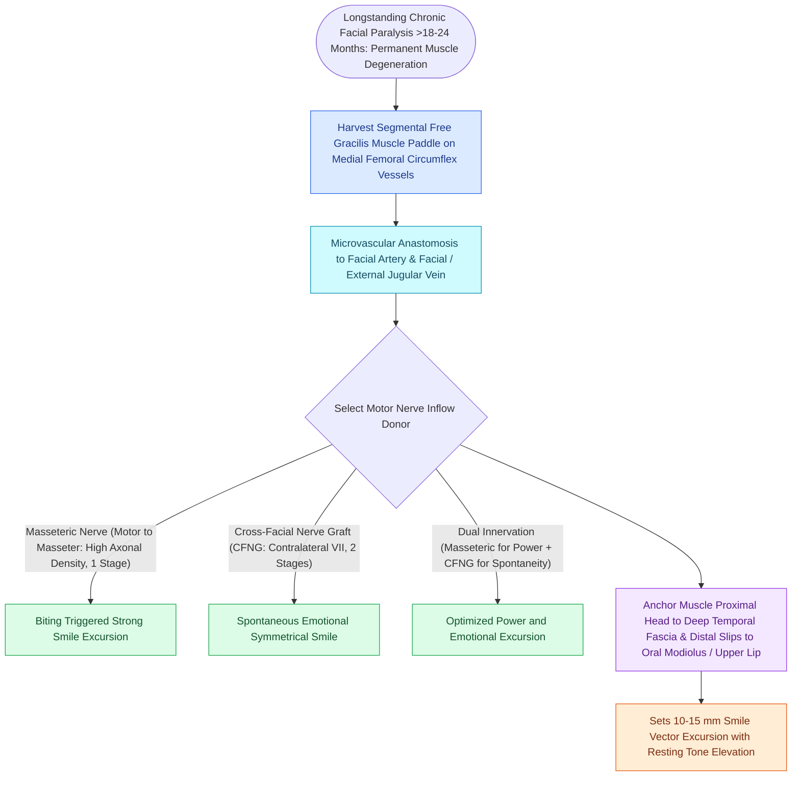

# Free gracilis muscle transfer provides dynamic smile restoration in chronic facial paralysis

## Active Recall

> [!question]- What is the motor nerve and vascular pedicle of the gracilis muscle free flap?
> *Answer / Clinical Rationale*: The **anterior branch of the obturator nerve** (motor) and the **medial circumflex femoral artery and vein** (vascular pedicle).

> [!question]- To what anatomical structures are the distal and proximal ends of the gracilis muscle fixed to recreate a natural smile vector?
> *Answer / Clinical Rationale*: The **distal slips are anchored to the modiolus and upper lip**, and the **proximal muscle is fixed to the deep temporal fascia and zygomatic arch**, matching the superolateral pull of the zygomaticus major.

## Core Clinical & Mechanistic Principles
In **chronic, long-standing facial paralysis ($>2\text{ years}$)**, native mimetic facial musculature undergoes irreversible atrophy and fibrotic replacement. Dynamic smile restoration requires **microvascular free tissue transfer of a functional neuromuscular unit**, for which the **Gracilis Muscle** is the gold standard.

### Muscle Tensioning & Inset Craft
- **Resting Tension Calibration**: The muscle must be inset under appropriate resting stretch tension ($1.0\text{–}1.5\text{ cm}$ [[Cross-facial nerve grafting provides coordinated spontaneous smile excursion in children|excursion]]) with slight over-correction of the oral commissure to account for postoperative settling and gravity.

## Connected Concepts & Graph Traversal
- **Motor Donor**: [[The masseteric nerve provides a dense motor donor for single-stage facial reanimation|Masseteric Nerve Transfer]]
- **Microvascular Standards**: [[Microvascular free flap salvage requires urgent re-exploration within two hours of vascular compromise|Free Flap Monitoring]]
- **Static Support**: [[Upper eyelid platinum weights and lateral tarsal strips protect the cornea in flaccid facial paralysis|Corneal Protection]]
- **Anatomical Foundation**: [[Cross-facial nerve grafting provides coordinated spontaneous smile excursion in children|Cross-Facial Nerve Graft (CFNG)]]
- **Surgical Craft**: [[Epineural neurorrhaphy and cable nerve grafting restore facial continuity within twelve months|Direct Epineural Neurorrhaphy]]
- **Diagnostic Assessment**: [[Static fascia lata slings suspend the modiolus and nasal valve in non-innervation candidates|Static Facial Slings]]
- **Two-Stage Reanimation Protocol**: [[Cross-facial nerve grafting combined with free gracilis muscle transfer restores spontaneous emotional smile excursion in established facial paralysis|Two-Stage CFNG-Gracilis Reanimation]]
