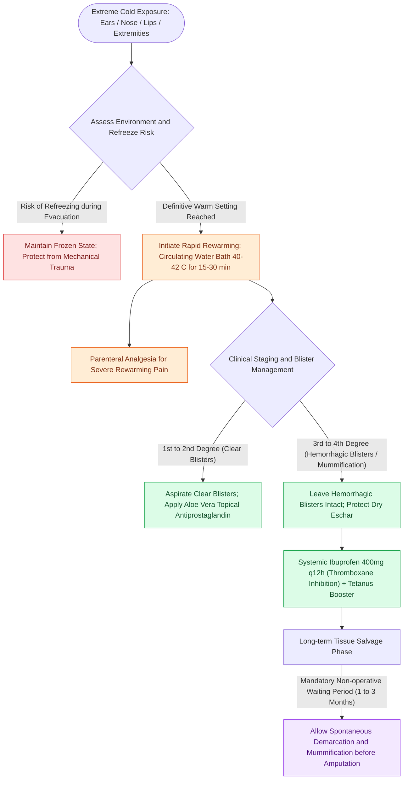

# Frostbite tissue salvage prioritizes rapid warm water bath thawing and delayed tissue demarcation over early debridement

## Active Recall

> [!question]- What are the two distinct pathophysiological phases of frostbite injury, and why is refreezing catastrophic?
> *Answer / Clinical Rationale*:
> 1. **Direct Cellular Freezing (Pre-thaw phase)**: At skin temperatures $<0^\circ\text{C}$, extracellular fluid crystallizes into ice crystals. This draws water out of cells by osmotic forces, causing profound cellular dehydration, electrolyte hyperosmolarity, membrane lipid disruption, and metabolic arrest.
> 2. **Reperfusion / Progressive Ischemic Injury (Post-thaw phase)**: During and after thawing, endothelial damage triggers severe platelet aggregation, leukocyte adherence, thromboxane $A_2$ release, and microvascular thrombosis. Edema and compartment pressures exacerbate ischemia, leading to tissue infarction.
> **Refreezing injury is catastrophic**: if partially thawed tissue refreezes before definitive care, ice crystal formation accelerates within damaged cells, virtually guaranteeing **$100\%$ irreversible full-thickness necrosis**. Thawing must never be initiated in the field if there is any risk of refreezing.

> [!question]- What are the specific parameters of the canonical rapid rewarming protocol for acute frostbite?
> *Answer / Clinical Rationale*: The frozen extremity or facial subunit (ears, nose) must be submerged in a **circulating warm water bath maintained precisely between $40^\circ\text{C}$ and $42^\circ\text{C}$ ($104^\circ\text{F}$ to $108^\circ\text{F}$)** for **15 to 30 minutes**. Rewarming must continue until the tissue becomes soft, pliable, and distinctly erythematous or purplish throughout. Dry heat (stoves, radiators) and physical rubbing (with snow or hands) are strictly contraindicated due to severe thermal burns and mechanical tissue destruction. Severe rewarming pain necessitates IV opioid analgesia.

> [!question]- How is acute frostbite staged clinically, and what is the fundamental surgical rule regarding debridement?
> *Answer / Clinical Rationale*:
> - **1st Degree**: Erythema, central pallor, edema, anesthesia; no blisters. Complete recovery expected.
> - **2nd Degree**: Erythema, severe edema, and **clear or milky fluid-filled blisters** (superficial dermal injury). Heals without tissue loss.
> - **3rd Degree**: **Hemorrhagic (purple/black) blisters** extending into deep dermis and subcutaneous fat. Significant tissue loss likely.
> - **4th Degree**: Full-thickness necrosis involving skin, muscle, tendon, and bone. Dry black mummification.
> **Surgical Cardinal Rule**: **Avoid early surgical debridement or amputation** ("*Frostbite in January, amputate in July*"). Clear demarcation between viable, regenerating tissue and nonviable necrotic eschar requires **1 to 3 months**. Premature debridement sacrifices salvageable underlying deep tissue.

## Core Clinical & Mechanistic Principles

Frostbite is a cold-induced thermal injury where tissue salvage depends entirely on minimizing the duration of frozen state, preventing mechanical/thaw-refreeze trauma, restoring microvascular perfusion, and exercising strict non-operative patience during the subacute phase.

### Frostbite Staging and Prognostic Matrix

| Grade | Blister Characteristics | Depth of Involvement | Sensitivity | Long-Term Prognosis |
| :--- | :--- | :--- | :--- | :--- |
| **First Degree** | None; localized edema and hyperemic halo | Epidermis only; partial-thickness | Numbness, tingling, hypersensitivity | Complete recovery; no tissue loss; chronic cold hypersensitivity possible |
| **Second Degree** | **Clear or milky blister fluid** forming within 24h | Full epidermis and superficial dermis | Intact sensation to pinprick; blister base is pink | Good tissue preservation; superficial desquamation; heals in 2–4 weeks |
| **Third Degree** | **Hemorrhagic (dark purple/black) blisters** | Full-thickness skin and reticular dermis/subcutis | Marked anesthesia; loss of light touch and pinprick | Incomplete recovery; tissue loss of skin/digits; hard black eschar forms |
| **Fourth Degree** | Absent or desiccated mummified vesicles | Deep fascia, muscle, perichondrium, and bone | Complete anesthesia | Severe auto-amputation or surgical formalization required |

### Medical & Pharmacological Adjuncts

1. **Prostaglandin & Thromboxane Modulation**:
   - **Ibuprofen ($400\text{–}800\text{ mg}$ PO q12h)**: Systemic nonsteroidal anti-inflammatory administered immediately upon rewarming to selectively block the arachidonic acid pathway and suppress **thromboxane $A_2$**, a potent microvascular vasoconstrictor and platelet aggregator.
   - **Topical Aloe Vera**: Rich in antiprostaglandin compounds; applied directly to clear blisters and thawed skin to limit dermal necrosis.
2. **Blister Protocol**:
   - **Clear blisters**: Aspirated or debrided to remove inflammatory thromboxane and prostaglandin rich blister fluid, followed by topical antimicrobial or aloe vera dressings.
   - **Hemorrhagic blisters**: Left **intact and undisturbed**; their fluid reflects deep dermal microvascular thrombosis. Unroofing hemorrhagic blisters dries out the deep bed and converts viable tissue into necrotic eschar.
3. **Advanced Microvascular Therapies**:
   - In severe, limb-threatening or major facial 3rd/4th degree frostbite presenting within **24 hours** of rewarming, intravenous or intra-arterial **tissue plasminogen activator (tPA)** or prostacyclin analogs (e.g., **iloprost**) significantly reduces amputation rates by lysing microvascular thrombi.

Comprehensive physiological and surgical principles connect these findings directly to [[The external auditory canal cartilaginous third harbors Fissures of Santorini and Foramen of Huschke as routes of disease spread|external ear anatomy]].

## Connected Concepts & Graph Traversal
- **Soft Tissue Healing**: [[Wound healing progresses through hemostasis, inflammation, proliferation, and maturation|Wound Healing and Tissue Perfusion]]
- **Wound Closure Principles**: [[Fusiform ellipse geometry requires a three-to-one ratio to prevent standing cutaneous cones|Surgical Tension and Cone Prevention]]
- **Facial Vascularity**: [[The facial artery and facial vein provide the primary vascular supply to the anterior face|Facial Angiosome Perfusion]]
- **Local Flap Repair**: [[Advancement flaps recruit adjacent tissue laxity along a linear vector without rotation|Cutaneous Advancement Flaps]]
- **Anatomical Foundation**: [[Parotid duct laceration requires primary microsurgical repair over a silastic stent to prevent sialocele and salivary fistula|Stensen Duct Laceration Repair]]
