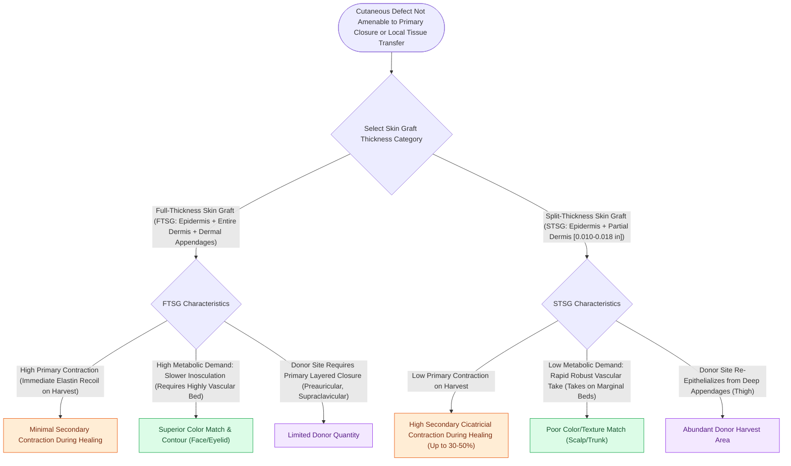

# Full-thickness and split-thickness skin grafts differ in primary contraction and vascular take

## Active Recall

> [!question]- Why do full-thickness skin grafts (FTSG) exhibit high primary contraction but low secondary contraction compared to split-thickness grafts?
> *Answer / Clinical Rationale*: **Primary contraction** is mediated by **dermal elastin fibers** (abundant in FTSG, minimal in STSG). **Secondary contraction** is driven by wound bed **[[Wound healing progresses through hemostasis, inflammation, proliferation, and maturation|myofibroblasts]]**, which are mechanically suppressed by the thick dermis of an FTSG.

> [!question]- What occurs during the 'inosculation' phase of skin graft healing?
> *Answer / Clinical Rationale*: Between **48 and 72 hours**, host and donor capillary buds make direct microscopic end-to-end connections (kissing vessels), establishing initial blood flow.

## Core Clinical & Mechanistic Principles
Skin grafts are completely detached from their donor blood supply and rely on revascularization from the recipient wound bed. Skin graft physiology progresses through three distinct phases: **Serum Imbibition, [[Skin graft bolsters and negative pressure wound therapy optimize graft bed inosculation|Inosculation]], and Revascularization/Angiogenesis**.

### Full-Thickness (FTSG) vs Split-Thickness (STSG) Dynamics

| Parameter | Full-Thickness Skin Graft (FTSG) | Split-Thickness Skin Graft (STSG) |
| :---- | :---- | :---- |
| **Composition** | Epidermis + Entire Dermis + Adnexa | Epidermis + Variable Portion of Dermis ($0.012\text{–}0.018\text{ in}$) |
| **Primary Contraction** (Immediate recoil after harvest) | **HIGH** (Rich in dermal elastin fibers) | **LOW** (Minimal dermal elastin) |
| **Secondary Contraction** (Late myofibroblast contracture) | **MINIMAL** (Thick dermis inhibits myofibroblasts) | **HIGH** (Severe contracture and distortion) |
| **Vascular Take on Marginal Beds** | Lower (Higher metabolic requirement) | **HIGHER** (Rapid inosculation, low metabolic demand) |
| **Color & Texture Match** | **SUPERIOR** (Preauricular, postauricular, clavicle) | Poor (Shiny, hyperpigmented, meshed look) |

## Connected Concepts & Graph Traversal
- **Local Flap Comparison**: [[Advancement flaps recruit adjacent tissue laxity along a linear vector without rotation|Advancement Flaps]]
- **Aesthetic Units**: [[Gonzalez-Ulloa facial aesthetic subunits guide complete subunit reconstruction|Aesthetic Subunits]]
- **Donor Sites**: [[Mustarde and Furnas sutures correct antihelical effacement and conchal hypertrophy|Postauricular FTSG]]
- **Anatomical Foundation**: [[Wound healing progresses through hemostasis, inflammation, proliferation, and maturation|Four Phases of Wound Healing]]
- **Surgical Craft**: [[Skin graft bolsters and negative pressure wound therapy optimize graft bed inosculation|Skin Graft Bolster Dressing]]
