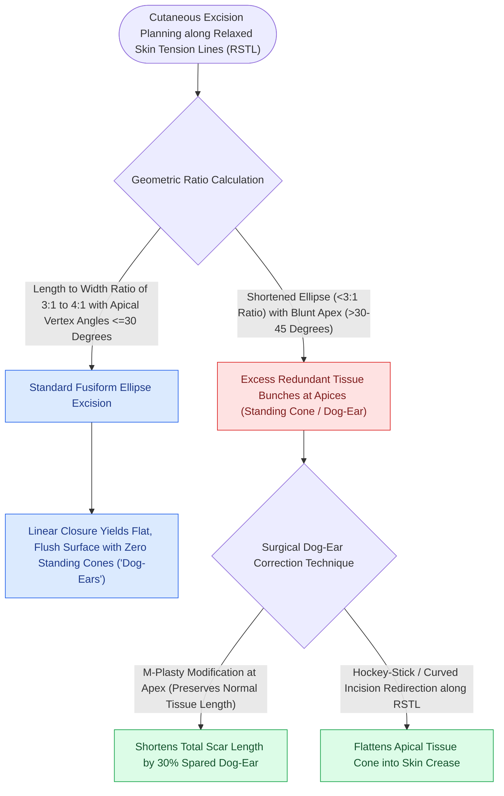

# Fusiform ellipse geometry requires a three-to-one ratio to prevent standing cutaneous cones

## Active Recall

> [!question]- What geometric parameters must be met when designing a fusiform ellipse to prevent standing cutaneous cones?
> *Answer / Clinical Rationale*: A **length-to-width ratio of $3:1\text{ to }4:1$** with **apical angles $\le 30^\circ$**, aligned parallel to local RSTLs.

> [!question]- When is an M-plasty indicated in facial defect closure?
> *Answer / Clinical Rationale*: When extending the tip of a standard $3:1$ ellipse would cross a critical aesthetic boundary (such as the vermilion border or eyelid margin); the M-plasty shortens the total length of the scar.

## Core Clinical & Mechanistic Principles
The standard primary closure of circular cutaneous defects requires excision of a **fusiform ellipse**. To achieve a flat closure without redundant tissue puckering at the apex (**standing cutaneous cone or "dog-ear"**), the excision must adhere to strict geometric proportions:
1. **Length-to-Width Ratio**: Minimum **$3:1\text{ to }4:1$**.
2. **Apical Angles**: **$\le 30^\circ$**.
3. **Long Axis Orientation**: Oriented **parallel to local [[Relaxed skin tension lines minimize scar hypertrophy along perpendicular muscular vectors|Relaxed Skin Tension Lines (RSTLs)]]**.

### Standing Cone Management & M-Plasty
- **Burow's Triangles**: Excising redundant triangular tissue at the apex along an RSTL direction flattens the standing cone.
- **Rule of Halves (Halving Technique)**: Placing the first suture at the exact midpoint of the wound and subsequent sutures at midpoints of remaining gaps distributes minor length discrepancies evenly.
- **M-Plasty**: When extending the length of an ellipse is restricted by adjacent anatomical structures (e.g., vermilion border, eyelid margin), an **M-plasty** splits the single terminal triangle into two smaller internal $30^\circ$ triangles, shortening total wound length by up to **$30\%$**.

## Connected Concepts & Graph Traversal
- **Biomechanical Lines**: [[Relaxed skin tension lines minimize scar hypertrophy along perpendicular muscular vectors|Relaxed Skin Tension Lines]]
- **Aesthetic Units**: [[Gonzalez-Ulloa facial aesthetic subunits guide complete subunit reconstruction|Gonzalez-Ulloa Aesthetic Subunits]]
- **Local Flaps**: [[Advancement flaps recruit adjacent tissue laxity along a linear vector without rotation|Advancement Flaps]]
- **Diagnostic Evaluation**: [[Gilles fan flaps and Webster-Bernard cheek advancements reconstruct large lower lip defects|Gilles Fan Flap]]
- **Anatomical Foundation**: [[Composite conchal cartilage grafts provide three-dimensional structural support and cutaneous coverage for auricular and facial defects|Composite Conchal Grafts]]
