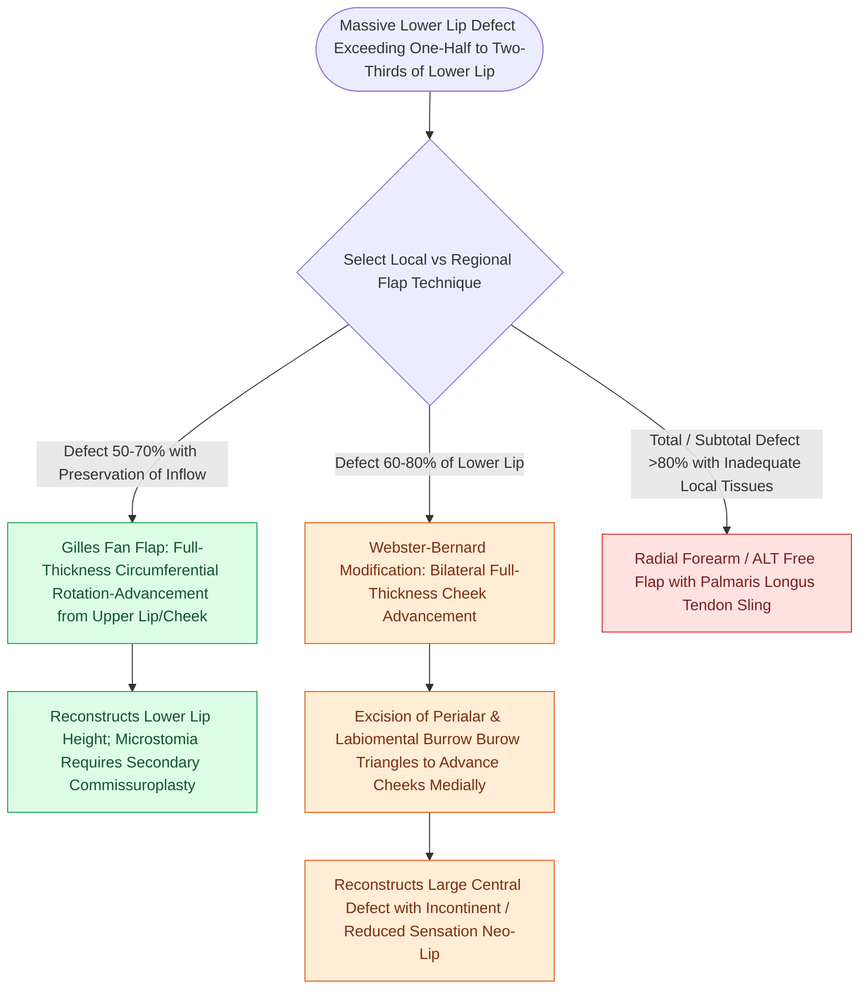

# Gilles fan flaps and Webster-Bernard cheek advancements reconstruct large lower lip defects

## Active Recall

> [!question]- How do Webster-Bernard cheek advancement flaps accommodate tissue advancement without distorting the nose?
> *Answer / Clinical Rationale*: By excising **full-thickness crescentic Burow's triangles in the perialar and melolabial creases**, allowing horizontal medial advancement of the cheek tissues.

> [!question]- Why does a Gilles fan flap result in lower oral competence compared to a Karapandzic flap?
> *Answer / Clinical Rationale*: The Gilles flap **transects motor and sensory nerve supplies** during circumoral rotation, resulting in a denervated, adynamic reconstructed lip segment.

## Core Clinical & Mechanistic Principles
When lower lip defects exceed **$>70\text{–}80\%$ of total lip width (subtotal or total lip defects)**, tissue cannot be mobilized purely circumorally without causing severe, unmanageable microstomia.

Regional cheek tissue must be recruited using **Gilles Fan Flaps** or the **Webster-Bernard Cheek Advancement Technique**.

### Microvascular Free Flap Alternative
- For complete total lower lip and chin composite defects, **Radial Forearm Free Flap (RFFF) suspended with Palmaris Longus tendon** or **Anterolateral Thigh (ALT)** flap represents the definitive standard (see [[The radial forearm free flap provides thin, pliable fasciocutaneous tissue for oral and pharyngeal defects|RFFF Reconstruction]]).

## Connected Concepts & Graph Traversal
- **Innervated Lip Flap**: [[Karapandzic orbicularis oris myocutaneous rotation flaps preserve oral sphincter innervation|Karapandzic Flap]]
- **Cross-Lip Option**: [[Abbe and Estlander cross-lip flaps are pedicled on the labial artery to repair lip defects|Abbe Flap]]
- **🔗 Microvascular Option (Head and Neck)**: [[The radial forearm free flap provides thin, pliable fasciocutaneous tissue for oral and pharyngeal defects|RFFF Lip Reconstruction]]
- **Reconstructive Ladder**: [[Near-total lip reconstruction combines functional local muscle flaps with microvascular free flaps|Near-Total Lip Reconstruction]]
- **Anatomical Foundation**: [[The Mustarde cervicofacial rotation-advancement flap recruits cervical and preauricular tissue laxity to reconstruct large cheek and lower eyelid defects|Mustarde Cervicofacial Flap]]
